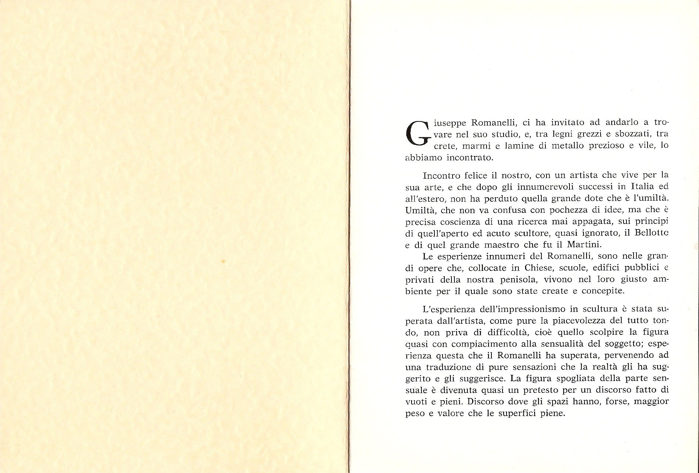
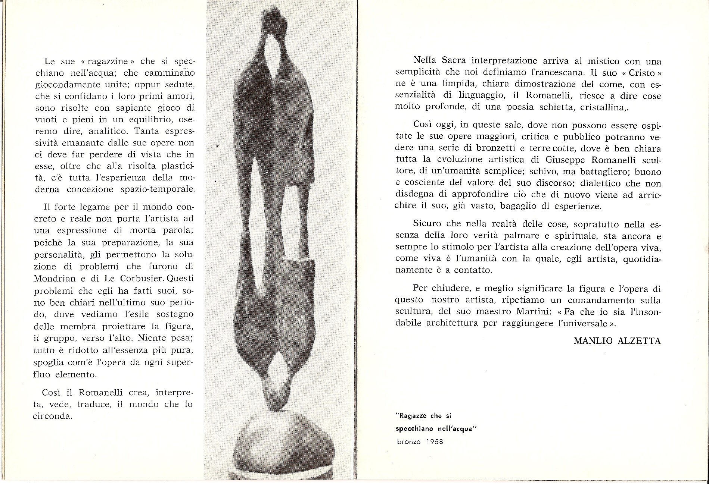
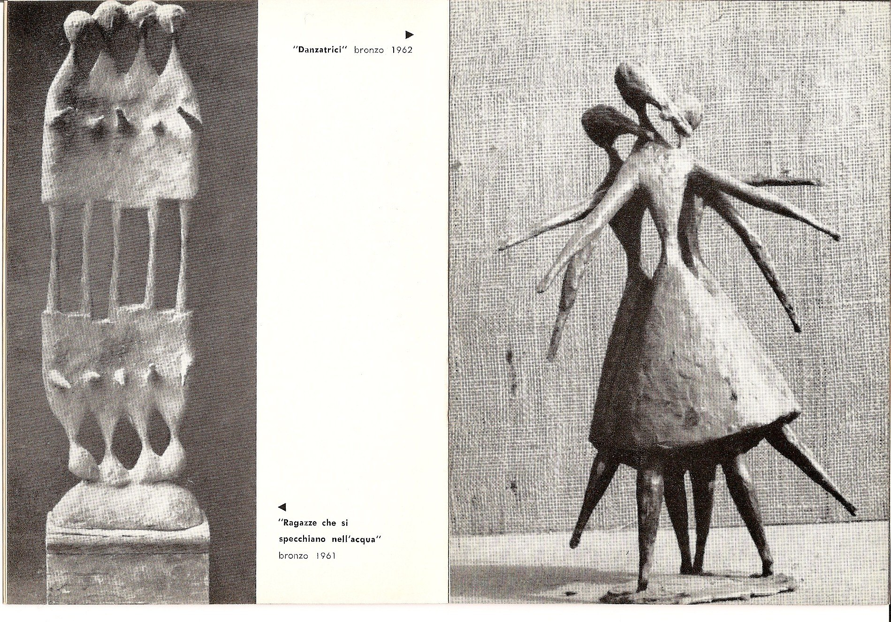
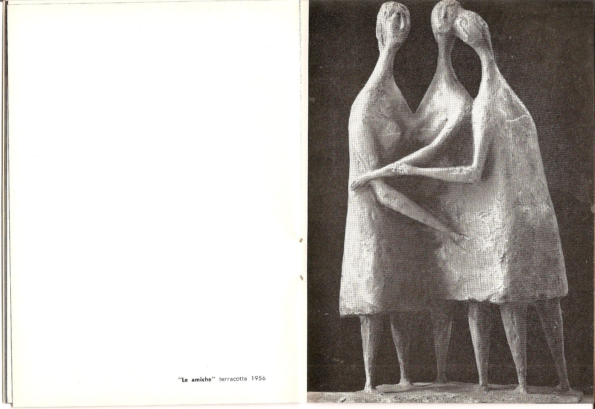

###

### Mostra presso la Galleria Bevilaqua La Masa a Venezia

### dal 5 al 18 ottobre 1963

##

##### L’artista espone alla Bevilacqua La Masa di Venezia una 30 opere in bronzo e terracotta e 20 disegni preparatori.

> Le sue ragazzine che si specchiano nell’acqua; che camminano giocondamente unite; oppure sedute, che si confidano i primi amori, sono risolte con sapiente gioco di vuoti e pieni in un equilibrio, oseremo dire, analitico. (Manlio Alzetta)

