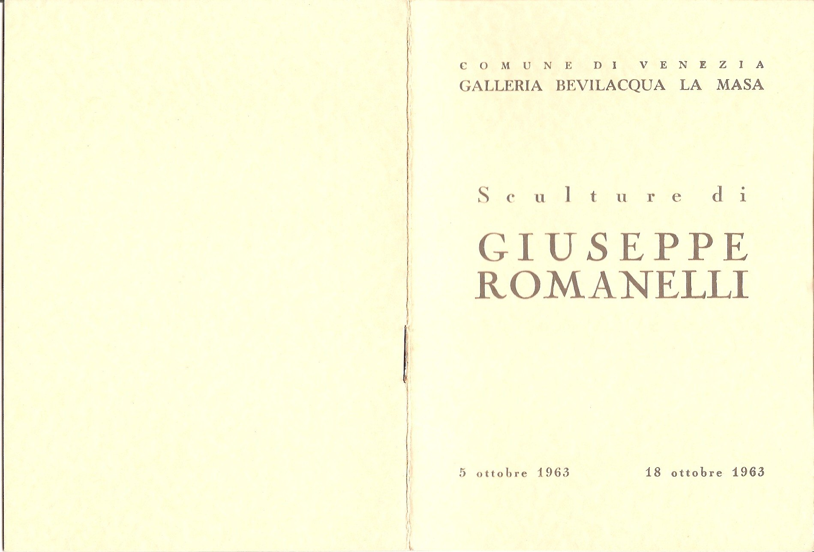
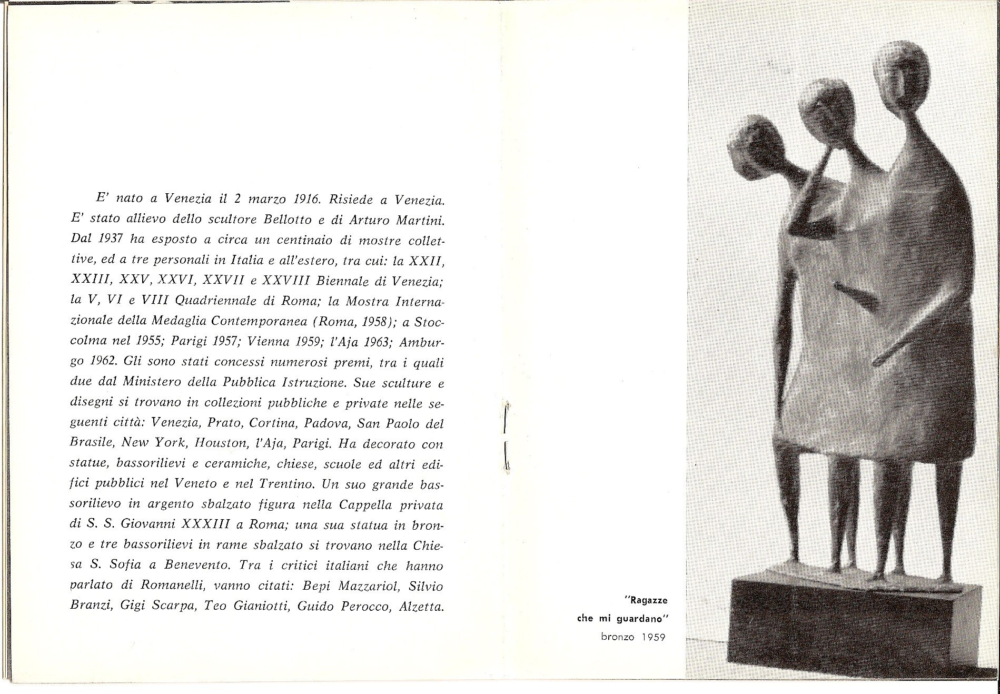
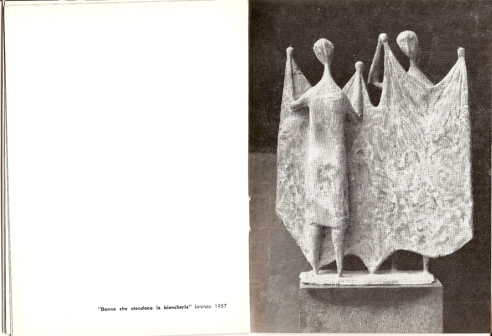
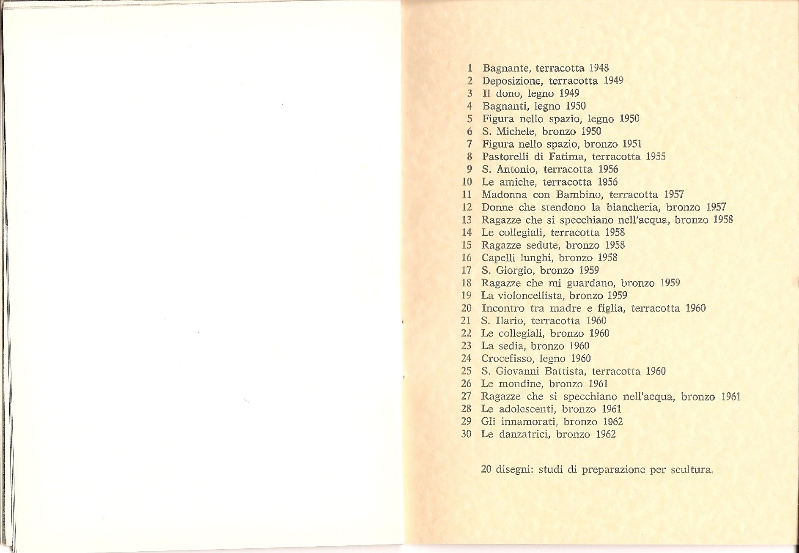

###

### Mostra presso la Galleria Bevilaqua La Masa a Venezia

### dal 5 al 18 ottobre 1963

##

##### L’artista espone alla Bevilacqua La Masa di Venezia una 30 opere in bronzo e terracotta e 20 disegni preparatori.

> Le sue ragazzine che si specchiano nell’acqua; che camminano giocondamente unite; oppure sedute, che si confidano i primi amori, sono risolte con sapiente gioco di vuoti e pieni in un equilibrio, oseremo dire, analitico. ([Manlio Alzetta](https://web.archive.org/web/20250815221700/https://digilander.libero.it/manlioalzetta/home.htm))

Sotto ogni pagina dell’opuscolo c’è la trascrizione del testo così come è stampato, errori di stampa compresi.

Trascrizione

COMUNE DI VENEZIA\
GALLERIA BEVILACQUA LA MASA

Sculture di\
GIUSEPPE\
ROMANELLI

5 ottobre 1963\
18 ottobre 1963

Trascrizione

Giuseppe Romanelli, ci ha invitato ad andarlo a trovare nel suo studio, e, tra legni grezzi e sbozzati, tra crete, marmi e lamine di metallo prezioso e vile, lo abbiamo incontrato.

Incontro felice il nostro, con un artista che vive per la sua arte, e che dopo gli innumerevoli successi in Italia ed all’estero, non ha perduto quella grande dote che è l’umiltà. Umiltà, che non va confusa con pochezza di idee, ma che è precisa coscienza di una ricerca mai appagata, sui principi di quell’aperto ed acuto scultore, quasi ignorato, il Bellotto e di quel grande maestro che fu il Martini.

Le esperienze innumeri del Romanelli, sono nelle grandi opere che, collocate in Chiese, scuole, edifici pubblici e privati della nostra penisola, vivono nel loro giusto ambiente per il quale sono state create e concepite.

L’esperienza dell’impressionismo in scultura è stata superata dall’artista, come pure la piacevolezza del tutto tondo, non priva di difficoltà, cioè quello scolpire la figura quasi con compiacimento alla sensualità del soggetto; esperienza questa che il Romanelli ha superata, pervenendo ad una traduzione di pure sensazioni che la realtà gli ha suggerito e gli suggerisce. La figura spogliata della parte sensuale è divenuta quasi un pretesto per un discorso fatto di vuoti e pieni. Discorso dove gli spazi hanno, forse, maggior peso e valore che le superfici piene.

Ragazze che si specchiano nell’acqua, bronzo 1958

Trascrizione

Le sue « ragazzine » che si specchiano nell’acqua; che camminano giocondamente unite; oppur sedute, che si confidano i loro primi amori, sono risolte con sapiente gioco di vuoti e pieni in un equilibrio, oseremo dire, analitico. Tanta espressività emanante dalle sue opere non ci deve far perdere di vista che in esse, oltre che alla risolta plasticità, c’è tutta l’esperienza della moderna concezione spazio-temporale.

Il forte legame per il mondo concreto e reale non porta l’artista ad una espressione di morta parola; poichè la sua preparazione, la sua personalità, gli permettono la soluzione di problemi che furono di Mondrian e di Le Corbusier. Questi problemi che egli ha fatti suoi, sono ben chiari nell’ultimo suo periodo, dove vediamo l’esile sostegno delle membra proiettare la figura, ii gruppo, verso l’alto. Niente pesa; tutto è ridotto all’essenza più pura, spoglia com’è l’opera da ogni superfluo elemento.

Così il Romanelli crea, interpreta, vede, traduce, il mondo che lo circonda.

Nella Sacra interpretazione arriva al mistico con una semplicità che noi definiamo francescana. Il suo « Cristo » ne è una limpida, chiara dimostrazione del come, con essenzialità di linguaggio, il Romanelli, riesce a dire cose molto profonde, di una poesia schietta, cristallina,.

Così oggi, in queste sale, dove non possono essere ospitate le sue opere maggiori, critica e pubblico potranno vedere una serie di bronzetti e terre cotte, dove è ben chiara tutta la evoluzione artistica di Giuseppe Romanelli scultore, di un’umanità semplice; schivo, ma battagliero; buono e cosciente del valore del suo discorso; dialettico che non disdegna di approfondire ciò che di nuovo viene ad arricchire il suo, già vasto, bagaglio di esperienze.

Sicuro che nella realtà delle cose, sopratutto nella essenza della loro verità palmare e spirituale, sta ancora e sempre lo stimolo per l’artista alla creazione dell’opera viva, come viva è l’umanità con la quale, egli artista, quotidianamente è a contatto.

Per chiudere, e meglio significare la figura e l’opera di questo nostro artista, ripetiamo un comandamento sulla scultura, del suo maestro Martini: « Fa che io sia l’insondabile architettura per raggiungere l’universale ».

MANLIO ALZETTA

A sinistra Ragazze che si specchiano nell’acqua, bronzo 1961; a destra Danzatrici, bronzo 1962

Ragazze che mi guardano, bronzo 1959

Trascrizione

E’ nato a Venezia il 2 marzo 1916. Risiede a Venezia. E’ stato allievo dello scultore Bellotto e di Arturo Martini. Dal 1937 ha esposto a circa un centinaio di mostre collettive, ed a tre personali in Italia e all’estero, tra cui: la XXII, XXIII, XXV, XXVI, XXVII e XXVIII Biennale di Venezia; la V, VI e VIII Quadriennale di Roma; la Mostra Internazionale della Medaglia Contemporanea (Roma, 1958); a Stoccolma nel 1955; Parigi 1957; Vienna 1959; l’Aja 1963; Amburgo 1962. Gli sono stati concessi numerosi premi, tra i quali due dal Ministero della Pubblica Istruzione. Sue sculture e disegni si trovano in collezioni pubbliche e private nelle seguenti città: Venezia, Prato, Cortina, Padova, San Paolo del Brasile, New York, Houston, l’Aja, Parigi. Ha decorato con statue, bassorilievi e ceramiche, chiese, scuole ed altri edifici pubblici nel Veneto e nel Trentino. Un suo grande bassorilievo in argento sbalzato figura nella Cappella privata di S. S. Giovanni XXXIII a Roma; una sua statua in bronzo e tre bassorilievi in rame sbalzato si trovano nella Chiesa S. Sofia a Benevento. Tra i critici italiani che hanno parlato di Romanelli, vanno citati: Bepi Mazzariol, Silvio Branzi, Gigi Scarpa, Teo Gianiotti, Guido Perocco, Alzetta.

Le amiche, terracotta 1956

Donne che stendono la biancheria, bronzo 1957

Trascrizione

| N. | Titolo | Materiale e anno |
|---:|---|---|
| 1 | Bagnante | terracotta 1948 |
| 2 | Deposizione | terracotta 1949 |
| 3 | Il dono | legno 1949 |
| 4 | Bagnanti | legno 1950 |
| 5 | Figura nello spazio | legno 1950 |
| 6 | S. Michele | bronzo 1950 |
| 7 | Figura nello spazio | bronzo 1951 |
| 8 | Pastorelli di Fatima | terracotta 1955 |
| 9 | S. Antonio | terracotta 1956 |
| 10 | Le amiche | terracotta 1956 |
| 11 | Madonna con Bambino | terracotta 1957 |
| 12 | Donne che stendono la biancheria | bronzo 1957 |
| 13 | Ragazze che si specchiano nell’acqua | bronzo 1958 |
| 14 | Le collegiali | terracotta 1958 |
| 15 | Ragazze sedute | bronzo 1958 |
| 16 | Capelli lunghi | bronzo 1958 |
| 17 | S. Giorgio | bronzo 1959 |
| 18 | Ragazze che mi guardano | bronzo 1959 |
| 19 | La violoncellista | bronzo 1959 |
| 20 | Incontro tra madre e figlia | terracotta 1960 |
| 21 | S. Ilario | terracotta 1960 |
| 22 | Le collegiali | bronzo 1960 |
| 23 | La sedia | bronzo 1960 |
| 24 | Crocefisso | legno 1960 |
| 25 | S. Giovanni Battista | terracotta 1960 |
| 26 | Le mondine | bronzo 1961 |
| 27 | Ragazze che si specchiano nell’acqua | bronzo 1961 |
| 28 | Le adolescenti | bronzo 1961 |
| 29 | Gli innamorati | bronzo 1962 |
| 30 | Le danzatrici | bronzo 1962 |

20 disegni: studi di preparazione per scultura.

