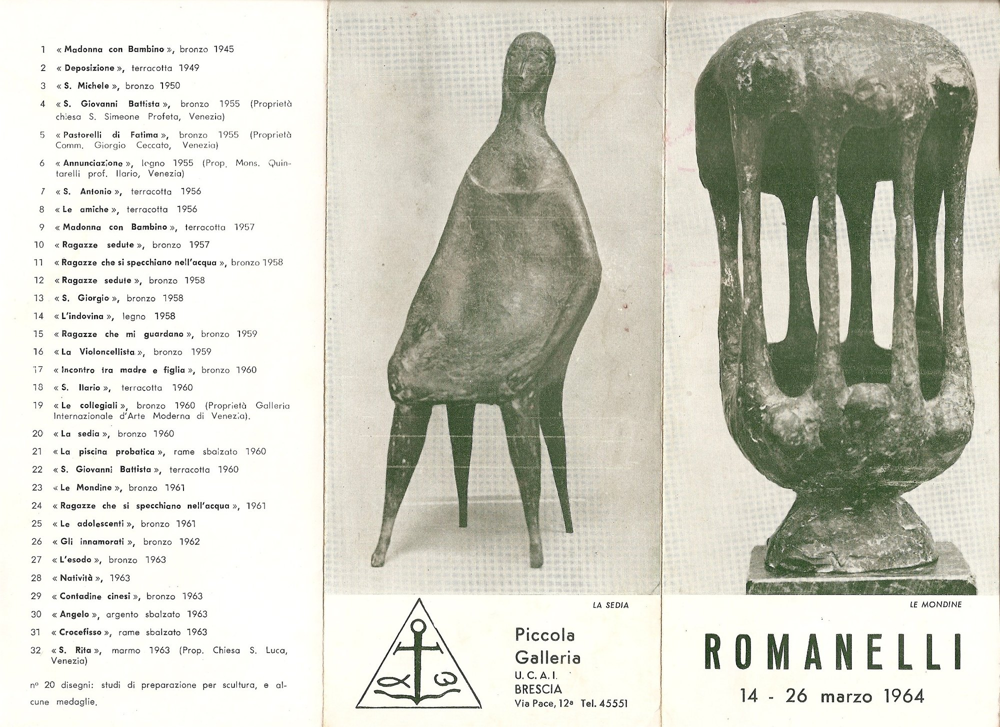
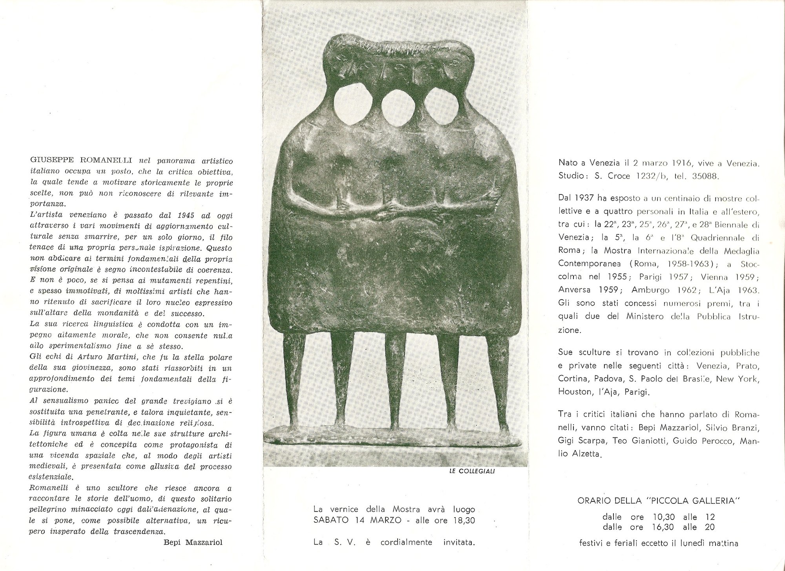

###

### Piccola Galleria U.C.A.I , Brescia

### dal 14 al 26 marzo 1964

##

##### L’artista espone alla Piccola Galleria di Brescia “20 disegni di studio e preparazione per scultura e alcune medaglie”

