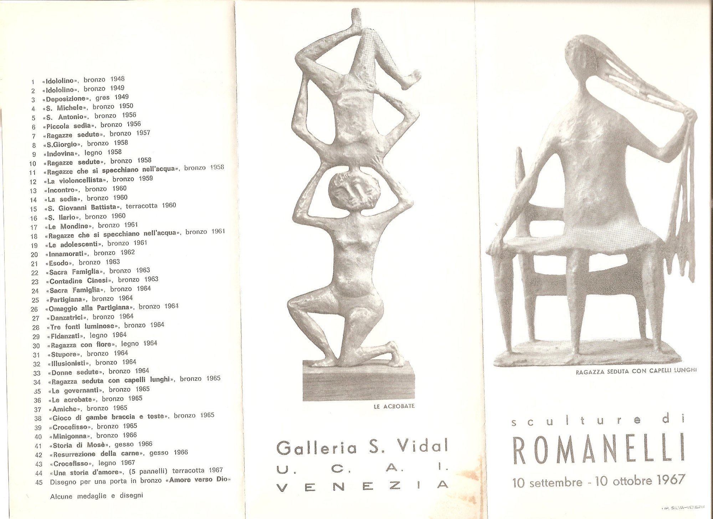
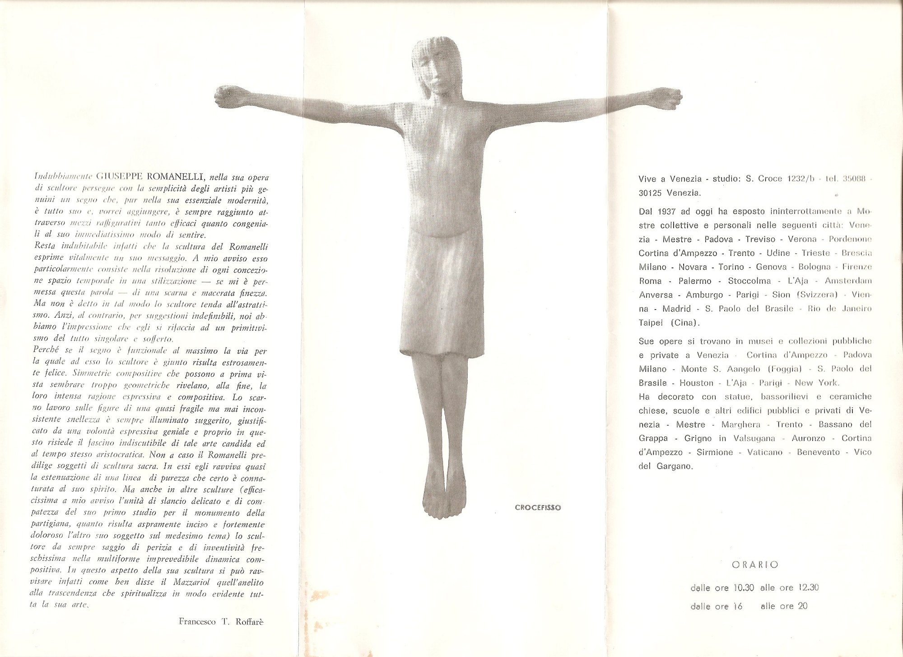

###

### Galleria San Vidal U.C.A.I, Venezia

### dal 10 settembre al 10 ottobre 1967

##

##### L’artista espone alla Galleria San Vidal di Venezia 45 opere in bronzo, legno e terracotta, più disegni e medaglie.

