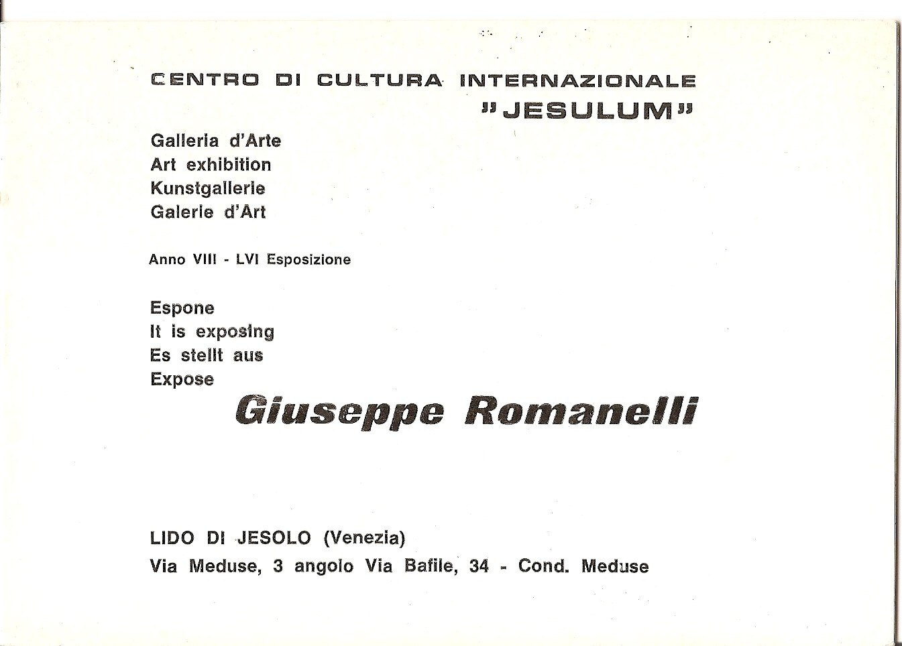
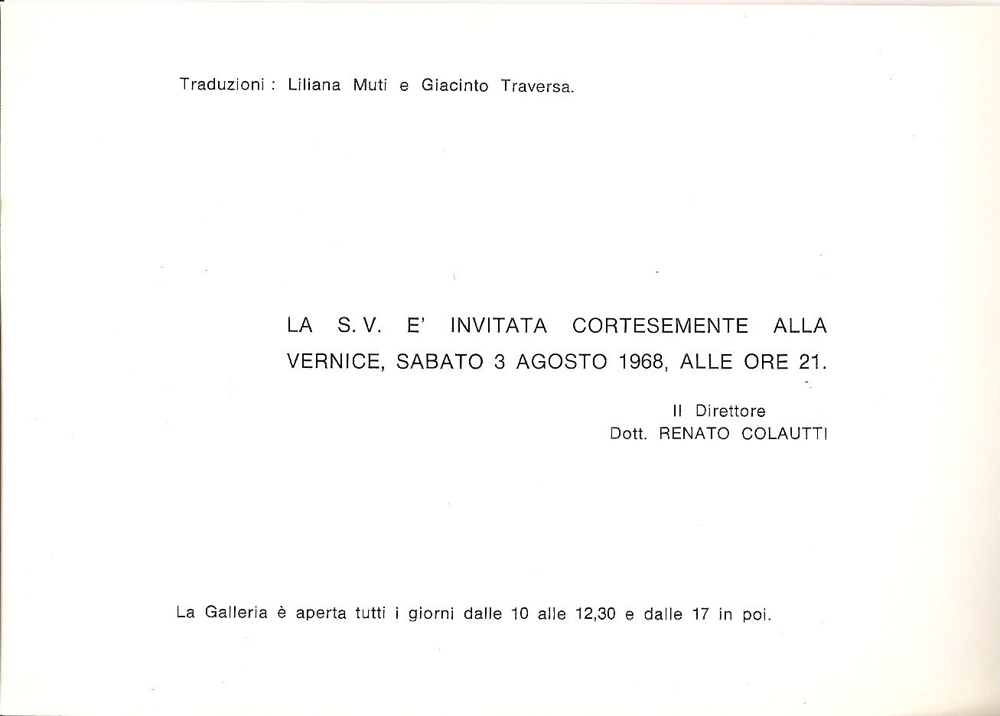
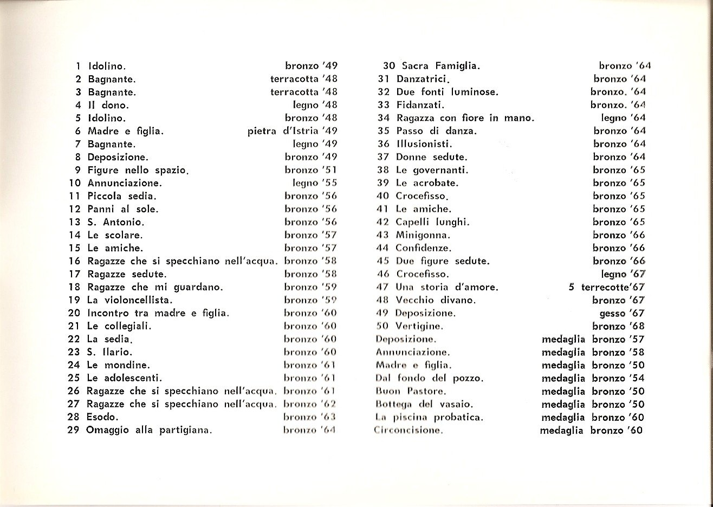
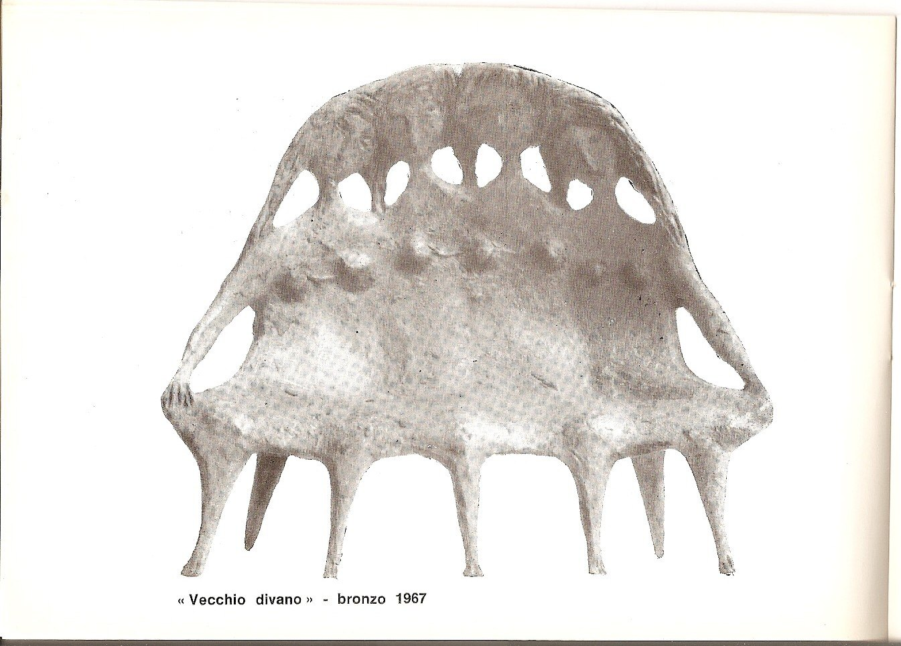
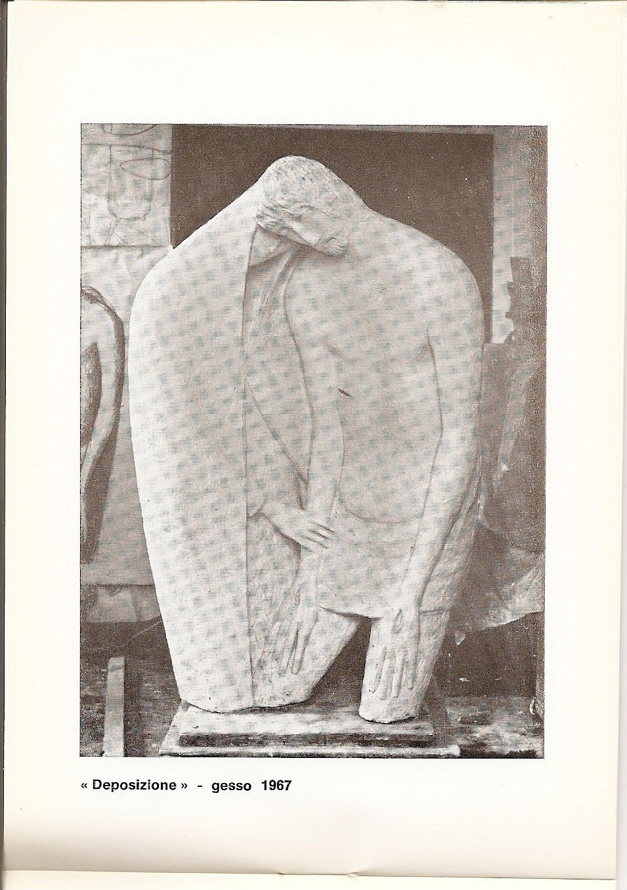
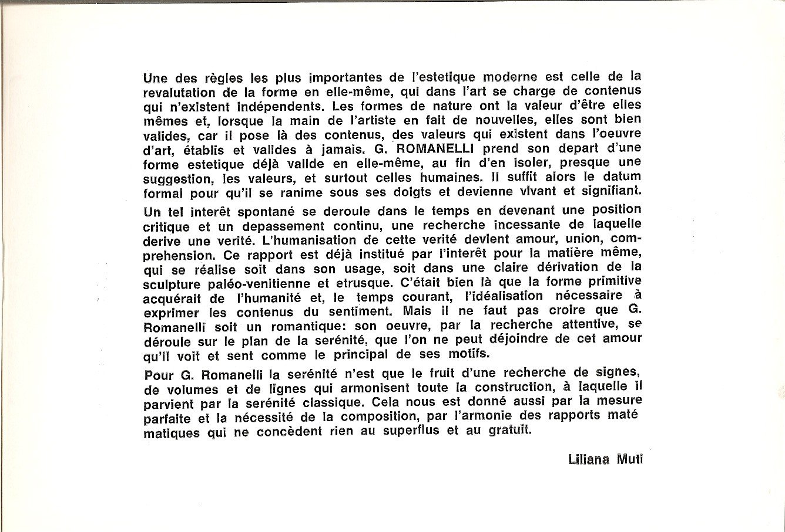
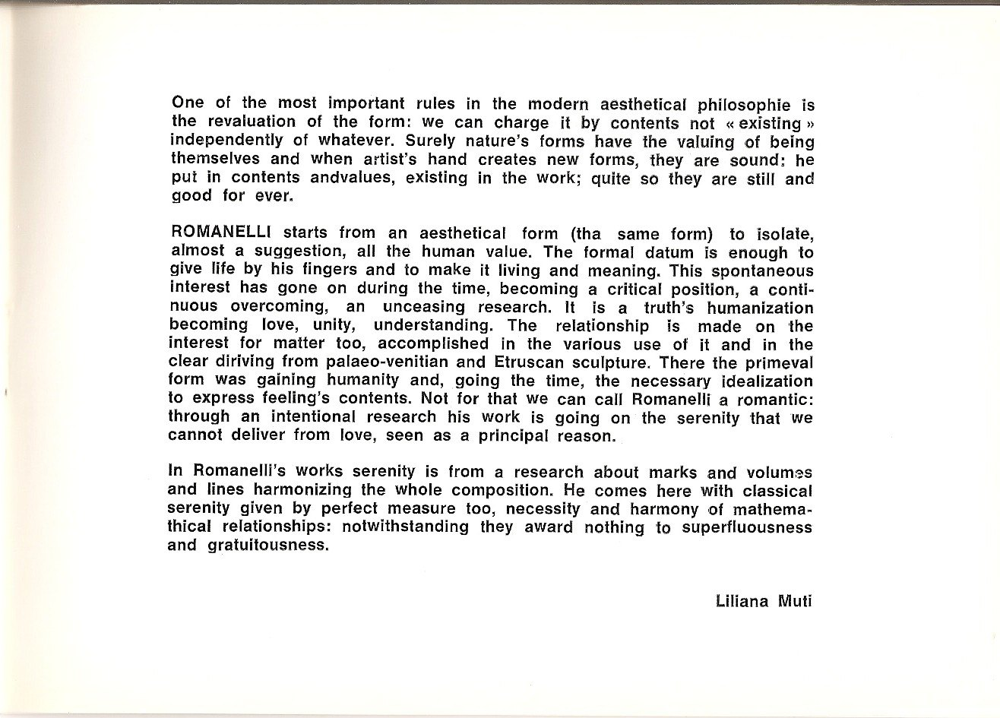

###

### Centro di Cultura Internazionale “JESULUM”, Venezia

### dal 3 al 23 agosto 1968

##

##### L’artista espone alla Centro di Cultura Internazionale “JESULUM” del Lido di Venezia, 50 opere scultore e 8 medaglie di bronzo.

### Altre pagine della brochure

Le scolare, bronzo 1958

Passo di danza, bronzo 1964

Testo di Liliana Moll, versione francese

Testo di Liliana Moll, versione inglese

Testo di Liliana Moll, versione tedesca
