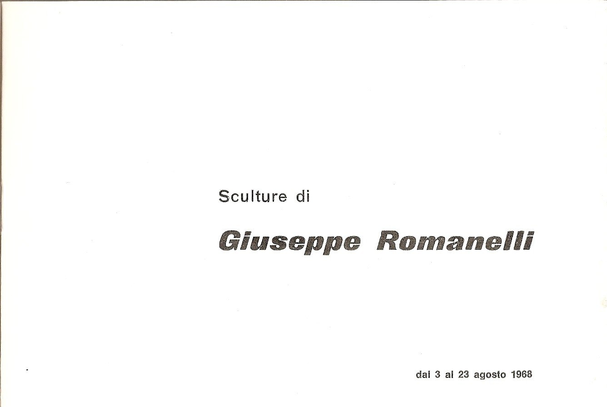
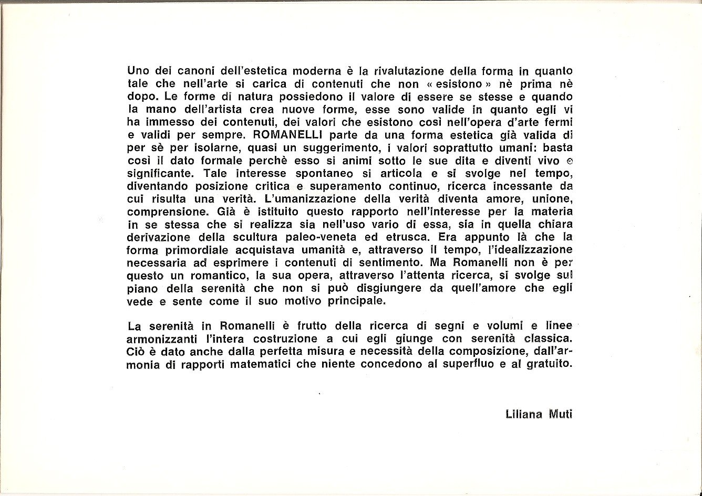
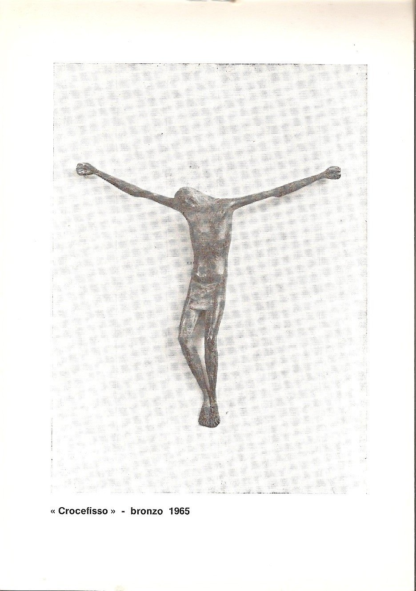
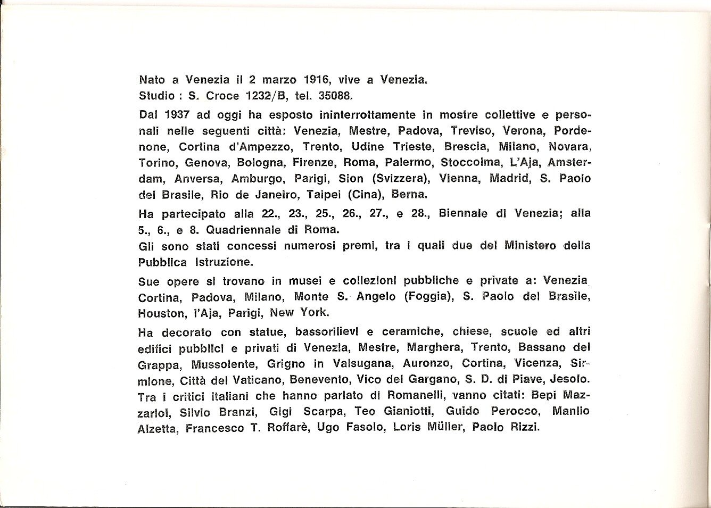
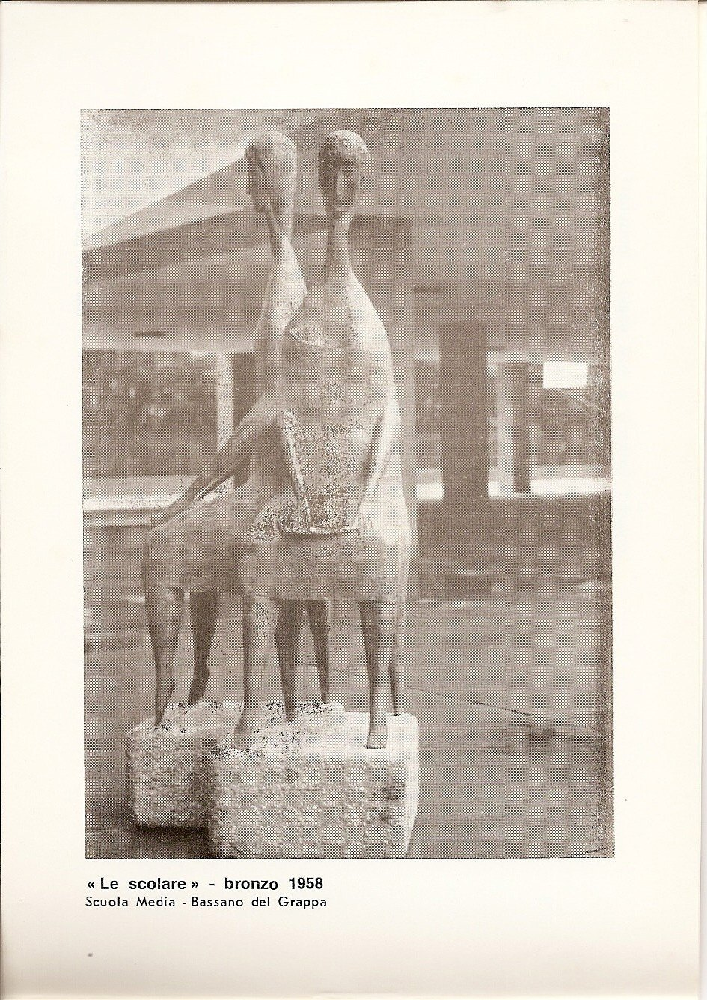
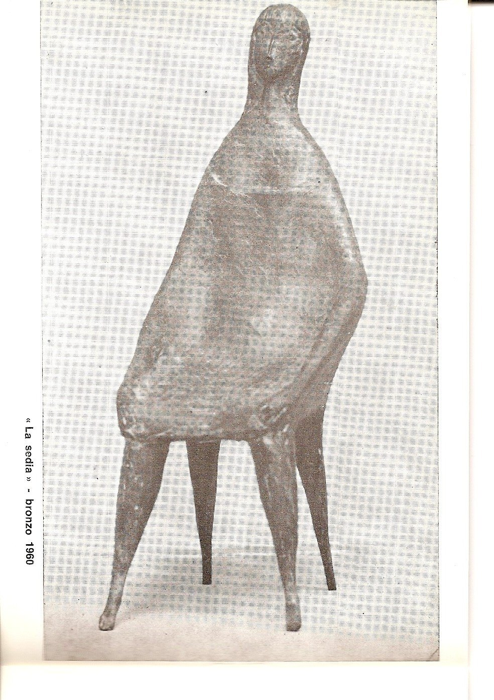
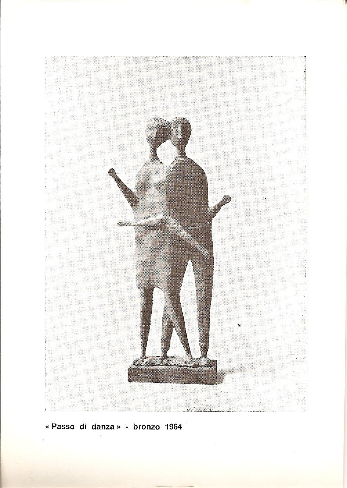
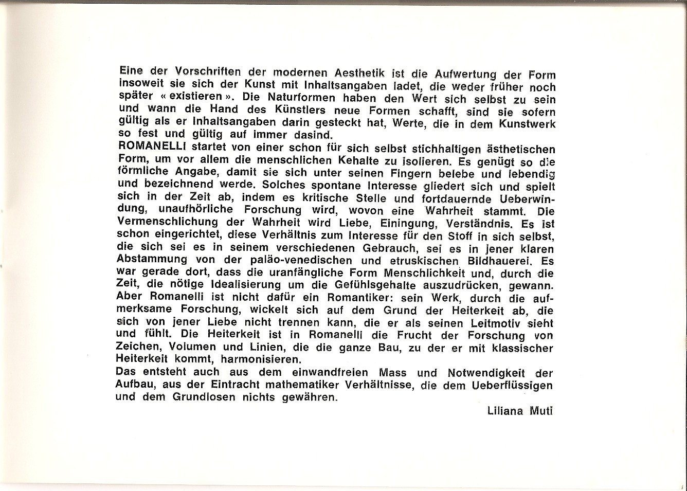

Trascrizione

CENTRO DI CULTURA INTERNAZIONALE\
“JESULUM”

Galleria d’Arte\
Art exhibition\
Kunstgallerie\
Galerie d’Art

Anno VIII - LVI Esposizione

Espone\
It is exposing\
Es stellt aus\
Expose\
Giuseppe Romanelli

LIDO DI JESOLO (Venezia)\
Via Meduse, 3 angolo Via Bafile, 34 - Cond. Meduse

Trascrizione

Sculture di\
Giuseppe Romanelli

dal 3 al 23 agosto 1968

###

### Centro di Cultura Internazionale “JESULUM”, Venezia

### dal 3 al 23 agosto 1968

##

##### L’artista espone alla Centro di Cultura Internazionale “JESULUM” del Lido di Venezia, 50 opere scultore e 8 medaglie di bronzo.

Sotto ogni pagina della brochure c’è la trascrizione del testo così come è stampato, errori di stampa compresi.

Trascrizione

Traduzioni : Liliana Muti e Giacinto Traversa.

LA S.V. E’ INVITATA CORTESEMENTE ALLA VERNICE, SABATO 3 AGOSTO 1968, ALLE ORE 21.

Il Direttore\
Dott. RENATO COLAUTTI

La Galleria è aperta tutti i giorni dalle 10 alle 12,30 e dalle 17 in poi.

Trascrizione

| N. | Titolo | Materiale e anno |
|---:|---|---|
| 1 | Idolino. | bronzo ’49 |
| 2 | Bagnante. | terracotta ’48 |
| 3 | Bagnante. | terracotta ’48 |
| 4 | Il dono. | legno ’48 |
| 5 | Idolino. | bronzo ’48 |
| 6 | Madre e figlia. | pietra d’Istria ’49 |
| 7 | Bagnante. | legno ’49 |
| 8 | Deposizione. | bronzo ’49 |
| 9 | Figure nello spazio. | bronzo ’51 |
| 10 | Annunciazione. | legno ’55 |
| 11 | Piccola sedia. | bronzo ’56 |
| 12 | Panni al sole. | bronzo ’56 |
| 13 | S. Antonio. | bronzo ’56 |
| 14 | Le scolare. | bronzo ’57 |
| 15 | Le amiche. | bronzo ’57 |
| 16 | Ragazze che si specchiano nell’acqua. | bronzo ’58 |
| 17 | Ragazze sedute. | bronzo ’58 |
| 18 | Ragazze che mi guardano. | bronzo ’59 |
| 19 | La violoncellista. | bronzo ’59 |
| 20 | Incontro tra madre e figlia. | bronzo ’60 |
| 21 | Le collegiali. | bronzo ’60 |
| 22 | La sedia. | bronzo ’60 |
| 23 | S. Ilario. | bronzo ’60 |
| 24 | Le mondine. | bronzo ’61 |
| 25 | Le adolescenti. | bronzo ’61 |
| 26 | Ragazze che si specchiano nell’acqua. | bronzo ’61 |
| 27 | Ragazze che si specchiano nell’acqua. | bronzo ’62 |
| 28 | Esodo. | bronzo ’63 |
| 29 | Omaggio alla partigiana. | bronzo ’64 |
| 30 | Sacra Famiglia. | bronzo ’64 |
| 31 | Danzatrici. | bronzo ’64 |
| 32 | Due fonti luminose. | bronzo. ’64 |
| 33 | Fidanzati. | bronzo. ’64 |
| 34 | Ragazza con fiore in mano. | legno ’64 |
| 35 | Passo di danza. | bronzo ’64 |
| 36 | Illusionisti. | bronzo ’64 |
| 37 | Donne sedute. | bronzo ’64 |
| 38 | Le governanti. | bronzo ’65 |
| 39 | Le acrobate. | bronzo ’65 |
| 40 | Crocefisso. | bronzo ’65 |
| 41 | Le amiche. | bronzo ’65 |
| 42 | Capelli lunghi. | bronzo ’65 |
| 43 | Minigonna. | bronzo ’66 |
| 44 | Confidenze. | bronzo ’66 |
| 45 | Due figure sedute. | bronzo ’66 |
| 46 | Crocefisso. | legno ’67 |
| 47 | Una storia d’amore. | 5 terrecotte’67 |
| 48 | Vecchio divano. | bronzo ’67 |
| 49 | Deposizione. | gesso ’67 |
| 50 | Vertigine. | bronzo ’68 |
| | Deposizione. | medaglia bronzo ’57 |
| | Annunciazione. | medaglia bronzo ’58 |
| | Madre e figlia. | medaglia bronzo ’50 |
| | Dal fondo del pozzo. | medaglia bronzo ’54 |
| | Buon Pastore. | medaglia bronzo ’50 |
| | Bottega del vasaio. | medaglia bronzo ’50 |
| | La piscina probatica. | medaglia bronzo ’60 |
| | Circoncisione. | medaglia bronzo ’60 |

Trascrizione

Uno dei canoni dell’estetica moderna è la rivalutazione della forma in quanto tale che nell’arte si carica di contenuti che non « esistono » nè prima nè dopo. Le forme di natura possiedono il valore di essere se stesse e quando la mano dell’artista crea nuove forme, esse sono valide in quanto egli vi ha immesso dei contenuti, dei valori che esistono così nell’opera d’arte fermi e validi per sempre. ROMANELLI parte da una forma estetica già valida di per sè per isolarne, quasi un suggerimento, i valori soprattutto umani: basta così il dato formale perchè esso si animi sotto le sue dita e diventi vivo e significante. Tale interesse spontaneo si articola e si svolge nel tempo, diventando posizione critica e superamento continuo, ricerca incessante da cui risulta una verità. L’umanizzazione della verità diventa amore, unione, comprensione. Già è istituito questo rapporto nell’interesse per la materia in se stessa che si realizza sia nell’uso vario di essa, sia in quella chiara derivazione della scultura paleo-veneta ed etrusca. Era appunto là che la forma primordiale acquistava umanità e, attraverso il tempo, l’idealizzazione necessaria ad esprimere i contenuti di sentimento. Ma Romanelli non è per questo un romantico, la sua opera, attraverso l’attenta ricerca, si svolge sul piano della serenità che non si può disgiungere da quell’amore che egli vede e sente come il suo motivo principale.

La serenità in Romanelli è frutto della ricerca di segni e volumi e linee armonizzanti l’intera costruzione a cui egli giunge con serenità classica. Ciò è dato anche dalla perfetta misura e necessità della composizione, dall’armonia di rapporti matematici che niente concedono al superfluo e al gratuito.

Liliana Muti

Vecchio divano, bronzo 1967

Deposizione, gesso 1967

Crocefisso, bronzo 1965

Trascrizione

Nato a Venezia il 2 marzo 1916, vive a Venezia.\
Studio : S. Croce 1232/B, tel. 35088.

Dal 1937 ad oggi ha esposto ininterrottamente in mostre collettive e personali nelle seguenti città: Venezia, Mestre, Padova, Treviso, Verona, Pordenone, Cortina d’Ampezzo, Trento, Udine Trieste, Brescia, Milano, Novara, Torino, Genova, Bologna, Firenze, Roma, Palermo, Stoccolma, L’Aja, Amsterdam, Anversa, Amburgo, Parigi, Sion (Svizzera), Vienna, Madrid, S. Paolo del Brasile, Rio de Janeiro, Taipei (Cina), Berna.

Ha partecipato alla 22., 23., 25., 26., 27., e 28., Biennale di Venezia; alla 5., 6., e 8. Quadriennale di Roma.

Gli sono stati concessi numerosi premi, tra i quali due del Ministero della Pubblica Istruzione.

Sue opere si trovano in musei e collezioni pubbliche e private a: Venezia, Cortina, Padova, Milano, Monte S. Angelo (Foggia), S. Paolo del Brasile, Houston, l’Aja, Parigi, New York.

Ha decorato con statue, bassorilievi e ceramiche, chiese, scuole ed altri edifici pubblici e privati di Venezia, Mestre, Marghera, Trento, Bassano del Grappa, Mussolente, Grigno in Valsugana, Auronzo, Cortina, Vicenza, Sirmione, Città del Vaticano, Benevento, Vico del Gargano, S. D. di Piave, Jesolo.

Tra i critici italiani che hanno parlato di Romanelli, vanno citati: Bepi Mazzariol, Silvio Branzi, Gigi Scarpa, Teo Gianiotti, Guido Perocco, Manlio Alzetta, Francesco T. Roffarè, Ugo Fasolo, Loris Müller, Paolo Rizzi.

### Altre pagine della brochure

Le scolare, bronzo 1958 – Scuola Media, Bassano del Grappa

La sedia, bronzo 1960

Passo di danza, bronzo 1964

Testo di Liliana Muti, versione francese

Trascrizione

Une des règles les plus importantes de l’estetique moderne est celle de la revalutation de la forme en elle-même, qui dans l’art se charge de contenus qui n’existent indépendents. Les formes de nature ont la valeur d’être elles mêmes et, lorsque la main de l’artiste en fait de nouvelles, elles sont bien valides, car il pose là des contenus, des valeurs qui existent dans l’oeuvre d’art, établis et valides à jamais. G. ROMANELLI prend son depart d’une forme estetique déjà valide en elle-même, au fin d’en isoler, presque une suggestion, les valeurs, et surtout celles humaines. Il suffit alors le datum formal pour qu’il se ranime sous ses doigts et devienne vivant et signifiant.

Un tel interêt spontané se deroule dans le temps en devenant une position critique et un depassement continu, une recherche incessante de laquelle derive une verité. L’humanisation de cette verité devient amour, union, comprehension. Ce rapport est déjà institué par l’interêt pour la matière même, qui se réalise soit dans son usage, soit dans une claire dérivation de la sculpture paléo-venitienne et etrusque. C’était bien là que la forme primitive acquérait de l’humanité et, le temps courant, l’idéalisation nécessaire à exprimer les contenus du sentiment. Mais il ne faut pas croire que G. Romanelli soit un romantique: son oeuvre, par la recherche attentive, se déroule sur le plan de la serénité, que l’on ne peut déjoindre de cet amour qu’il voit et sent comme le principal de ses motifs.

Pour G. Romanelli la serénité n’est que le fruit d’une recherche de signes, de volumes et de lignes qui armonisent toute la construction, à laquelle il parvient par la serénité classique. Cela nous est donné aussi par la mesure parfaite et la nécessité de la composition, par l’armonie des rapports matématiques qui ne concèdent rien au superflus et au gratuit.

Liliana Muti

Testo di Liliana Muti, versione inglese

Trascrizione

One of the most important rules in the modern aesthetical philosophie is the revaluation of the form: we can charge it by contents not « existing » independently of whatever. Surely nature’s forms have the valuing of being themselves and when artist’s hand creates new forms, they are sound: he put in contents andvalues, existing in the work; quite so they are still and good for ever.

ROMANELLI starts from an aesthetical form (tha same form) to isolate, almost a suggestion, all the human value. The formal datum is enough to give life by his fingers and to make it living and meaning. This spontaneous interest has gone on during the time, becoming a critical position, a continuous overcoming, an unceasing research. It is a truth’s humanization becoming love, unity, understanding. The relationship is made on the interest for matter too, accomplished in the various use of it and in the clear diriving from palaeo-venitian and Etruscan sculpture. There the primeval form was gaining humanity and, going the time, the necessary idealization to express feeling’s contents. Not for that we can call Romanelli a romantic: through an intentional research his work is going on the serenity that we cannot deliver from love, seen as a principal reason.

In Romanelli’s works serenity is from a research about marks and volumes and lines harmonizing the whole composition. He comes here with classical serenity given by perfect measure too, necessity and harmony of mathemathical relationships: notwithstanding they award nothing to superfluousness and gratuitousness.

Liliana Muti

Testo di Liliana Muti, versione tedesca

Trascrizione

Eine der Vorschriften der modernen Aesthetik ist die Aufwertung der Form insoweit sie sich der Kunst mit Inhaltsangaben ladet, die weder früher noch später « existieren ». Die Naturformen haben den Wert sich selbst zu sein und wann die Hand des Künstlers neue Formen schafft, sind sie sofern gültig als er Inhaltsangaben darin gesteckt hat, Werte, die in dem Kunstwerk so fest und gültig auf immer dasind.

ROMANELLI startet von einer schon für sich selbst stichhaltigen ästhetischen Form, um vor allem die menschlichen Kehalte zu isolieren. Es genügt so die förmliche Angabe, damit sie sich unter seinen Fingern belebe und lebendig und bezeichnend werde. Solches spontane Interesse gliedert sich und spielt sich in der Zeit ab, indem es kritische Stelle und fortdauernde Ueberwindung, unaufhörliche Forschung wird, wovon eine Wahrheit stammt. Die Vermenschlichung der Wahrheit wird Liebe, Einingung, Verständnis. Es ist schon eingerichtet, diese Verhältnis zum Interesse für den Stoff in sich selbst, die sich sei es in seinem verschiedenen Gebrauch, sei es in jener klaren Abstammung von der paläo-venedischen und etruskischen Bildhauerei. Es war gerade dort, dass die uranfängliche Form Menschlichkeit und, durch die Zeit, die nötige Idealisierung um die Gefühlsgehalte auszudrücken, gewann. Aber Romanelli ist nicht dafür ein Romantiker: sein Werk, durch die aufmerksame Forschung, wickelt sich auf dem Grund der Heiterkeit ab, die sich von jener Liebe nicht trennen kann, die er als seinen Leitmotiv sieht und fühlt. Die Heiterkeit ist in Romanelli die Frucht der Forschung von Zeichen, Volumen und Linien, die die ganze Bau, zu der er mit klassischer Heiterkeit kommt, harmonisieren.

Das entsteht auch aus dem einwandfreien Mass und Notwendigkeit der Aufbau, aus der Eintracht mathematiker Verhältnisse, die dem Ueberflüssigen und dem Grundlosen nichts gewähren.

Liliana Muti

