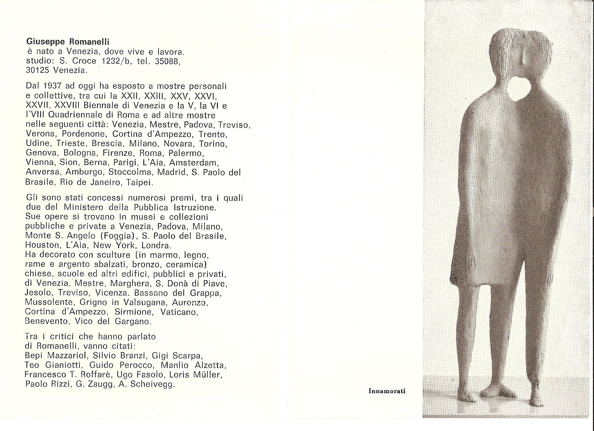

###

### Circolo Artistico di Bologna

### dal 18 al 29 maggio 1969

#####

Sotto ogni pagina dell’opuscolo c’è la trascrizione del testo così come è stampato, errori di stampa compresi.

Trascrizione

SCULTURE DI\
GIUSEPPE\
ROMANELLI

dal 18 al. 29 maggio 1969

CIRCOLO ARTISTICO - BOLOGNA\
Via Clavature 8 - Tel. 229490\
orario 10.30 - 12 — 16.30 - 19.30

Innamorati

Trascrizione

**Giuseppe Romanelli**\
è nato a Venezia, dove vive e lavora.\
studio: S. Croce 1232/b, tel. 35088, 30125 Venezia.

Dal 1937 ad oggi ha esposto a mostre personali e collettive, tra cui la XXII, XXIII, XXV, XXVI, XXVII, XXVIII Biennale di Venezia e la V, la VI e l’VIII Quadriennale di Roma e ad altre mostre nelle seguenti città: Venezia, Mestre, Padova, Treviso, Verona, Pordenone, Cortina d’Ampezzo, Trento, Udine, Trieste, Brescia, Milano, Novara, Torino, Genova, Bologna, Firenze, Roma, Palermo, Vienna, Sion, Berna, Parigi, L’Aia, Amsterdam, Anversa, Amburgo, Stoccolma, Madrid, S. Paolo del Brasile, Rio de Janeiro, Taipei.

Gli sono stati concessi numerosi premi, tra i quali due del Ministero della Pubblica Istruzione. Sue opere si trovano in musei e collezioni pubbliche e private a Venezia, Padova, Milano, Monte S. Angelo (Foggia), S. Paolo del Brasile, Houston, L’Aia, New York, Londra. Ha decorato con sculture (in marmo, legno, rame e argento sbalzati, bronzo, ceramica) chiese, scuole ed altri edifici, pubblici e privati, di Venezia, Mestre, Marghera, S. Donà di Piave, Jesolo, Treviso, Vicenza, Bassano del Grappa, Mussolente, Grigno in Valsugana, Auronzo, Cortina d’Ampezzo, Sirmione, Vaticano, Benevento, Vico del Gargano.

Tra i critici che hanno parlato di Romanelli, vanno citati: Bepi Mazzariol, Silvio Branzi, Gigi Scarpa, Teo Gianiotti, Guido Perocco, Manlio Alzetta, Francesco T. Roffarè, Ugo Fasolo, Loris Müller, Paolo Rizzi, G. Zaugg, A. Scheivegg.

