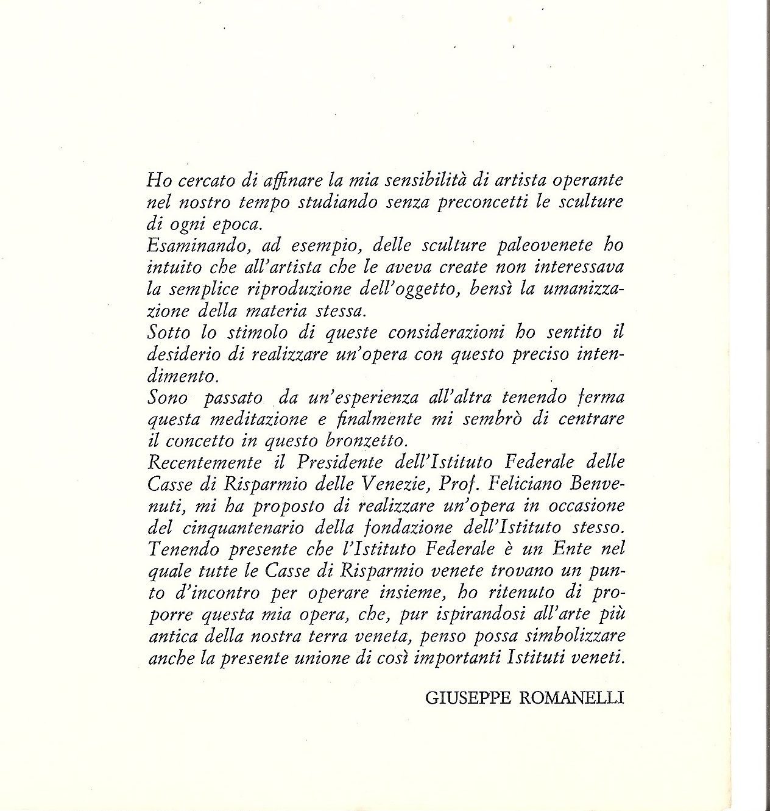
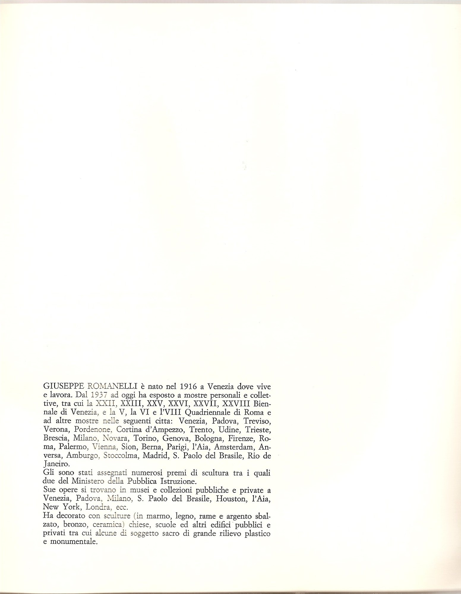
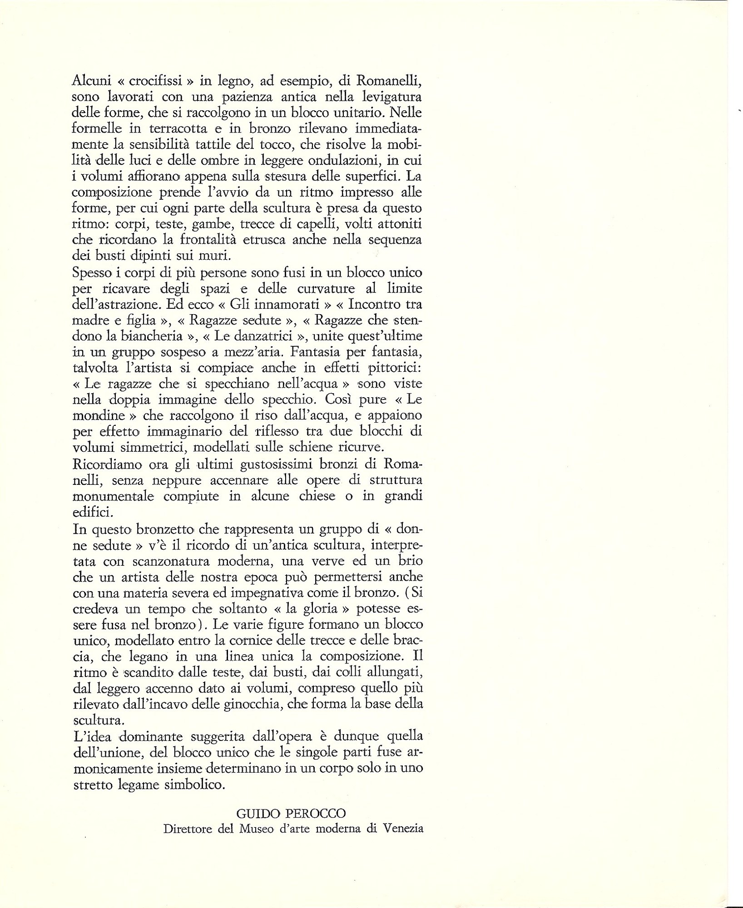

###

### Realizzazione Opera e Mostra presso Istituto Federale delle Casse di Risparmio delle Venezie a Venezia

### cinquantenario fondazione dell’Istituto, 1919 –  1969

##### L’artista in occasione del cinquantenario della fondazione dell’Istituto Federale delle Casse di Risparmio delle Venezie, è chiamato a realizzare un’opera celebrativa.

Sotto ogni pagina dell’opuscolo c’è la trascrizione del testo così come è stampato, errori di stampa compresi.

“Bronzetto” dello scultore Giuseppe Romanelli fuso in n.50 copie per conto dell’Istituto Federale delle Casse di Risparmio delle Venezie in occasione del Cinquantenario della sua fondazione.

Trascrizione

ISTITUTO FEDERALE\
DELLE CASSE DI RISPARMIO DELLE VENEZIE\
1919 / 1969

Trascrizione

Ho cercato di affinare la mia sensibilità di artista operante nel nostro tempo studiando senza preconcetti le sculture di ogni epoca.

Esaminando, ad esempio, delle sculture paleovenete ho intuito che all’artista che le aveva create non interessava la semplice riproduzione dell’oggetto, bensì la umanizzazione della materia stessa.

Sotto lo stimolo di queste considerazioni ho sentito il desiderio di realizzare un’opera con questo preciso intendimento.

Sono passato da un’esperienza all’altra tenendo ferma questa meditazione e finalmente mi sembrò di centrare il concetto in questo bronzetto.

Recentemente il Presidente dell’Istituto Federale delle Casse di Risparmio delle Venezie, Prof. Feliciano Benvenuti, mi ha proposto di realizzare un’opera in occasione del cinquantenario della fondazione dell’Istituto stesso. Tenendo presente che l’Istituto Federale è un Ente nel quale tutte le Casse di Risparmio venete trovano un punto d’incontro per operare insieme, ho ritenuto di proporre questa mia opera, che, pur ispirandosi all’arte più antica della nostra terra veneta, penso possa simbolizzare anche la presente unione di così importanti Istituti veneti.

GIUSEPPE ROMANELLI

Trascrizione

GIUSEPPE ROMANELLI è nato nel 1916 a Venezia dove vive e lavora. Dal 1937 ad oggi ha esposto a mostre personali e collettive, tra cui la XXII, XXIII, XXV, XXVI, XXVII, XXVIII Biennale di Venezia, e la V, la VI e l’VIII Quadriennale di Roma e ad altre mostre nelle seguenti citta: Venezia, Padova, Treviso, Verona, Pordenone, Cortina d’Ampezzo, Trento, Udine, Trieste, Brescia, Milano, Novara, Torino, Genova, Bologna, Firenze, Roma, Palermo, Vienna, Sion, Berna, Parigi, l’Aia, Amsterdam, Anversa, Amburgo, Stoccolma, Madrid, S. Paolo del Brasile, Rio de Janeiro.

Gli sono stati assegnati numerosi premi di scultura tra i quali due del Ministero della Pubblica Istruzione.

Sue opere si trovano in musei e collezioni pubbliche e private a Venezia, Padova, Milano, S. Paolo del Brasile, Houston, l’Aia, New York, Londra, ecc.

Ha decorato con sculture (in marmo, legno, rame e argento sbalzato, bronzo, ceramica) chiese, scuole ed altri edifici pubblici e privati tra cui alcune di soggetto sacro di grande rilievo plastico e monumentale.

Trascrizione

Giuseppe Romanelli è uno scultore veneziano autentico, che ha saputo guardare la scultura antica con profitto ed intelligente curiosità, ma sempre con un occhio tipicamente veneziano, che trasfigura a modo suo i volumi plastici.

Romanelli si è formato da solo, dopo aver frequentato alcuni corsi di Arturo Martini all’Accademia Belle Arti dal 1941 al 1944; ma anche da Martini, che era un vulcano di idee, ha tratto quello che serviva per il suo temperamento e la sensibilità tattile delle forme, che spesso si accordano insieme in un immaginario racconto. Il racconto di un episodio, di un atteggiamento, di uno stato d’animo, nasce spontaneo in Romanelli, che ha virtù di saper tradurre in scultura tutto questo con la pazienza di un ricercatore sempre insoddisfatto fino al momento giusto in cui la fantasia si placa nel raggiungimento della forma voluta.

In questa ricerca di umori diversi sui quali prevale appunto la libertà della fantasia, che giunge fino alle soglie della pittura, sta il carattere tipicamente veneziano di Giuseppe Romanelli.

Basta guardarsi attorno per convincersi come la scultura veneziana antica sappia raccontare, indicando qualcosa che va al di là della prima immagine plastica e trovi nuovi suggerimenti dalla disposizione delle forme che nascono lì per lì nel contesto del discorso. Indichiamo soprattutto quella che si trova diffusa ovunque, anche negli angoli più remoti della città: nelle patere, nei marcapiani, nei portali, nelle formelle, nei simboli religiosi, nelle insegne delle scuole e perfino negli stemmi araldici.

La famosa scultura toscana del Quattrocento, a guardar bene, va per un’altra strada, tende all’ideale classico dell’equilibrio delle forme. Ma anche Sansovino, quando si è staccato da Firenze e da Michelangelo ed è venuto a Venezia, non è stato insensibile alla decorazione fragile ed elegante, all’influsso pittorico, in una parola, leggero e fantasioso, della città, che è un opera d’arte essa stessa con il suo inconfondibile carattere.

Romanelli ha saputo fare propria una esperienza che gli è connaturale, aggiungendo, specie nelle sculture più recenti, una nota di quieto umorismo, un senso di gioco, che si traducono plasticamente nell’opera d’arte in una instancabile dosatura di forme spesso concepite in materie diverse: marmo, bronzo, terracotta, legno, ceramica, rame e argento sbalzati. Lo scultore porta il segno ben preciso della sua personalità nelle singole materie, che vengono lavorate secondo la struttura più intima, la loro fisicità, per poterne poi trarre gli autentici valori plastici.

Trascrizione

Alcuni « crocifissi » in legno, ad esempio, di Romanelli, sono lavorati con una pazienza antica nella levigatura delle forme, che si raccolgono in un blocco unitario. Nelle formelle in terracotta e in bronzo rilevano immediatamente la sensibilità tattile del tocco, che risolve la mobilità delle luci e delle ombre in leggere ondulazioni, in cui i volumi affiorano appena sulla stesura delle superfici. La composizione prende l’avvio da un ritmo impresso alle forme, per cui ogni parte della scultura è presa da questo ritmo: corpi, teste, gambe, trecce di capelli, volti attoniti che ricordano la frontalità etrusca anche nella sequenza dei busti dipinti sui muri.

Spesso i corpi di più persone sono fusi in un blocco unico per ricavare degli spazi e delle curvature al limite dell’astrazione. Ed ecco « Gli innamorati » « Incontro tra madre e figlia », « Ragazze sedute », « Ragazze che stendono la biancheria », « Le danzatrici », unite quest’ultime in un gruppo sospeso a mezz’aria. Fantasia per fantasia, talvolta l’artista si compiace anche in effetti pittorici: « Le ragazze che si specchiano nell’acqua » sono viste nella doppia immagine dello specchio. Così pure « Le mondine » che raccolgono il riso dall’acqua, e appaiono per effetto immaginario del riflesso tra due blocchi di volumi simmetrici, modellati sulle schiene ricurve.

Ricordiamo ora gli ultimi gustosissimi bronzi di Romanelli, senza neppure accennare alle opere di struttura monumentale compiute in alcune chiese o in grandi edifici.

In questo bronzetto che rappresenta un gruppo di « donne sedute » v’è il ricordo di un’antica scultura, interpretata con scanzonatura moderna, una verve ed un brio che un artista delle nostra epoca può permettersi anche con una materia severa ed impegnativa come il bronzo. (Si credeva un tempo che soltanto « la gloria » potesse essere fusa nel bronzo). Le varie figure formano un blocco unico, modellato entro la cornice delle trecce e delle braccia, che legano in una linea unica la composizione. Il ritmo è scandito dalle teste, dai busti, dai colli allungati, dal leggero accenno dato ai volumi, compreso quello più rilevato dall’incavo delle ginocchia, che forma la base della scultura.

L’idea dominante suggerita dall’opera è dunque quella dell’unione, del blocco unico che le singole parti fuse armonicamente insieme determinano in un corpo solo in uno stretto legame simbolico.

GUIDO PEROCCO\
Direttore del Museo d’arte moderna di Venezia

