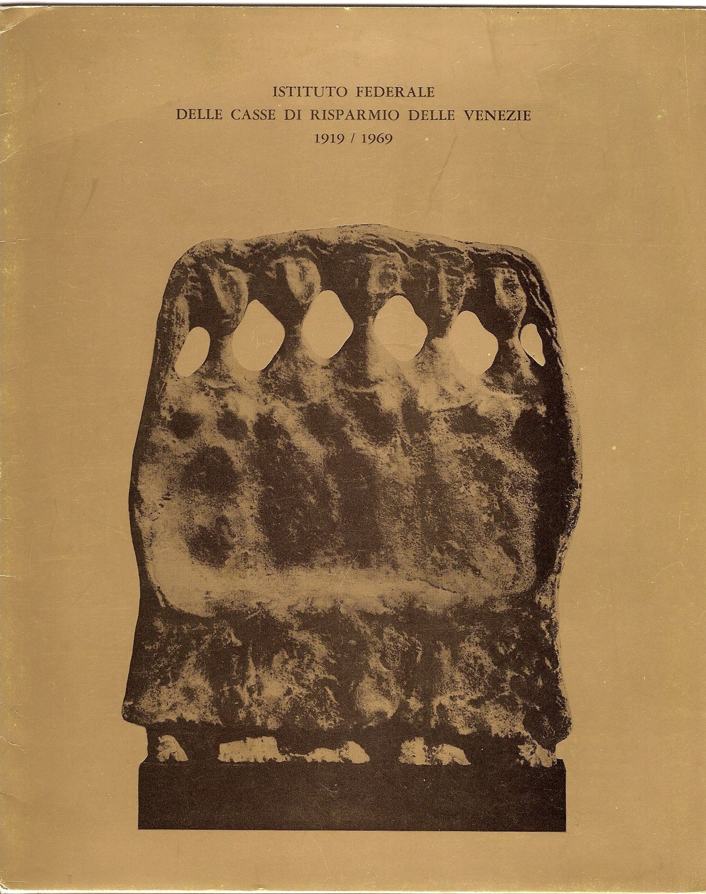
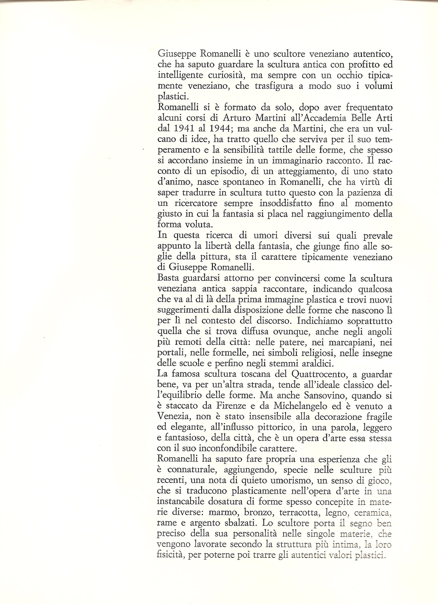
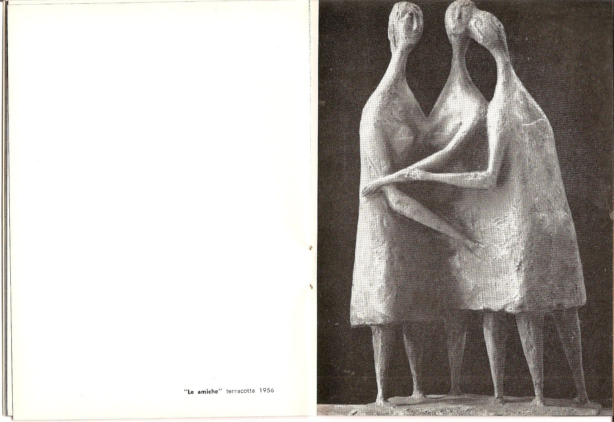
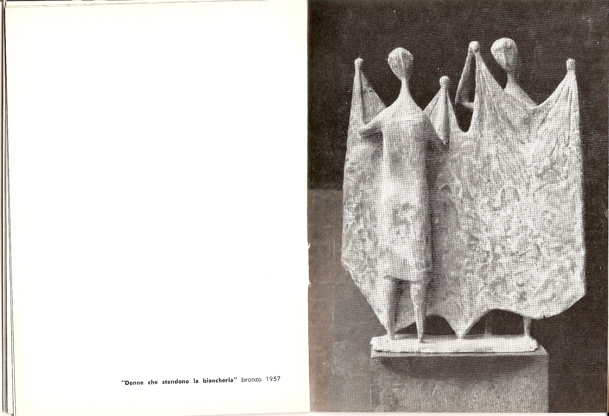
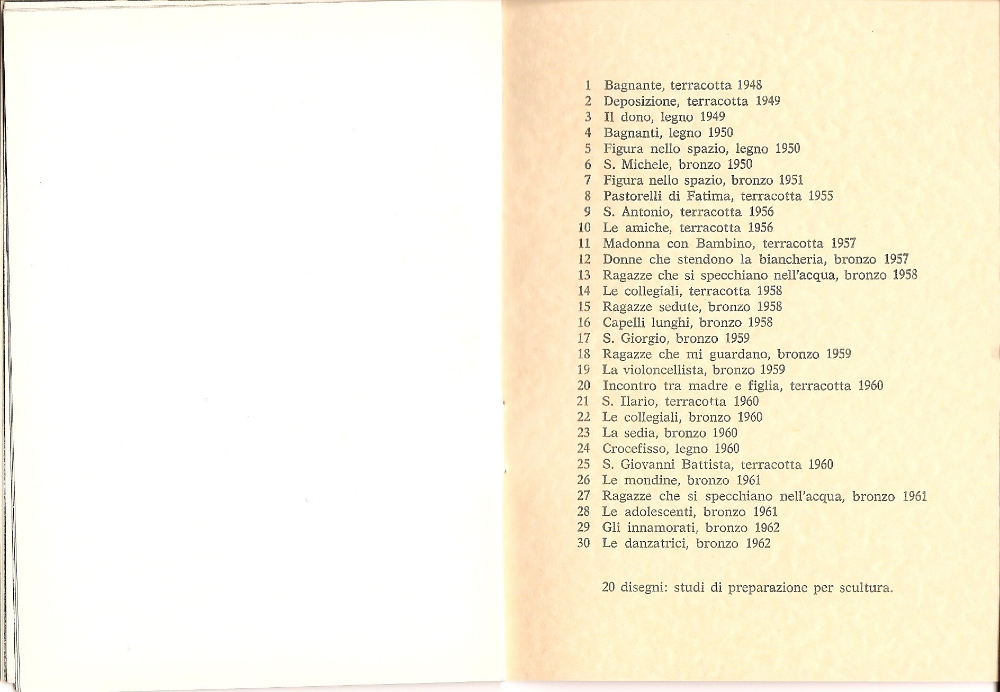

###

### Realizzazione Opera e Mostra presso Istituto Federale delle Casse di Risparmio delle Venezie a Venezia

### cinquantenario fondazione dell’Istituto, 1919 –  1969

##### L’artista in occasione del cinquantenario della fondazione dell’Istituto Federale delle Casse di Risparmio delle Venezie, è chiamato a realizzare un’opera celebrativa.

“Bronzetto” dello scultore Giuseppe Romanelli fuso in n.50 copie per conto dell’Istituto Federale delle Casse di Risparmio delle Venezie in occasione del Cinquantenario della sua fondazione.

