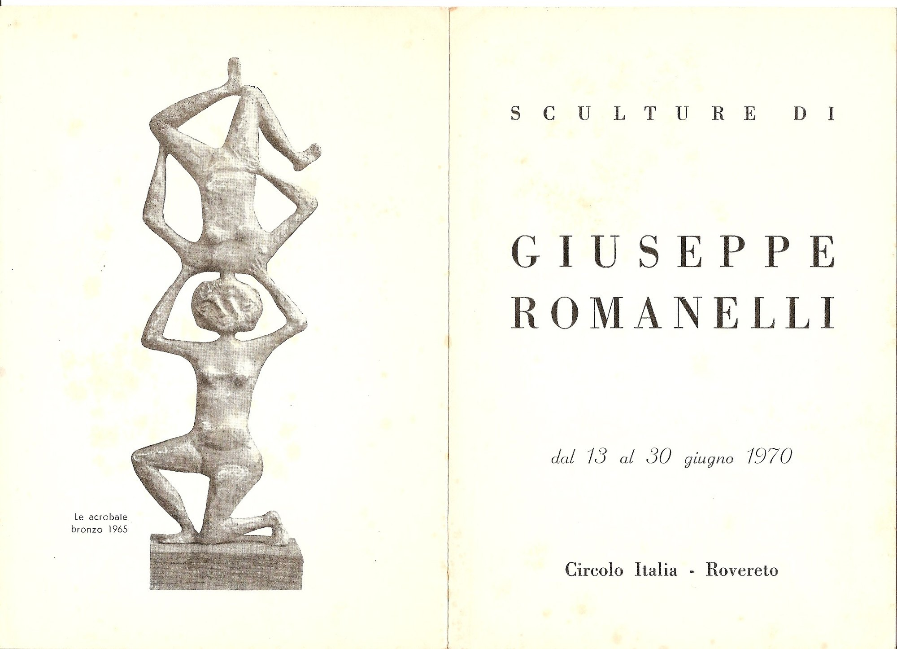
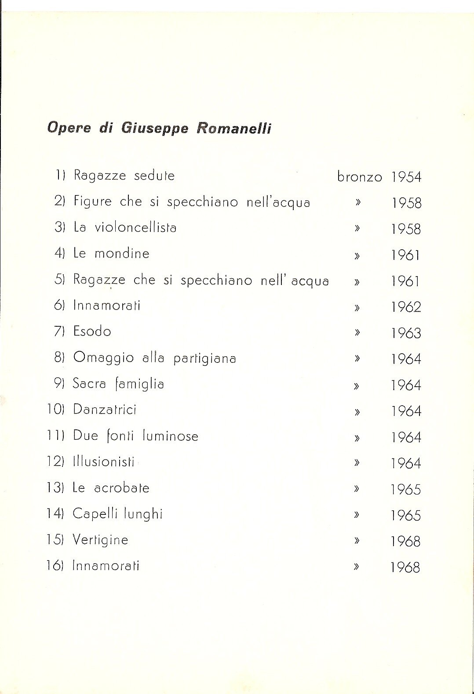

###

### Circolo Italia di Rovereto

### dal 13 al 30 giugno 1970

##### L’artista espone al Circolo Italia di Rovereto 16 opere scultoree.

Sotto ogni pagina dell’opuscolo c’è la trascrizione del testo così come è stampato, errori di stampa compresi.

Le acrobate, bronzo 1965

Trascrizione

Le acrobate\
bronzo 1965

SCULTURE DI\
GIUSEPPE\
ROMANELLI

dal 13 al 30 giugno 1970

Circolo Italia - Rovereto

Le mondine, bronzo 1961

Trascrizione

**GIUSEPPE ROMANELLI**\
è nato a Venezia, dove vive e lavora.\
studio: S. Croce 1232 b - Telef. 35088\
30125 Venezia

Dal 1937 ad oggi ha esposto a mostre personali e collettive, tra cui la XXII, XXIII, XXV, XXVI, XXVII, XXVIII Biennale di Venezia e la V, la VI e l’VIII Quadriennale di Roma e ad altre mostre nelle seguenti città: Venezia, Mestre, Padova, Treviso, Verona, Pordenone, Cortina d’Ampezzo, Trento, Udine, Trieste, Brescia, Milano, Novara, Torino, Genova, Bologna, Firenze, Roma, Palermo, Vienna, Sion, Berna Parigi, L’Aia, Amsterdam. Anversa, Amburgo, Stoccolma, Madrid, S. Paolo del Brasile Rio de Janeiro, Taipei.

Gli sono stati concessi numerosi premi, tra i quali due del Ministero della Pubblica Istruzione. Sue opere si trovano in musei e collezioni pubbliche e private a Venezia, Padova, Milano, Monte S. Angelo (Foggia), S. Paolo del Brasile, Houston, L’Aia, New York, Londra.

Ha decorato con sculture (in marmo, legno, rame e argento sbalzati, bronzo, ceramica) chiese, scuole ed altri edifici pubblici e privati di Venezia, Mestre, Marghera, S. Donà di Piave, Jesolo, Treviso, Vicenza, Bassano del Grappa, Mussolente, Grigno in Valsugana, Auronzo, Cortina d’Ampezzo, Sirmione, Vaticano, Benevento, Vico del Gargano, Rovereto.

Tra i critici che hanno parlato di Romanelli vanno citati: Bepi Mazzariol, Silvio Branzi, Gigi Scarpa, Teo Gianiotti Guido Perocco, Manlio Alzetta, Francesco T. Roffarè, Ugo Fasolo, Loris Müller, Paolo Rizzi, G. Zaugg, A. Scheivegg, M. Stefani.

Trascrizione

**Opere di Giuseppe Romanelli**

| N. | Titolo | Materiale e anno |
|---:|---|---|
| 1) | Ragazze sedute | bronzo 1954 |
| 2) | Figure che si specchiano nell’acqua | » 1958 |
| 3) | La violoncellista | » 1958 |
| 4) | Le mondine | » 1961 |
| 5) | Ragazze che si specchiano nell’acqua | » 1961 |
| 6) | Innamorati | » 1962 |
| 7) | Esodo | » 1963 |
| 8) | Omaggio alla partigiana | » 1964 |
| 9) | Sacra famiglia | » 1964 |
| 10) | Danzatrici | » 1964 |
| 11) | Due fonti luminose | » 1964 |
| 12) | Illusionisti | » 1964 |
| 13) | Le acrobate | » 1965 |
| 14) | Capelli lunghi | » 1965 |
| 15) | Vertigine | » 1968 |
| 16) | Innamorati | » 1968 |

