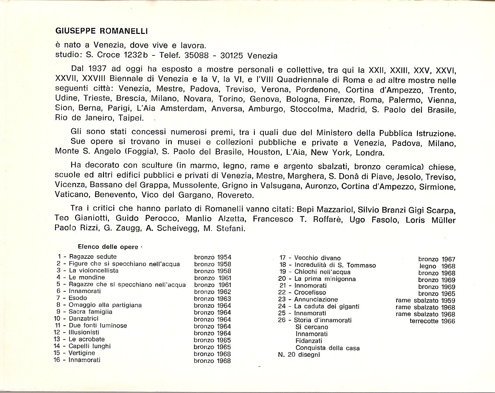
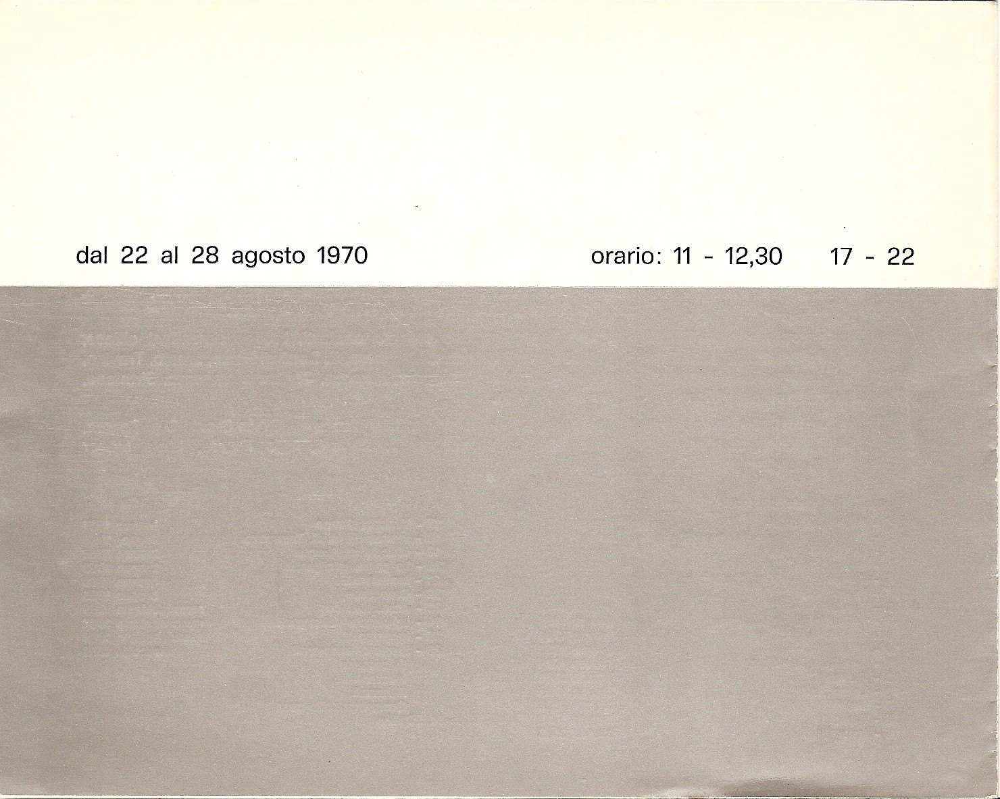

Sotto ogni pagina dell’opuscolo c’è la trascrizione del testo così come è stampato, errori di stampa compresi.

Trascrizione

sculture di\
giuseppe romanelli

galleria d’arte\
nuovo spazio\
nei locali dell’agenzia\
assicurazioni generali\
38064 folgaria trento

direttore artistico prof. luciano chinese\
consulente commerciale dott. giancarlo cappelletti

###

### Galleria d’Arte “Nuovo Spazio”, Folgaria (Trento)

### dal 22 al 28 agosto 1970

##### L’artista espone alla Galleria Nuovo Spazio di Folgaria 30 opere scultoree e  20 disegni.

#####

Trascrizione

**GIUSEPPE ROMANELLI**\
è nato a Venezia, dove vive e lavora.\
studio: S. Croce 1232b - Telef. 35088 - 30125 Venezia

Dal 1937 ad oggi ha esposto a mostre personali e collettive, tra qui la XXII, XXIII, XXV, XXVI, XXVII, XXVIII Biennale di Venezia e la V, la VI, e l’VIII Quadriennale di Roma e ad altre mostre nelle seguenti città: Venezia, Mestre, Padova, Treviso, Verona, Pordenone, Cortina d’Ampezzo, Trento, Udine, Trieste, Brescia, Milano, Novara, Torino, Genova, Bologna, Firenze, Roma, Palermo, Vienna, Sion, Berna, Parigi, L’Aia Amsterdam, Anversa, Amburgo, Stoccolma, Madrid, S. Paolo del Brasile, Rio de Janeiro, Taipei.

Gli sono stati concessi numerosi premi, tra i quali due del Ministero della Pubblica Istruzione. Sue opere si trovano in musei e collezioni pubbliche e private a Venezia, Padova, Milano, Monte S. Angelo (Foggia), S. Paolo del Brasile, Houston, L’Aia, New York, Londra.

Ha decorato con sculture (in marmo, legno, rame e argento sbalzati, bronzo ceramica) chiese, scuole ed altri edifici pubblici e privati di Venezia, Mestre, Marghera, S. Donâ di Piave, Jesolo, Treviso, Vicenza, Bassano del Grappa, Mussolente, Grigno in Valsugana, Auronzo, Cortina d’Ampezzo, Sirmione, Vaticano, Benevento, Vico del Gargano, Rovereto.

Tra i critici che hanno parlato di Romanelli vanno citati: Bepi Mazzariol, Silvio Branzi Gigi Scarpa, Teo Gianiotti, Guido Perocco, Manlio Alzetta, Francesco T. Roffarè, Ugo Fasolo, Loris Müller Paolo Rizzi, G. Zaugg, A. Scheivegg, M. Stefani.

**Elenco delle opere:**

| N. | Titolo | Materiale e anno |
|---:|---|---|
| 1 | Ragazze sedute | bronzo 1954 |
| 2 | Figure che si specchiano nell’acqua | bronzo 1958 |
| 3 | La violoncellista | bronzo 1958 |
| 4 | Le mondine | bronzo 1961 |
| 5 | Ragazze che si specchiano nell’acqua | bronzo 1961 |
| 6 | Innamorati | bronzo 1962 |
| 7 | Esodo | bronzo 1963 |
| 8 | Omaggio alla partigiana | bronzo 1964 |
| 9 | Sacra famiglia | bronzo 1964 |
| 10 | Danzatrici | bronzo 1964 |
| 11 | Due fonti luminose | bronzo 1964 |
| 12 | Illusionisti | bronzo 1964 |
| 13 | Le acrobate | bronzo 1965 |
| 14 | Capelli lunghi | bronzo 1965 |
| 15 | Vertigine | bronzo 1968 |
| 16 | Innamorati | bronzo 1968 |
| 17 | Vecchio divano | bronzo 1967 |
| 18 | Incredulità di S. Tommaso | legno 1968 |
| 19 | Chiochi nell’acqua | bronzo 1968 |
| 20 | La prima minigonna | bronzo 1969 |
| 21 | Innomorati | bronzo 1969 |
| 22 | Crocefisso | bronzo 1965 |
| 23 | Annunciazione | rame sbalzato 1959 |
| 24 | La caduta dei giganti | rame sbalzato 1968 |
| 25 | Innamorati | rame sbalzato 1968 |
| 26 | Storia d’innamorati Si cercano Innamorati Fidanzati Conquista della casa | terrecotte 1966 |

N. 20 disegni

Trascrizione

dal 22 al 28 agosto 1970\
orario: 11 - 12,30 17 - 22

