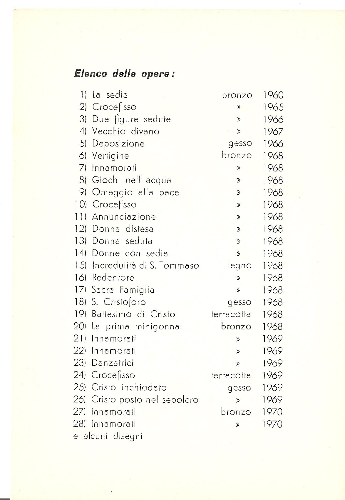

###

### Galleria Bevilacqua La Masa, Venezia

### dal 19 settembre al 2 ottobre 1970

##### L’artista espone alla Galleria Bevilacqua la Masa di Venezia 28 opere scultoree e alcuni disegni. Nella brochure di presentazione della mostra è presente una introduzione di Mario Stefani.

Sotto ogni pagina dell’opuscolo c’è la trascrizione del testo così come è stampato, errori di stampa compresi.

Trascrizione

**Pagina sinistra: notizie biografiche**

è nato a Venezia, dove vive e lavora. studio: S. Croce 1232 b - Telef. 35088 30125 - Venezia.

Dal 1937 ad oggi ha esposto a mostre personali e collettive, tra cui la XXII, XXIII, XXV, XXVI, XXVII, XXVIII Biennale di Venezia e la V, e la VI e l’VIII Quadriennale di Roma e ad altre mostre nelle seguenti città: Venezia, Mestre, Padova, Treviso, Verona, Pordenone, Cortina d’Ampezzo, Trento, Rovereto, Folgaria, Udine, Trieste, Brescia, Milano, Novara, Torino, Genova, Bologna, Firenze, Roma, Palermo, Vienna, Sion, Berna, Parigi, L’Aia, Amsterdam, Anversa, Amburgo, Stoccolma, Madrid, S. Paolo del Brasile, Rio de Janeiro, Taipei.

Gli sono stati concessi numerosi premi, tra i quali due del Ministero della Pubblica Istruzione.

Sue opere si trovano in musei e collezioni pubbliche e private a Venezia, Padova, Milano, Monte S. Angelo (Foggia), S. Paolo del Brasile, Houston, L’Aia, New York, Londra.

Ha decorato con sculture (in marmo, legno, rame e argento sbalzati, bronzo, ceramica) chiese, scuole ed altri edifici pubblici e privati di Venezia, Mestre, Marghera, S. Donà di Piave, Jesolo, Treviso, Vicenza, Bassano del Grappa, Mussciente, Grigno in Valsugana, Auronzo, Cortina d’Ampezzo, Sirmione, Vaticano, Benevento, Vico del Gargano, Rovereto.

Tra i critici che hanno parlato di Romanelli vanno citati: Bepi Mazzariol, Silzio Branzi, Gigi Scarpa, Teo Gianiotti, Guido Perocco, Manlio Alzetta, Francesco T. Roffarè, Ugo Fasolo, Loris Müller, Paolo Rizzi, G. Zaugg, A. Scheivegg, M. Stefani.

**Pagina destra: copertina**

COMUNE DI VENEZIA\
GALLERIA BEVILACQUA LA MASA

MOSTRA DELLO SCULTORE\
GIUSEPPE\
ROMANELLI

dal 19 settembre al 2 ottobre 1970

Orario: dalle 10 alle 12,30 e dalle 16 alle 20

A sinistra Innamorati, bronzo 1969; a destra La prima minigonna, bronzo 1969

Trascrizione

Dice il poeta Vittorio Sereni: « Presto sarò il viandante stupefatto avventurato nel tempo nebbioso ». Giuseppe Romanelli fa questo viaggio umano, in una ricerca che ha come termine solo la vita. E forse nemmeno la vita, se un poeta surrealista volle impiccarsi ponendo come cartellino di riconoscimento il suo puro e semplice dato anagrafico: Arthur Crévan. La ricerca continuava altrove, in altri lidi, si potrebbe dire un po’ enfaticamente, se ciò sarebbe stato possibile. Romanelli segue la sua strada e la sua ispirazione con umiltà e con fedeltà. Senza scosse, senza improvvise rivelazioni, lavora, lavora, crea.

Si può parlare di impressionismo o meglio espressionismo? Se dovessi scegliere, come comunemente si dice, un’etichetta, sceglierei espressionismo. Ma direi che anch’essa soffrirebbe di limiti eccessivi, troppo evidenti. Romanelli scava, giunge all’essenziale. Un’essenzialità che non è freddezza o che giunga all’aspra riva dell’incomunicabilità, ma è necessità, forza stessa. Chi ha dimestichezza con lui, scopre che la sua umanità si rivela, celandosi, dietro un gesto, uno sguardo, un silenzio. Nel suo studio, a S. Croce si rifugia tra vecchie sculture e nuove, tra vecchie testimonianze e nuove ricerche espressive, tra un mondo ormai stabilito come il passato (ma stabilito fino a un certo punto direbbe il Borges, perchè il passato non ha fine) e il nuovo, profezia, promessa speranza mai esaurita, mai compiuta. Lo scultore Romanelli è una voce chiara del nostro tempo, fra tanta confusione (anche se con l’attenuante della buona fede!?!?), una voce che parla e che può essere capita.

Scorriamo un qualsiasi dépliant di Romanelli. Troveremo sempre l’uomo, il Cristo protagonista, la donna, gli innamorati. L’uomo come forza espressiva dell’animo, dei sentimenti, al centro delle « proccupazioni » dell’artista, della speranza umana sempre tradita, ma sempre rinnovata come promessa. Un Cristo adolescente ci guarda, un Cristo moderno, nella sua umanità sofferta, silenziosa, accorata.

Romanelli è in strano equilibrio fra classico e perennemente moderno. Tra realtà e [?] sogno, tra ciò che è, e ciò che è promessa, visione, allusione, speranza, ricerca. Non immobilismo quindi, o staticità, o intellettualismo rarefatto di ricerca, ma autentica vita problematica, vita innervata continuamente per simbiosi con il mondo esterno, nella sua accezione comune di realtà.

Romanelli è « le mondine » è flaubertianamente le sue opere. Una ricerca di spazi, di rapporti matematici, musicali, di volumi, di chiaroscuri, di un rapporto di luce, che è « in quanto tale. materia ».

Nel panorama poliglotta e confuso in cui singole tradizioni e « avances » si intersecano con altre ricerche d’altri luoghi e tempi, ecco apparire Romanelli con una sua limpida coerenza. Una lunga, lenta evoluzione, un dialogo prima con se stesso che con gli altri, una ricerca fatta carne, vita. Mai le sculture di Romanelli sono fatte per gioco esterno, per pura scommessa di moda. Ogni tappa creativa ha una sua giustificazione nell’autore. Lo scultore ricerca in se stesso le tensioni di una realtà strana e turbata, di una realtà, di chi come lui, vivendo coi giovani, avverte ogni minimo palpito, ogni significazione di vita, di testimonianza.

Non attende Romanelli da oltre mare o da oltre cortina una rivista illuminante per rimanere sulla cresta comoda dell’onda, ma cerca invece una voce, una giustificazione interiore, personale. L’artista, ogni artista, se e in quanto tale, fa una scommessa, scommessa umana, ricca, che si pone come ponte fra lui e gli altri, fra lui e l’umanità. Romanelli con la sua scultura ha cercato di fare onestamente questo, di ricercare, senza stanchezze o avvilimenti spirituali, o baratti (peggio ancora), una soluzione diversa. La promessa è tale, ai lettori di tale promessa spetterà il compito di giudicare.

La figura umana è sempre presente nelle sue sculture. Una ricerca senza compromessi, senza utili « cedimenti ». Si potrebbe dire: « il destino di essere umano », di essere quindi se stessi, come bisogna.

Forme spaziali, astratte, forme umane, equilibrio e come tale armonia. Le figure sono nella dimensione tempo, in magico torpore. Un torpore che dà vita ad esse, ritmo, foga, come in « donne sedute » del 1964. Fasolo parla di un « ritegno arcaico », un ritegno che si fa in noi commozione e partecipazione. Pensiamo a « due figure sedute », veramente belle, al ritmo compositivo di « Sacra Famiglia », in cui tutto pare divenire cosmico, roteante.

Ritorniamo alle « Mondine », chine nel loro lavoro, in rapporto fra espressione, ritmo estetico e forza, fatica umana? Ritorniamo a « Ragazza seduta con capelli lunghi »? Dove anche il gioco di luce e ombra è ridotto all’essenziale? Vogliamo ricordare « Le collegiali »? E’ uno scultore che, come ben dice Bepi Mazzariol « riesce ancora a raccontare le storie dell’uomo »...

Martini è stata una guida, ma Romanelli, ha poi battuto altre vie, in cui materialità e trascendenza si bilanciano, per cui ogni volta che si voglia maggiormente porre l’accento su l’una, subito si richiama alla mente l’altra e viceversa. E tutto in un equilibrio che si fa, diviene messaggio.

Mario Stefani

Innamorati, bronzo 1970 (due opere)

Trascrizione

**Elenco delle opere:**

| N. | Titolo | Materiale e anno |
|---:|---|---|
| 1) | La sedia | bronzo 1960 |
| 2) | Crocefisso | » 1965 |
| 3) | Due figure sedute | » 1966 |
| 4) | Vecchio divano | » 1967 |
| 5) | Deposizione | gesso 1966 |
| 6) | Vertigine | bronzo 1968 |
| 7) | Innamorati | » 1968 |
| 8) | Giochi nell’acqua | » 1968 |
| 9) | Omaggio alla pace | » 1968 |
| 10) | Crocefisso | » 1968 |
| 11) | Annunciazione | » 1968 |
| 12) | Donna distesa | » 1968 |
| 13) | Donna seduta | » 1968 |
| 14) | Donne con sedia | » 1968 |
| 15) | Incredulità di S. Tommaso | legno 1968 |
| 16) | Redentore | » 1968 |
| 17) | Sacra Famiglia | » 1968 |
| 18) | S. Cristoforo | gesso 1968 |
| 19) | Battesimo di Cristo | terracotta 1968 |
| 20) | La prima minigonna | bronzo 1968 |
| 21) | Innamorati | » 1969 |
| 22) | Innamorati | » 1969 |
| 23) | Danzatrici | » 1969 |
| 24) | Crocefisso | terracotta 1969 |
| 25) | Cristo inchiodato | gesso 1969 |
| 26) | Cristo posto nel sepolcro | » 1969 |
| 27) | Innamorati | bronzo 1970 |
| 28) | Innamorati | » 1970 |

e alcuni disegni

