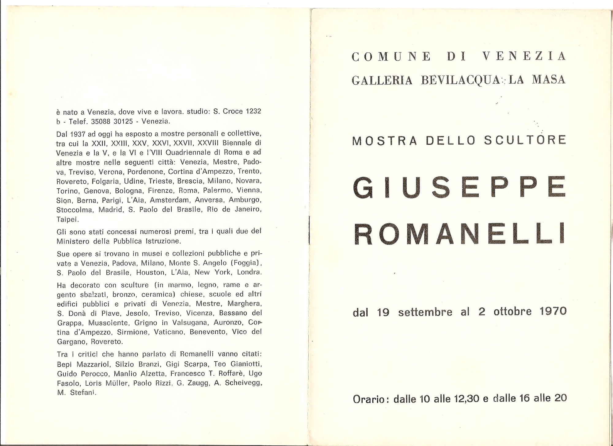
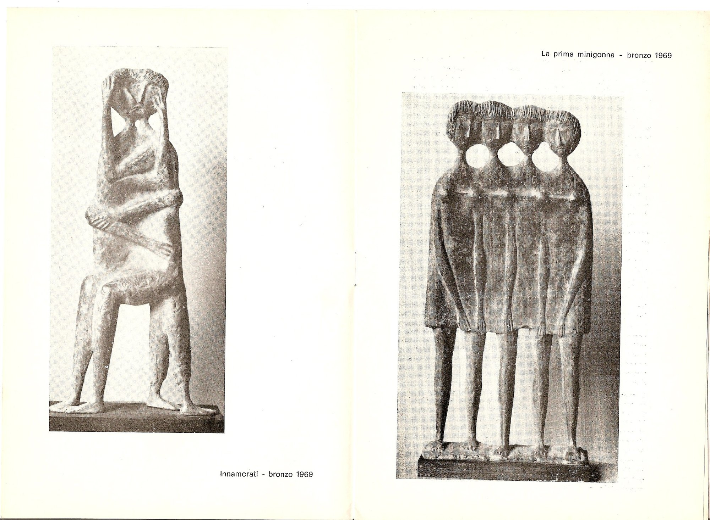
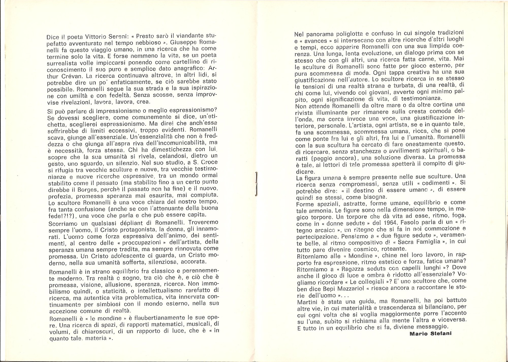
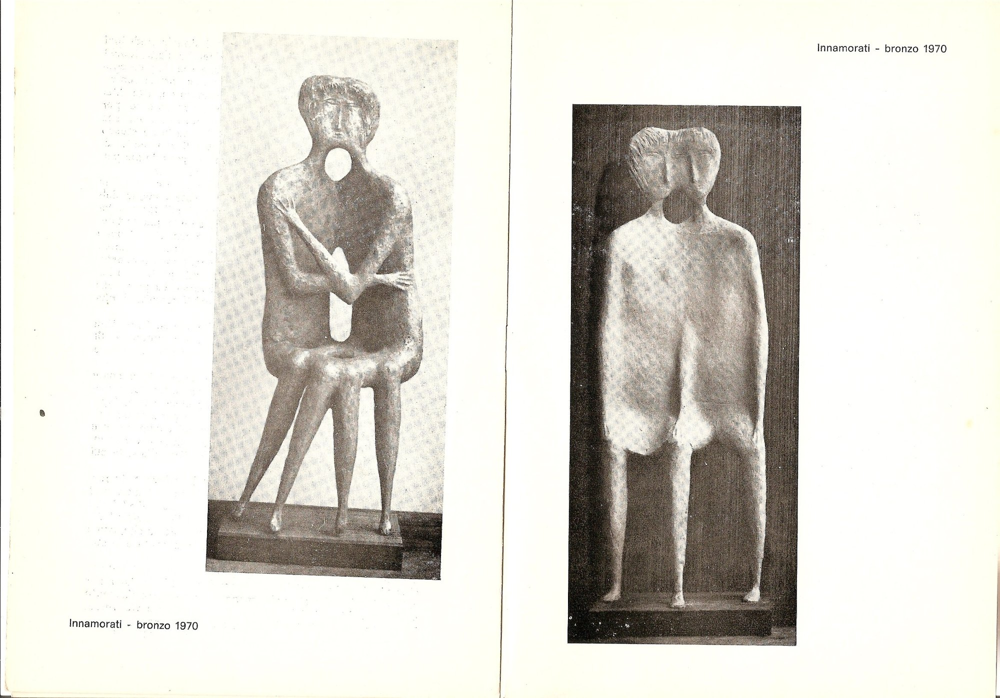

###

### Galleria Bevilacqua La Masa, Venezia

### dal 19 settembre al 2 ottobre 1970

##### L’artista espone alla Galleria Bevilacqua la Masa di Venezia 28 opere scultoree e alcuni disegni. Nella brochure di presentazione della mostra è presente una introduzione di Mario Stefani.

