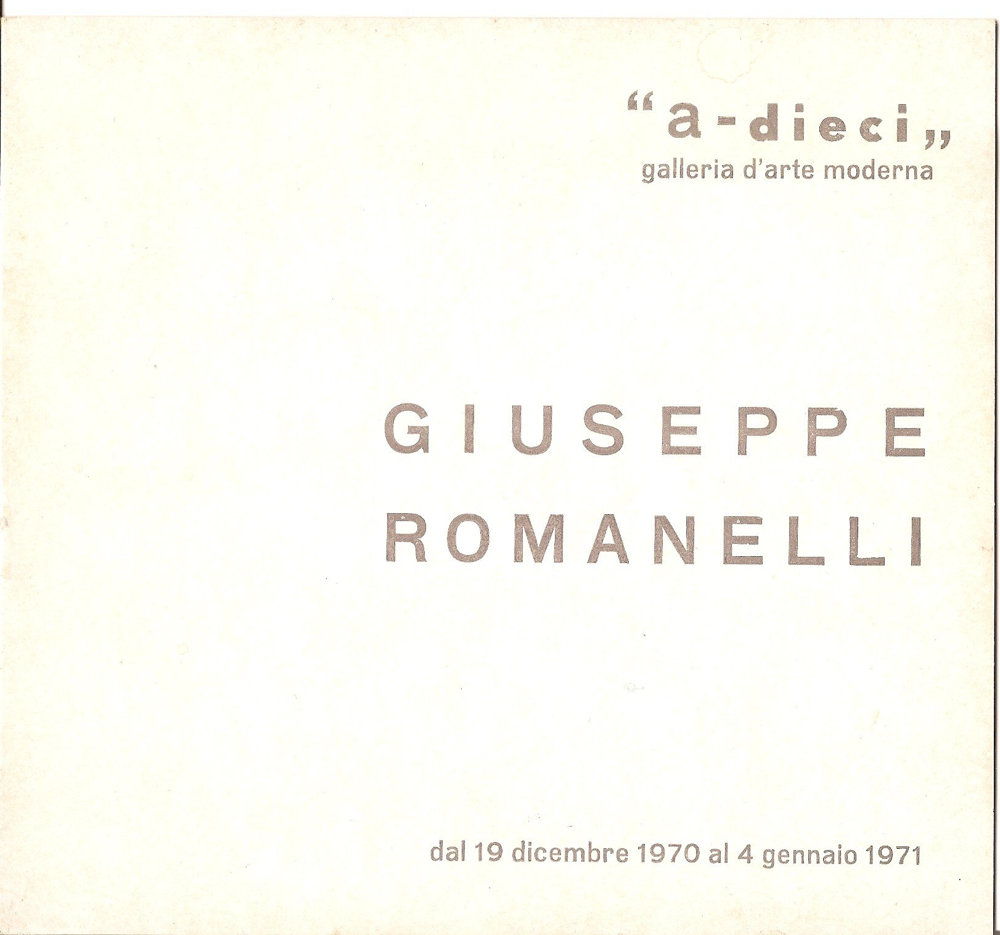
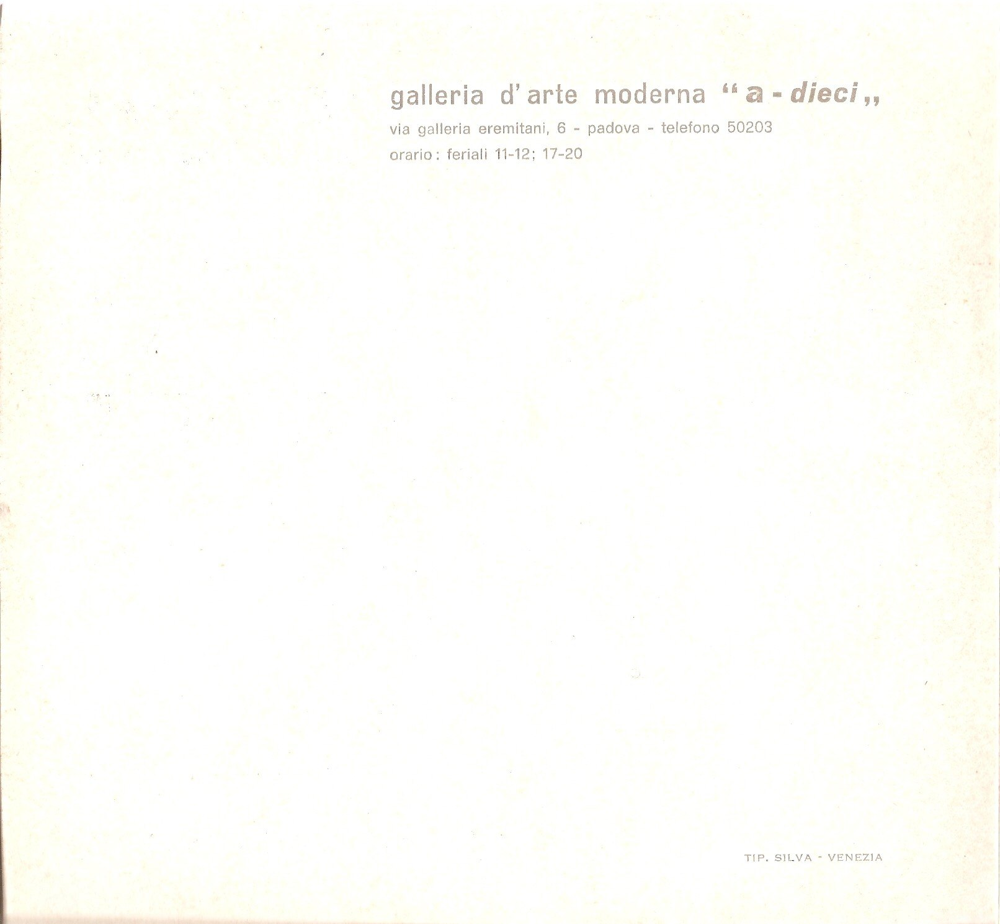
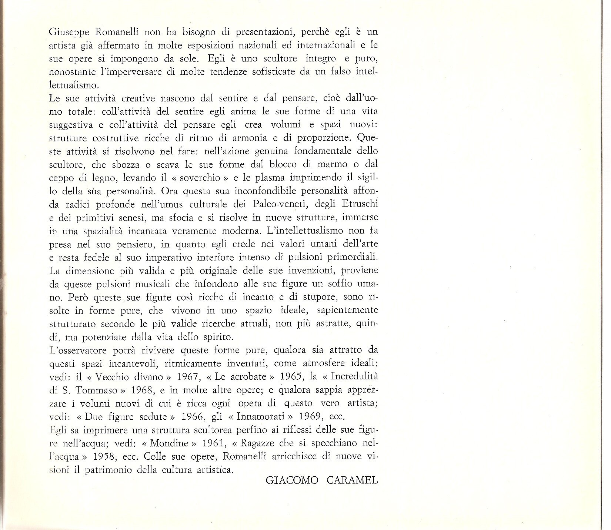

### Galleria d’Arte Moderna “a-dieci”, Padova

### dal 19 dicembre 1970 al 4 gennaio 1971

##### L’artista espone alla Galleria “a-dieci” di Padova 37 opere scultoree. Nella brochure di presentazione della mostra è presente una introduzione di Giacomo Caramel.

