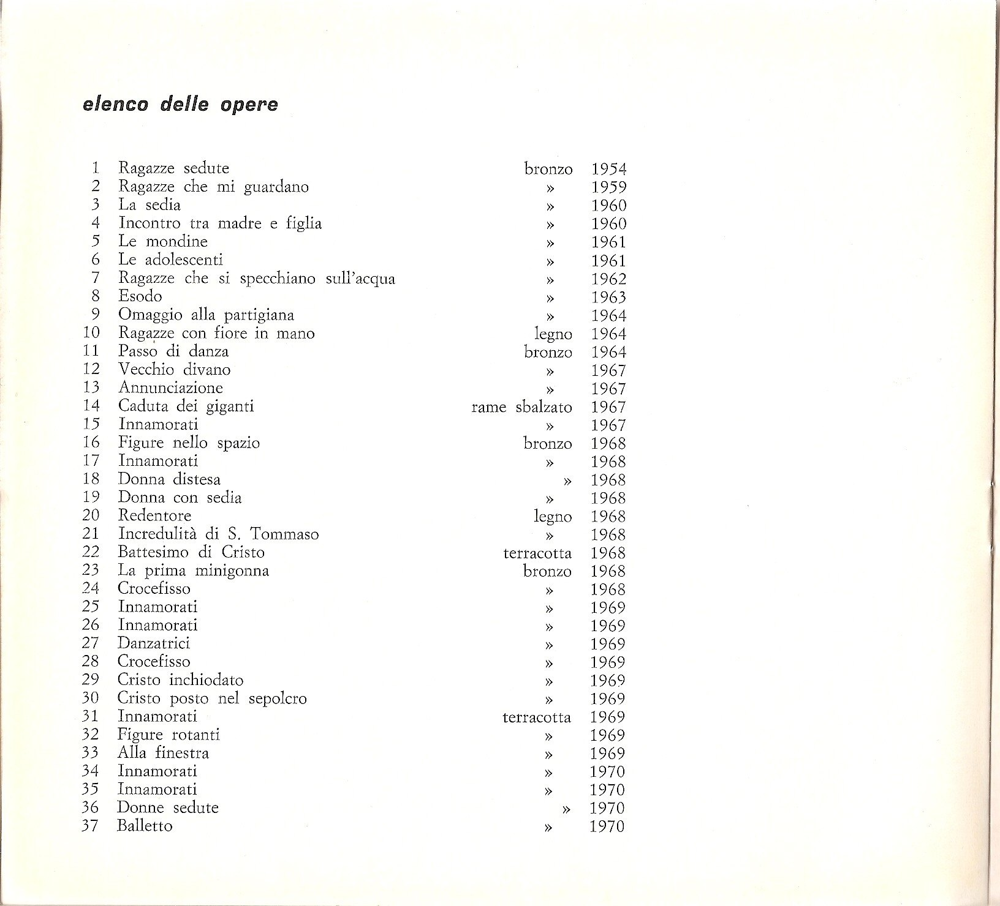

### Galleria d’Arte Moderna “a-dieci”, Padova

### dal 19 dicembre 1970 al 4 gennaio 1971

##### L’artista espone alla Galleria “a-dieci” di Padova 37 opere scultoree. Nella brochure di presentazione della mostra è presente una introduzione di [Giacomo Caramel](http://www.teknemedia.net/pagine-gialle/artisti/giacomo_caramel/documentazione-artista.html).

Sotto ogni pagina dell’opuscolo c’è la trascrizione del testo così come è stampato, errori di stampa compresi.

Trascrizione

“a-dieci„\
galleria d’arte moderna

GIUSEPPE\
ROMANELLI

dal 19 dicembre 1970 al 4 gennaio 1971

Trascrizione

galleria d’arte moderna “a-dieci„\
via galleria eremitani, 6 - padova - telefono 50203\
orario: feriali 11-12; 17-20

TIP. SILVA - VENEZIA

Trascrizione

Giuseppe Romanelli non ha bisogno di presentazioni, perchè egli è un artista già affermato in molte esposizioni nazionali ed internazionali e le sue opere si impongono da sole. Egli è uno scultore integro e puro, nonostante l’imperversare di molte tendenze sofisticate da un falso intellettualismo.

Le sue attività creative nascono dal sentire e dal pensare, cioè dall’uomo totale: coll’attività del sentire egli anima le sue forme di una vita suggestiva e coll’attività del pensare egli crea volumi e spazi nuovi: strutture costruttive ricche di ritmo di armonia e di proporzione. Queste attività si risolvono nel fare: nell’azione genuina fondamentale dello scultore, che sbozza o scava le sue forme dal blocco di marmo o dal ceppo di legno, levando il « soverchio » e le plasma imprimendo il sigillo della sua personalità. Ora questa sua inconfondibile personalità affonda radici profonde nell’umus culturale dei Paleo-veneti, degli Etruschi e dei primitivi senesi, ma sfocia e si risolve in nuove strutture, immerse in una spazialità incantata veramente moderna. L’intellettualismo non fa presa nel suo pensiero, in quanto egli crede nei valori umani dell’arte e resta fedele al suo imperativo interiore intenso di pulsioni primordiali. La dimensione più valida e più originale delle sue invenzioni, proviene da queste pulsioni musicali che infondono alle sue figure un soffio umano. Però queste sue figure così ricche di incanto e di stupore, sono risolte in forme pure, che vivono in uno spazio ideale, sapientemente strutturato secondo le più valide ricerche attuali, non più astratte, quindi, ma potenziate dalla vita dello spirito.

L’osservatore potrà rivivere queste forme pure, qualora sia attratto da questi spazi incantevoli, ritmicamente inventati, come atmosfere ideali; vedi: il « Vecchio divano » 1967, « Le acrobate » 1965, la « Incredulità di S. Tommaso » 1968, e in molte altre opere; e qualora sappia apprezzare i volumi nuovi di cui è ricca ogni opera di questo vero artista; vedi: « Due figure sedute » 1966, gli « Innamorati » 1969, ecc.

Egli sa imprimere una struttura scultorea perfino ai riflessi delle sue figure nell’acqua; vedi: « Mondine » 1961, « Ragazze che si specchiano nell’acqua » 1958, ecc. Colle sue opere, Romanelli arricchisce di nuove visioni il patrimonio della cultura artistica.

GIACOMO CARAMEL

Trascrizione

**elenco delle opere**

| N. | Titolo | Materiale e anno |
|---:|---|---|
| 1 | Ragazze sedute | bronzo 1954 |
| 2 | Ragazze che mi guardano | » 1959 |
| 3 | La sedia | » 1960 |
| 4 | Incontro tra madre e figlia | » 1960 |
| 5 | Le mondine | » 1961 |
| 6 | Le adolescenti | » 1961 |
| 7 | Ragazze che si specchiano sull’acqua | » 1962 |
| 8 | Esodo | » 1963 |
| 9 | Omaggio alla partigiana | » 1964 |
| 10 | Ragazze con fiore in mano | legno 1964 |
| 11 | Passo di danza | bronzo 1964 |
| 12 | Vecchio divano | » 1967 |
| 13 | Annunciazione | » 1967 |
| 14 | Caduta dei giganti | rame sbalzato 1967 |
| 15 | Innamorati | » 1967 |
| 16 | Figure nello spazio | bronzo 1968 |
| 17 | Innamorati | » 1968 |
| 18 | Donna distesa | » 1968 |
| 19 | Donna con sedia | » 1968 |
| 20 | Redentore | legno 1968 |
| 21 | Incredulità di S. Tommaso | » 1968 |
| 22 | Battesimo di Cristo | terracotta 1968 |
| 23 | La prima minigonna | bronzo 1968 |
| 24 | Crocefisso | » 1968 |
| 25 | Innamorati | » 1969 |
| 26 | Innamorati | » 1969 |
| 27 | Danzatrici | » 1969 |
| 28 | Crocefisso | » 1969 |
| 29 | Cristo inchiodato | » 1969 |
| 30 | Cristo posto nel sepolcro | » 1969 |
| 31 | Innamorati | terracotta 1969 |
| 32 | Figure rotanti | » 1969 |
| 33 | Alla finestra | » 1969 |
| 34 | Innamorati | » 1970 |
| 35 | Innamorati | » 1970 |
| 36 | Donne sedute | » 1970 |
| 37 | Balletto | » 1970 |

