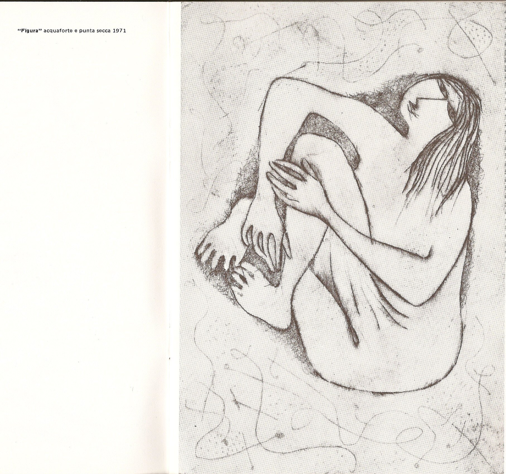
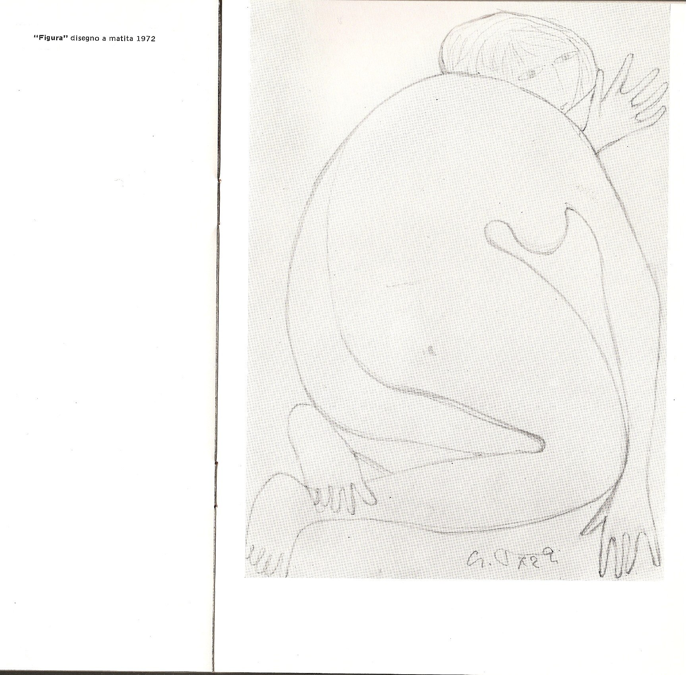
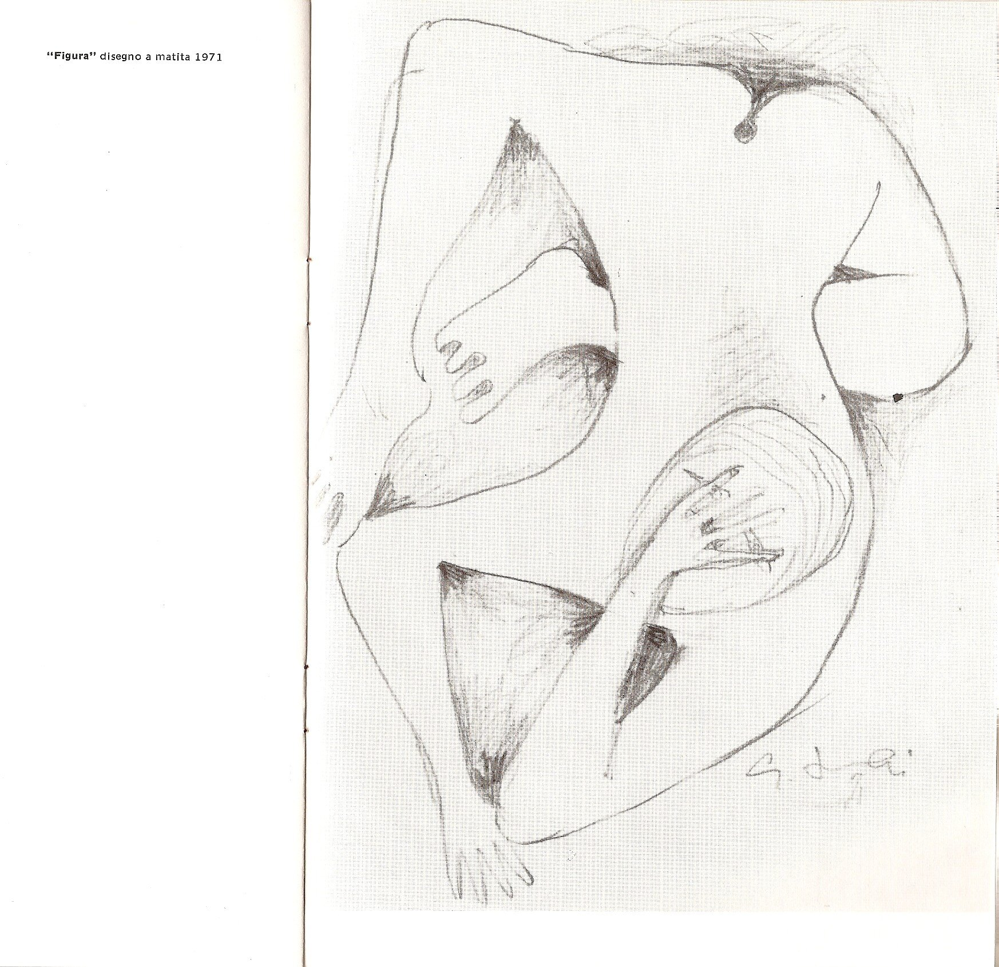
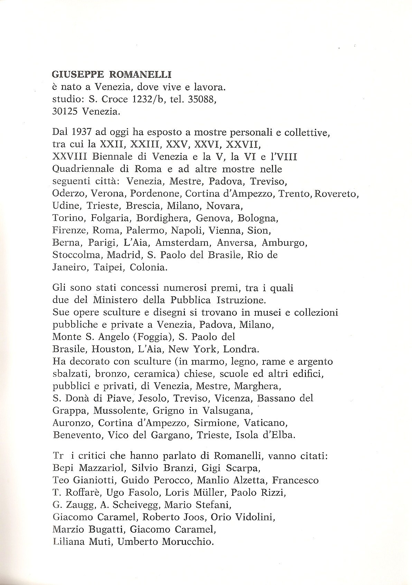

### Galleria Bevilacqua La Masa di Venezia

### dal 24 febbraio 1973

##### L’artista espone alla Galleria Bevilacqua la Masa di Venezia 20 incisioni, 80 disegni e 6 bronzi. Nella brochure di presentazione della mostra è presente un’introduzione di Berto Morucchio.

Sotto ogni pagina dell’opuscolo c’è la trascrizione del testo così come è stampato, errori di stampa compresi.

Trascrizione

GRAFICA DI\
GIUSEPPE\
ROMANELLI

DAL 24 FEBBRAIO 1973

COMUNE DI VENEZIA\
OPERA BEVILACQUA LA MASA

Trascrizione

Romanelli mi richiama gli anni prima della guerra,\
quando, pur individuandone le insidie, sembrava\
privilegiato il mondo dell’Accademia. Ma era solo perché ivi\
c’era l’abbondanza del gesso, il fiato\
della creta, si manovrava con perizia la sanguigna e\
il carbone dolce, c’erano i modelli antichi e il nudo\
e perfino quella luce d’obitorio mi sembrava ancestrale.\
E tra quei professionisti Romanelli sceglieva un\
aspetto del martinismo per contrastare la\
«fattura» micidiale della scuola (coincidenza nel nome di\
tecnica e magia).

Oggi nelle incisioni ho rivisto il suo voluto coltivare\
la fatica piuttosto che la facilità, fedele al peso\
di gravità dei corpi perché vi scopre la condizione umana.\
Ch’egli ami coronare questa spinta necessaria\
con scelte di décor, quasi la dolce chiacchiera sospenda\
un poco l’imperativo sempre doloroso del destino,\
esprime il rimedio attinto a una certa nozione di classicità.

Berto Morucchio

**Opere esposte**\
**20 incisioni, 80 disegni e 6 bronzi.**

“La coppia” disegno a matita copiativa 1970

“Figura” acquaforte e punta secca 1971

“Teste” acquaforte, bulino e acquatinta 1972

“Teste e mani” acquaforte 1972

“Figura” bulino 1972

“Allegoria” acquaforte e acquatinta 1971

“Figura” disegno a matita 1972

“Figura” disegno a matita 1971

“Figura” disegno a matita copiativa 1971

“Figura nello spazio” disegno a matita copiativa 1971

“Figura” disegno a matita copiativa 1972

Trascrizione

**GIUSEPPE ROMANELLI**\
è nato a Venezia, dove vive e lavora.\
studio: S. Croce 1232/b, tel. 35088, 30125 Venezia.

Dal 1937 ad oggi ha esposto a mostre personali e collettive, tra cui la XXII, XXIII, XXV, XXVI, XXVII, XXVIII Biennale di Venezia e la V, la VI e l’VIII Quadriennale di Roma e ad altre mostre nelle seguenti città: Venezia, Mestre, Padova, Treviso, Oderzo, Verona, Pordenone, Cortina d’Ampezzo, Trento, Rovereto, Udine, Trieste, Brescia, Milano, Novara, Torino, Folgaria, Bordighera, Genova, Bologna, Firenze, Roma, Palermo, Napoli, Vienna, Sion, Berna, Parigi, L’Aia, Amsterdam, Anversa, Amburgo, Stoccolma, Madrid, S. Paolo del Brasile, Rio de Janeiro, Taipei, Colonia.

Gli sono stati concessi numerosi premi, tra i quali due del Ministero della Pubblica Istruzione. Sue opere sculture e disegni si trovano in musei e collezioni pubbliche e private a Venezia, Padova, Milano, Monte S. Angelo (Foggia), S. Paolo del Brasile, Houston, L’Aia, New York, Londra. Ha decorato con sculture (in marmo, legno, rame e argento sbalzati, bronzo, ceramica) chiese, scuole ed altri edifici, pubblici e privati, di Venezia, Mestre, Marghera, S. Donà di Piave, Jesolo, Treviso, Vicenza, Bassano del Grappa, Mussolente, Grigno in Valsugana, Auronzo, Cortina d’Ampezzo, Sirmione, Vaticano, Benevento, Vico del Gargano, Trieste, Isola d’Elba.

Tr i critici che hanno parlato di Romanelli, vanno citati: Bepi Mazzariol, Silvio Branzi, Gigi Scarpa, Teo Gianiotti, Guido Perocco, Manlio Alzetta, Francesco T. Roffarè, Ugo Fasolo, Loris Müller, Paolo Rizzi, G. Zaugg, A. Scheivegg, Mario Stefani, Giacomo Caramel, Roberto Joos, Orio Vidolini, Marzio Bugatti, Giacomo Caramel, Liliana Muti, Umberto Morucchio.

