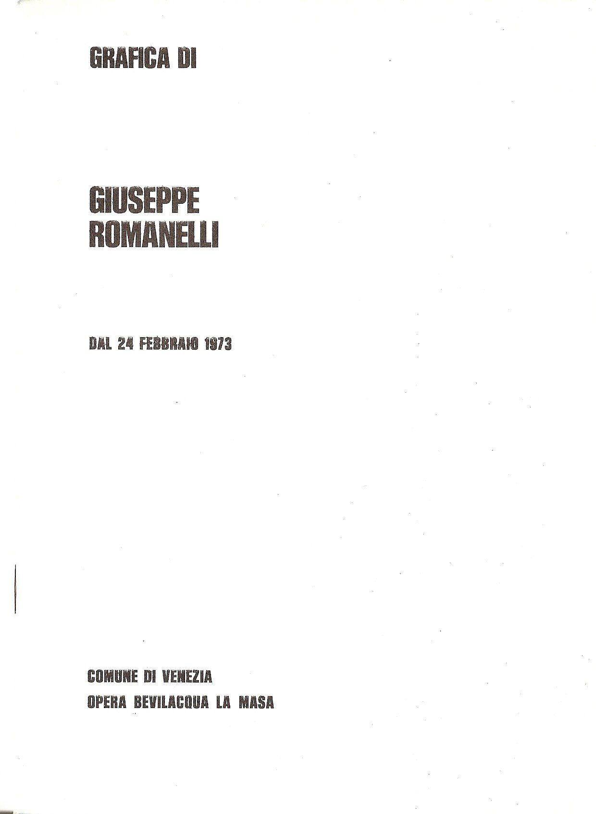
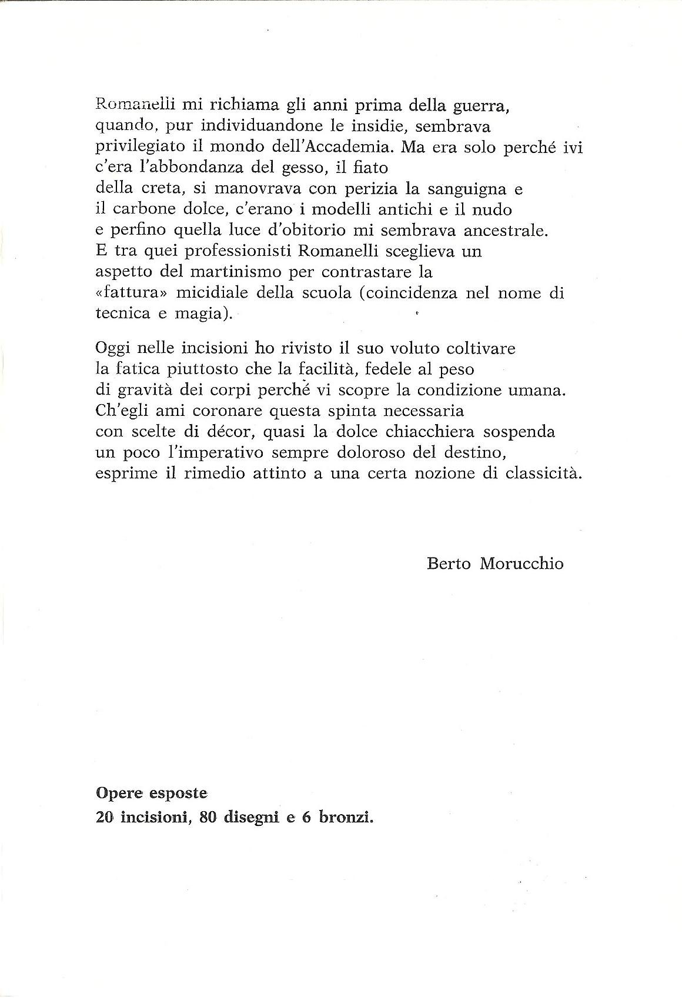
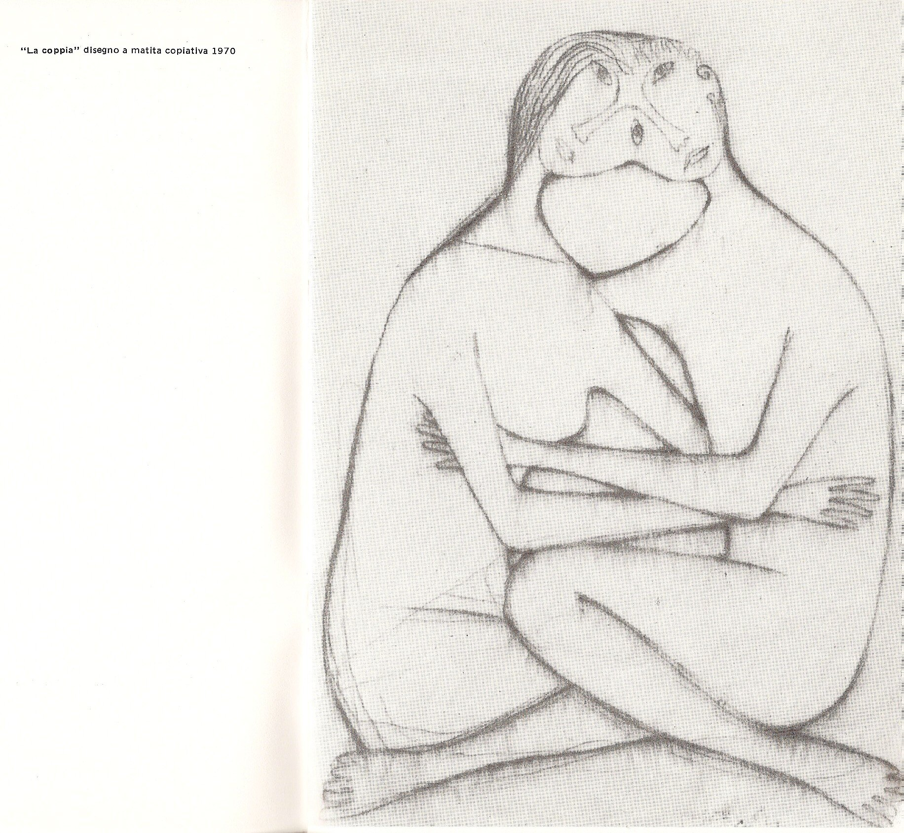
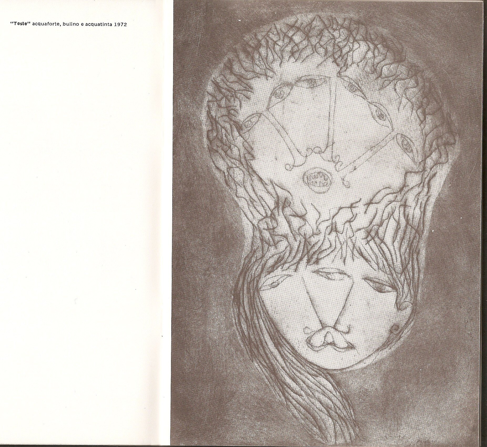
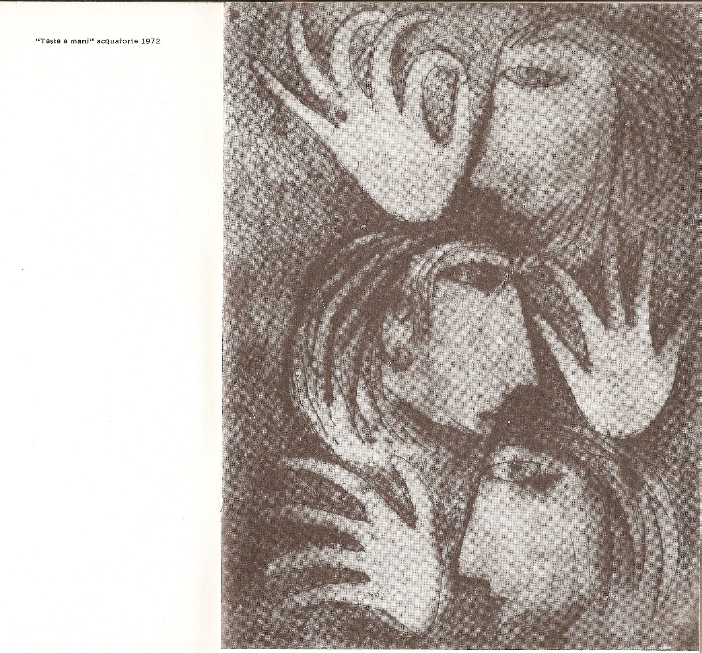
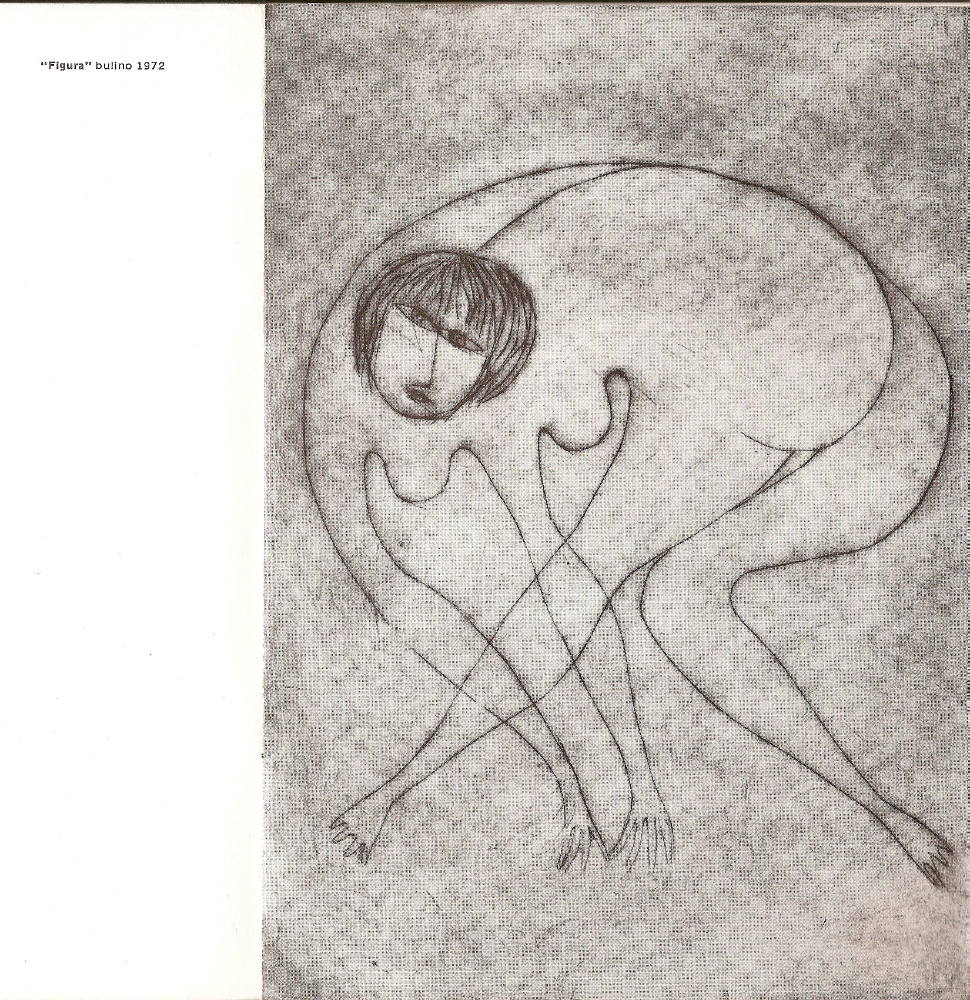
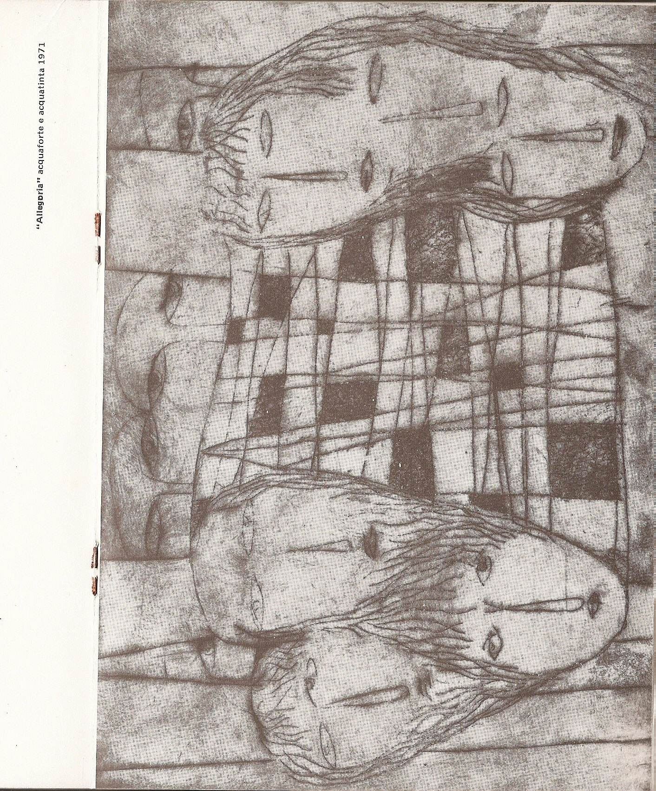
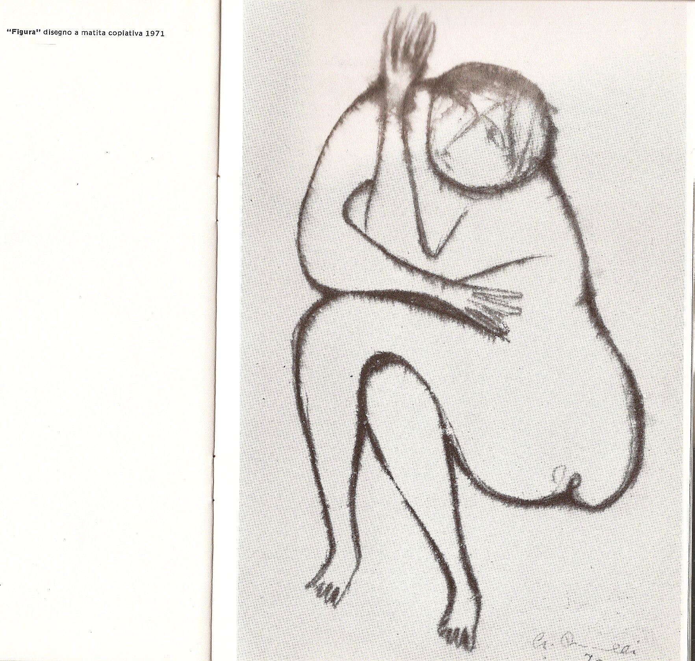
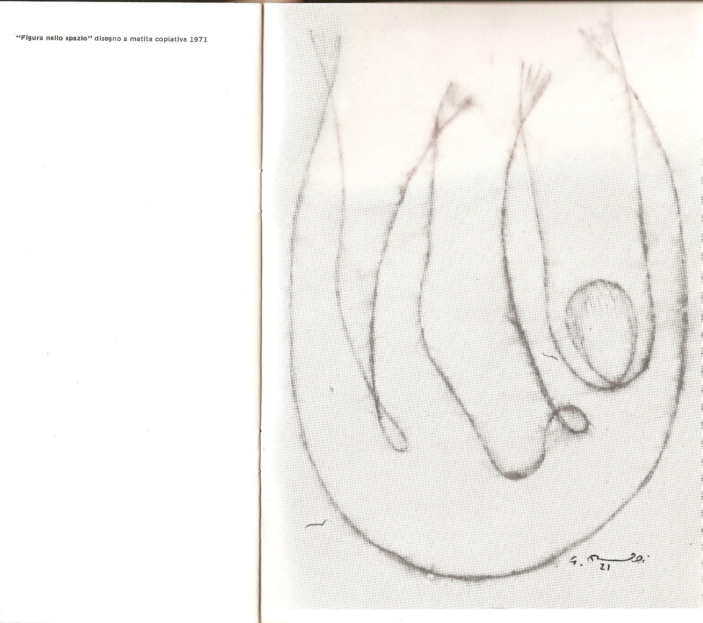
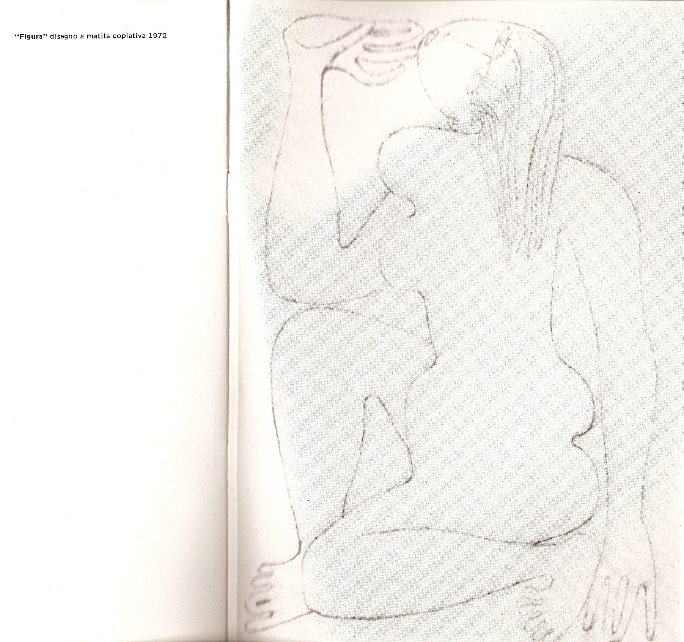

### Galleria Bevilacqua La Masa di Venezia

### dal 24 febbraio 1973

##### L’artista espone alla Galleria Bevilacqua la Masa di Venezia 20 incisioni, 80 disegni e 6 bronzi. Nella brochure di presentazione della mostra è presente un’introduzione di Berto Morucchio.

Romanelli, “Teste” acquaforte, bulino e acquatinta, 1972

Romanelli, “Teste e Mani” acquaforte 1972

Romanelli, “Figura” bulino 1972

Romanelli, “Allegoria” acquaforte e acquatinta, 1971

Romanelli, “Figura” matita 1972

Romanelli, “Figura” disegno a matita 1971

Romanelli, “Figura” disegno a matita copiativa 1971

Romanelli, “Figura” disegno a matita copiativa 1971

Romanelli, “Figura nello spazio disegno a matita copiativa 1971

