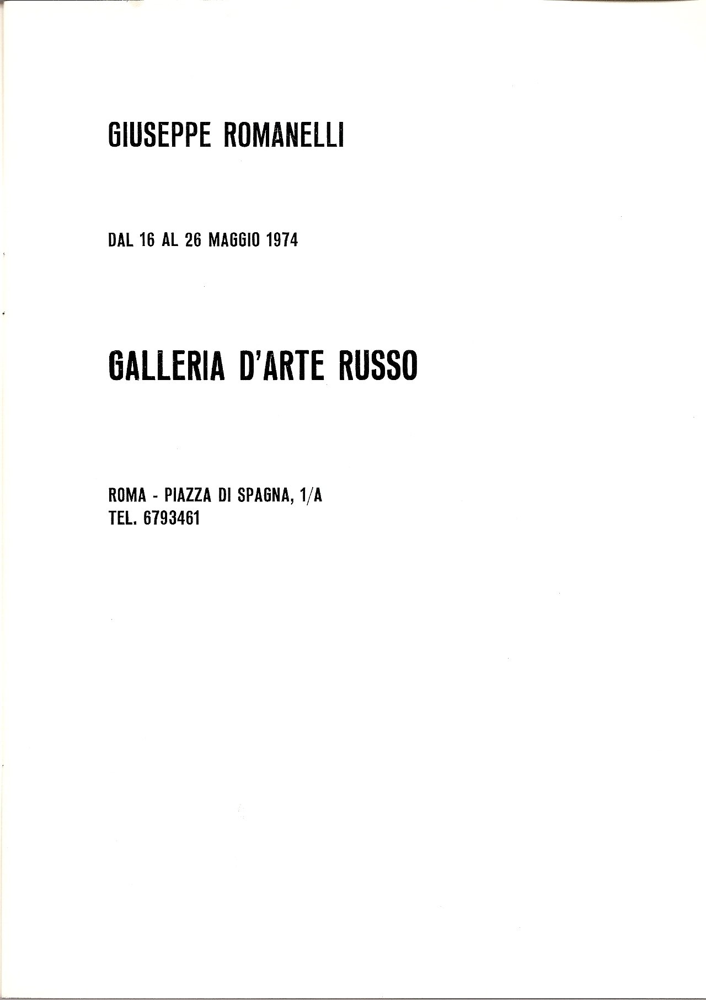
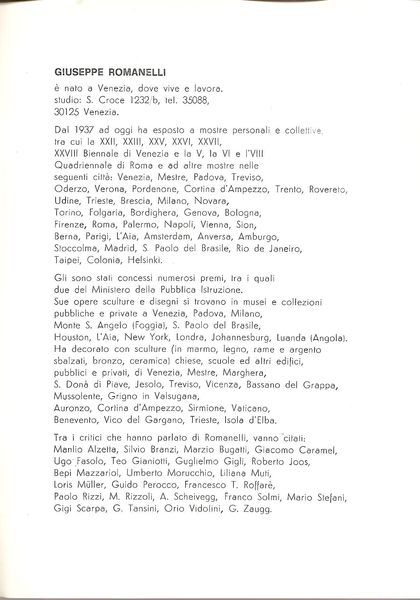
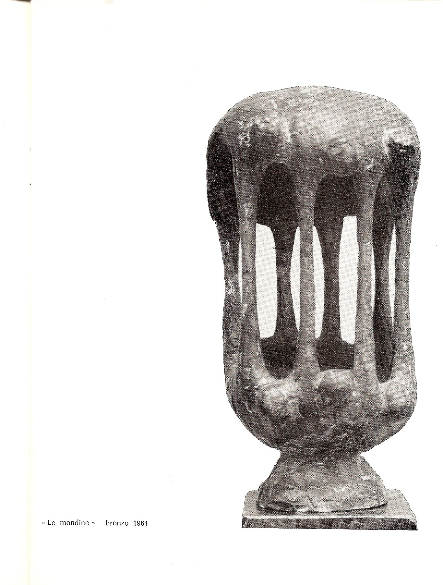
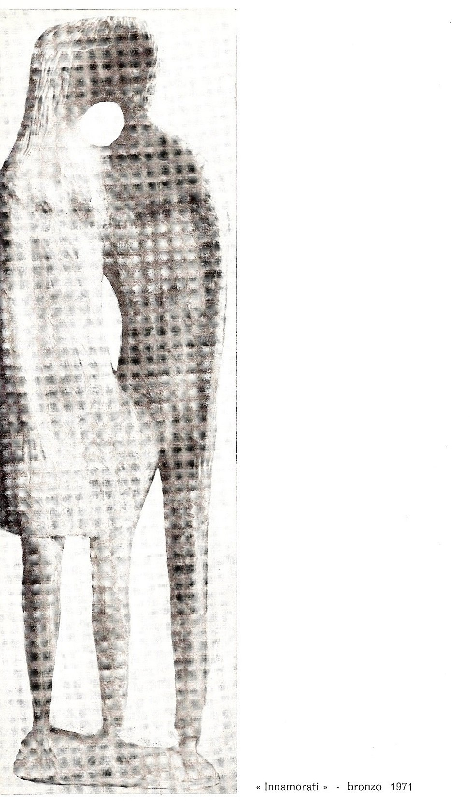
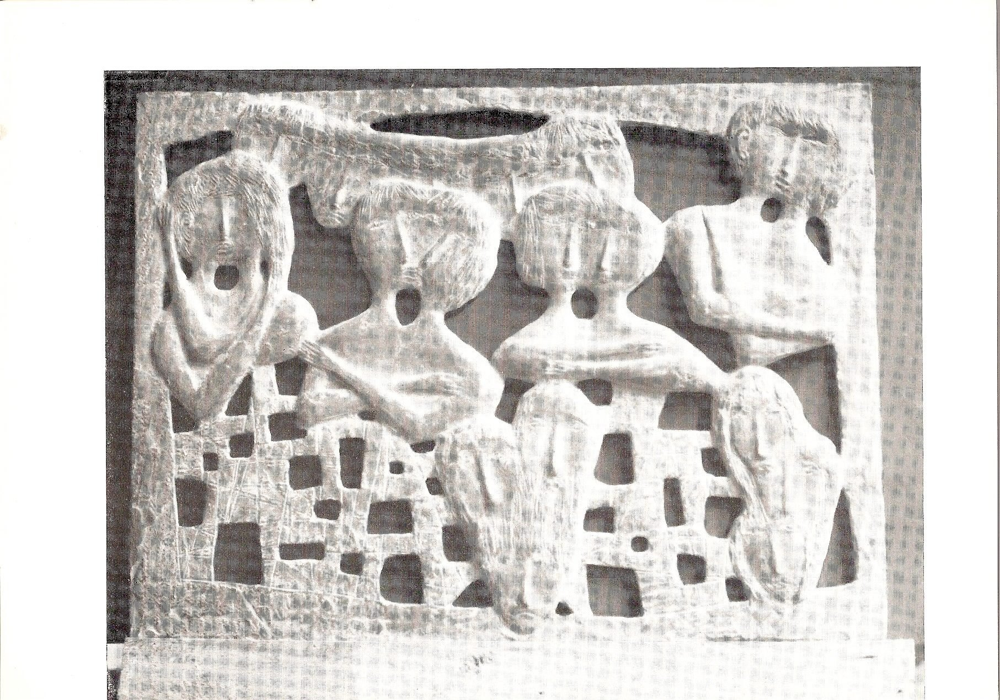
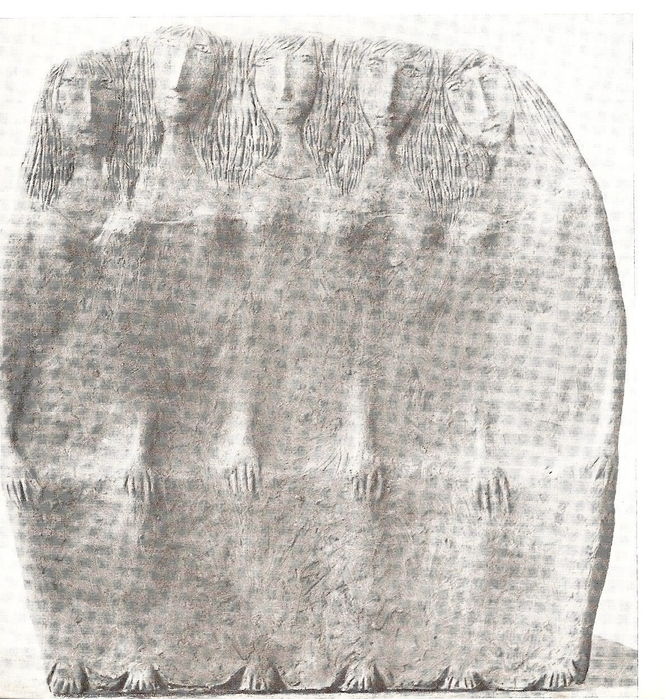
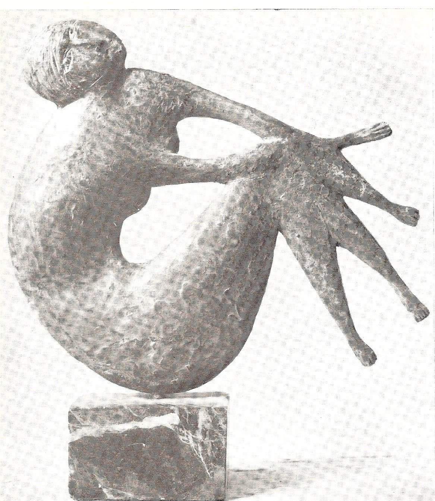
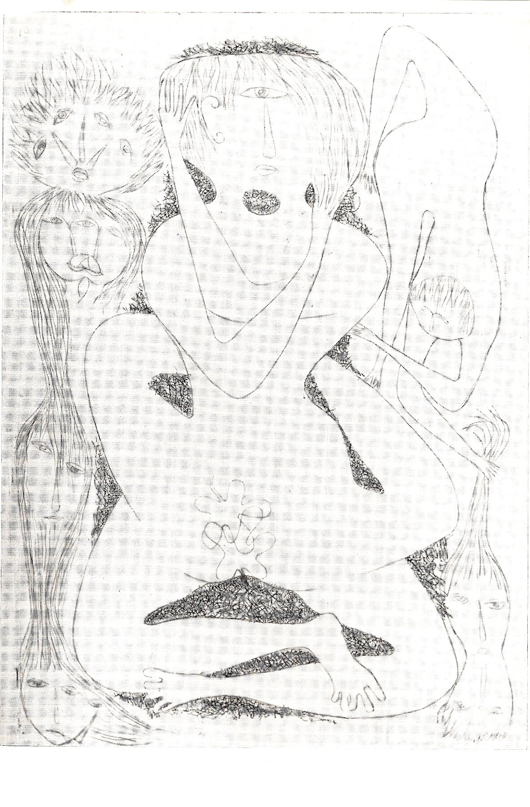

### Galleria d’Arte Russo, Roma

### dal 16 al 26 maggio 1974

##### L’artista espone alla Galleria d’Arte Russo a Roma, opere scultore e disegni. Nella brochure di presentazione della mostra è presente un’introduzione di [Guido Perocco](https://edizionicafoscari.it/media/pdf/books/978-88-6969-198-0/978-88-6969-198-0-ch-11_hrOYKIj.pdf).

Sotto ogni pagina dell’opuscolo c’è la trascrizione del testo così come è stampato, errori di stampa compresi.

Trascrizione

GIUSEPPE ROMANELLI

DAL 16 AL 26 MAGGIO 1974

GALLERIA D’ARTE RUSSO

ROMA - PIAZZA DI SPAGNA, 1/A\
TEL. 6793461

Trascrizione

Marino Marini per dare esca al temperamento infiammabile di Arturo Martini gli diceva a momento giusto: « Tu non sei uno scultore, sei un Veneto ». La vera scultura, diceva Marini, è toscana, a Venezia la scultura è decorazione di fantasia.

Qualcosa di vero si nasconde in una definizione così perentoria, detta con il mordente di un pistoiese come Marino Marini ad un veneto come Arturo Martini. A Venezia predomina una scultura d’impronta differente da quella toscana, e, in ultima analisi, possiamo dire che non spiegheremmo la varietà e la ricchezza della scultura moderna italiana se assieme alla molteplicità dei temperamenti non ci fossero degli ancestrali caratteri legati all’arte della propria terra, così varia e ricca di umori perfino contrastanti come l’Italia.

Tipicamente veneto e di grande classe è lo scultore che ora abbiamo il piacere di presentare: Giuseppe Romanelli. Romanelli ha anche lui, come un tempo Martini, una segreta adorazione per una certa scultura toscana di altissima qualità, quella del momento romanico e gotico e diciamo subito che l’immagine di questa scultura diviene forza intima nell’artista per equilibrare l’invenzione di fantasia veneta che gli nasce spontanea tra le mani, quella tendenza al racconto, tra il contemplativo e il patetico, che affiora anche negli antichi scultori di Venezia.

Giuseppe Romanelli è uno scultore meditativo: guarda un po’ di tutto con avidità fino a fare propria una forma, il suo sviluppo, le variazioni sul tema, i ricorsi plastici che questo tema sa suggerire. La sua stessa cultura, una eccezionale cultura figurativa, precisa, puntuale, ricca di immagini e di misurati raccordi, di scultore navigatissimo nella sua materia, non diviene mai dottrina a sé, non è di impedimento, essa invece favorisce a mo-

Trascrizione

mento giusto l’ispirazione con un soffio leggero che dona un incanto antico alle sue immagini d’oggi.

Egli non ha avuto timore, perciò, di affrontare anche gli antichi temi della scultura con vaste opere in chiese e in edifici pubblici. Un compito che spesso diventa arduo per uno scultore della qualità inventiva di Romanelli in rapporto alla libertà di interpretazione che oggi affidiamo all’artista. La personalità di Romanelli come artista è così varia, così duttile e raffinata, che riesce a definire la sua misura con la scultura antica: ha saputo fare propria in una città come Venezia una esperienza che gli è connaturale, aggiungendo, specie nelle sculture più recenti, una nota di quieto umorismo, un senso di gioco, che si traducono plasticamente nell’opera d’arte in una instancabile dosatura di forme spesso concepite in materie diverse: marmo, bronzo, terracotta, legno, ceramica, rame e argento sbalzati.

La sua opera di modellazione, di scavo e di rifinitura nasce da una innumerevole serie di disegni che mettono a fuoco il modellato plastico per dare alla materia un palpito di vita, il riflesso di un pensiero lungamente meditato che poi appare intatto, quasi miracolosamente alla luce. L’opera d’arte diviene dunque l’approdo e il punto d’incontro con la realtà dopo la meditazione che la scultura ed essa soltanto può suggerire nella sua genesi primitiva.

Questa stessa meditazione viene richiesta anche a noi spettatori della sua opera, perché Romanelli non cerca mai di sorprenderci, non ci tiene alla trovata, ma sa attendere anche con pazienza fino al momento in cui possiamo comprendere la sua creazione nella luce poetica che la illumina dall’interno.

Guido Perocco\
Direttore Museo d’arte moderna\
di Ca’ Pesaro - Venezia

Trascrizione

**GIUSEPPE ROMANELLI**\
è nato a Venezia, dove vive e lavora.\
studio: S. Croce 1232/b, tel. 35088, 30125 Venezia.

Dal 1937 ad oggi ha esposto a mostre personali e collettive, tra cui la XXII, XXIII, XXV, XXVI, XXVII, XXVIII Biennale di Venezia e la V, la VI e l’VIII Quadriennale di Roma e ad altre mostre nelle seguenti città: Venezia, Mestre, Padova, Treviso, Oderzo, Verona, Pordenone, Cortina d’Ampezzo, Trento, Rovereto, Udine, Trieste, Brescia, Milano, Novara, Torino, Folgaria, Bordighera, Genova, Bologna, Firenze, Roma, Palermo, Napoli, Vienna, Sion, Berna, Parigi, L’Aia, Amsterdam, Anversa, Amburgo, Stoccolma, Madrid, S. Paolo del Brasile, Rio de Janeiro, Taipei, Colonia, Helsinki.

Gli sono stati concessi numerosi premi, tra i quali due del Ministero della Pubblica Istruzione. Sue opere sculture e disegni si trovano in musei e collezioni pubbliche e private a Venezia, Padova, Milano, Monte S. Angelo (Foggia), S. Paolo del Brasile, Houston, L’Aia, New York, Londra, Johannesburg, Luanda (Angola). Ha decorato con sculture (in marmo, legno, rame e argento sbalzati, bronzo, ceramica) chiese, scuole ed altri edifici, pubblici e privati, di Venezia, Mestre, Marghera, S. Donà di Piave, Jesolo, Treviso, Vicenza, Bassano del Grappa, Mussolente, Grigno in Valsugana, Auronzo, Cortina d’Ampezzo, Sirmione, Vaticano, Benevento, Vico del Gargano, Trieste, Isola d’Elba.

Tra i critici che hanno parlato di Romanelli, vanno citati: Manlio Alzetta, Silvio Branzi, Marzio Bugatti, Giacomo Caramel, Ugo Fasolo, Teo Gianiotti, Guglielmo Gigli, Roberto Joos, Bepi Mazzariol, Umberto Morucchio, Liliana Muti, Loris Müller, Guido Perocco, Francesco T. Roffarè, Paolo Rizzi, M. Rizzoli, A. Scheivegg, Franco Solmi, Mario Stefani, Gigi Scarpa, G. Tansini, Orio Vidolini, G. Zaugg.

Romanelli, Le Mondine, bronzo 1961

Innamorati, bronzo 1971

Omaggio alla Partigiana, bronzo 1961

Innamorati, bronzo traforato 1969

Piastra, Bronzo, 1972

Figura Solare, bronzo 1972

Le amiche, bozzetto per la statua in bronzo 1972

Innamorati, bulino e acquaforte, 1972

La spiaggia, bulino 1972
