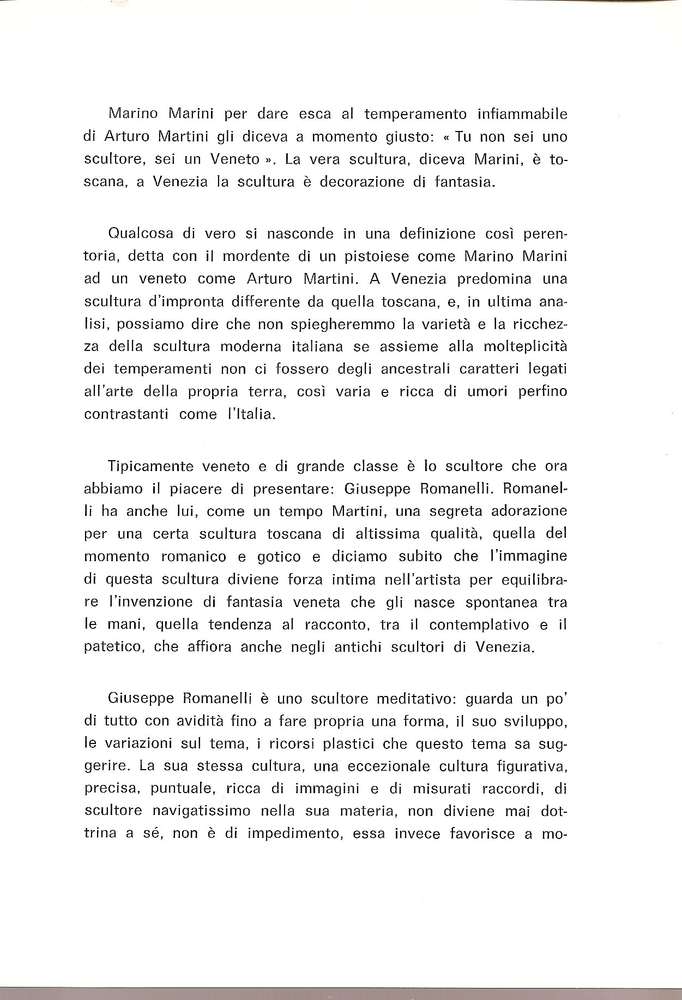
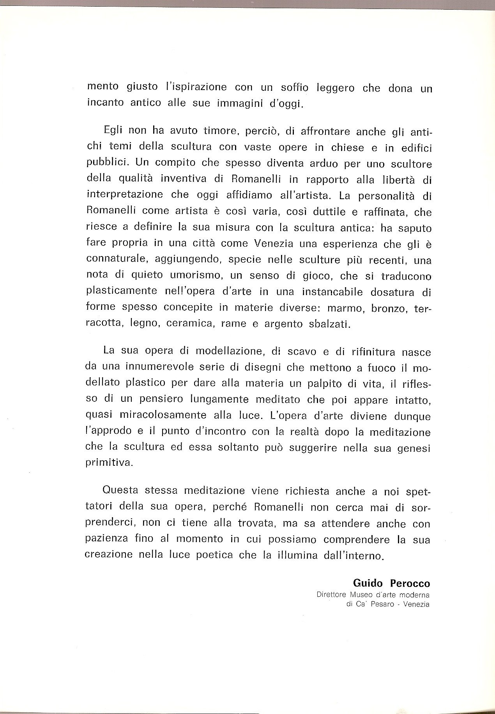
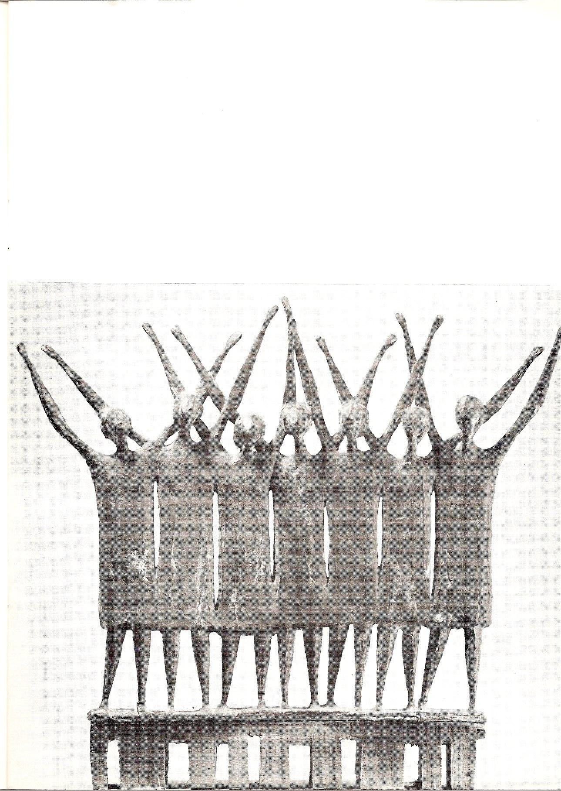
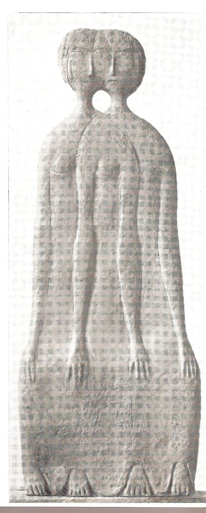
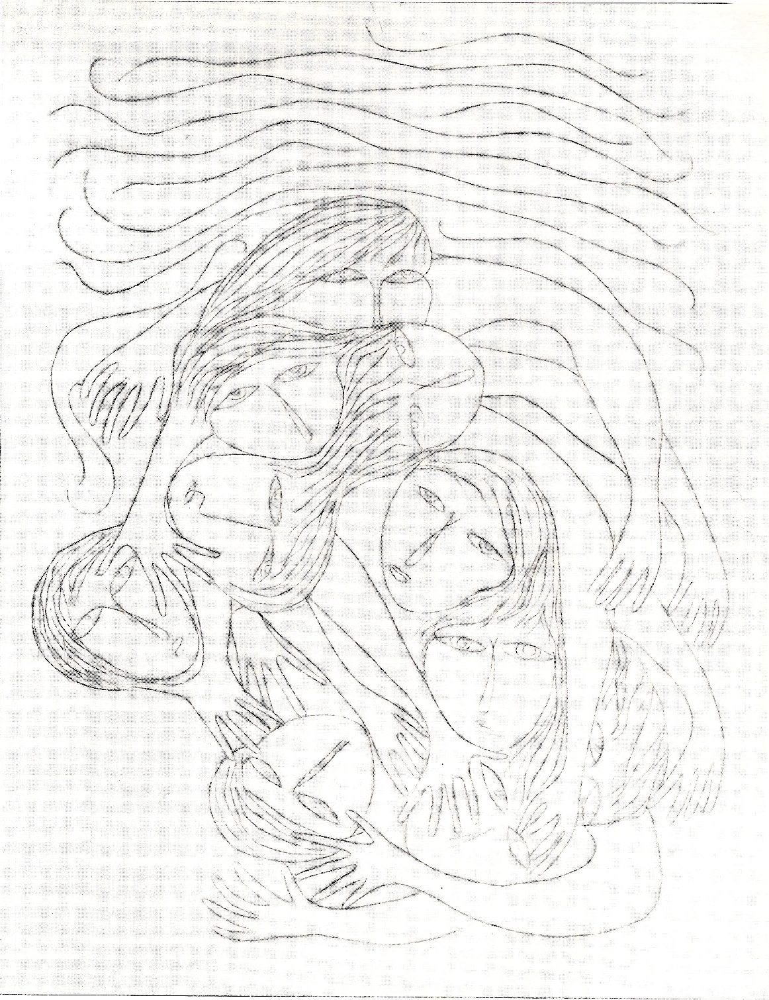
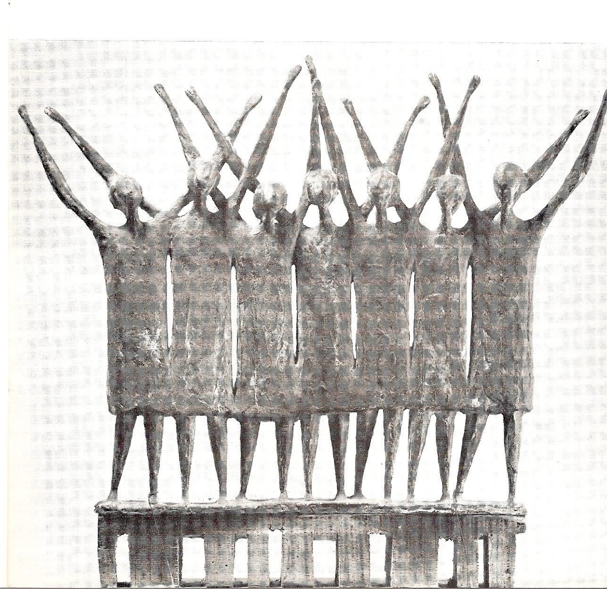

### Galleria d’Arte Russo, Roma

### dal 16 al 26 maggio 1974

##### L’artista espone alla Galleria d’Arte Russo a Roma, opere scultore e disegni. Nella brochure di presentazione della mostra è presente un’introduzione di [Guido Perocco](https://edizionicafoscari.it/media/pdf/books/978-88-6969-198-0/978-88-6969-198-0-ch-11_hrOYKIj.pdf).

Romanelli, Introduzione di Guido Perocco

Romanelli, Le Mondine, bronzo 1961

Innamorati, bronzo 1971

Omaggio alla Partigiana, bronzo 1961

Innamorati, bronzo traforato 1969

Piastra, Bronzo, 1972

Figura Solare, bronzo 1972

Le amiche, bozzetto per la statua in bronzo 1972

Innamorati, bulino e acquaforte, 1972

La spiaggia, bulino 1972

Omaggio alla Partigiana, bronzo 1961
