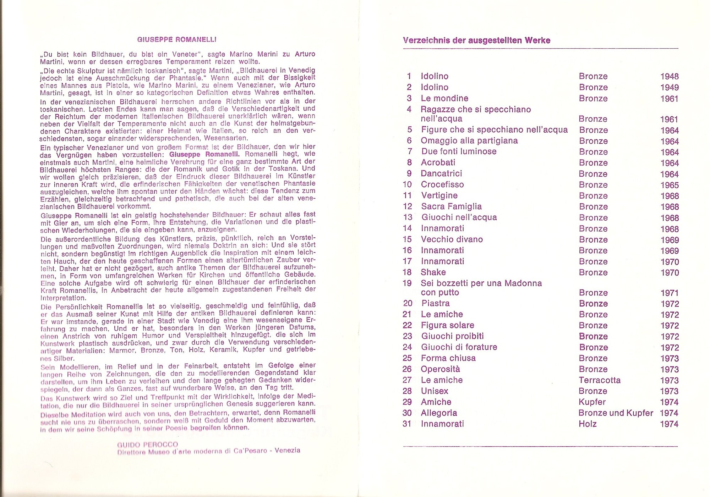

### Tonwarengesellschaft m.b.H, Klagenfurt am Wörthersee (Austria)

### dal 17 novembre al 13 dicembre 1975

##### L’artista espone alla Galleria d’Arte Tonwarengesellschaft m.b.H a Klagenfurt (in Austria) 65 opere.  Nella brochure di presentazione della mostra è presente un’introduzione di [Guido Perocco](https://edizionicafoscari.it/media/pdf/books/978-88-6969-198-0/978-88-6969-198-0-ch-11_hrOYKIj.pdf) (in tedesco).

Sotto ogni pagina del pieghevole c’è la trascrizione del testo così come è stampato, in tedesco, errori di stampa compresi. Il testo di Guido Perocco è la traduzione di quello pubblicato per la mostra di Roma del 1974.

Trascrizione

**Pagina sinistra: elenco delle opere, da 32 a 65**

| Nr. | Titel | Material und Jahr |
|---:|---|---|
| 32 | Figure che si specchiano nell’acqua | Holz 1974 |
| 33 | Idolo | Holz 1975 |
| 34 | Teste e mani | Grafik 1970 |
| 35 | Il sottosuolo | Grafik 1970 |
| 36 | Allegoria | Grafik 1971 |
| 37 | La spiaggia | Grafik 1971 |
| 38 | Innamorati | Grafik 1972 |
| 39 | I filosofi | Grafik 1972 |
| 40 | Susanna e i vecchioni | Grafik 1972 |
| 41 | Linee combinate | Grafik 1972 |
| 42 | Ventata | Grafik 1973 |
| 43 | Circuito | Grafik 1973 |
| 44 | Innamorati | Grafik 1973 |
| 45 | Malinconia | Grafik 1973 |
| 46 | Figura nello spazio | Grafik 1973 |
| 47 | Uomini a mare | Grafik 1973 |
| 48 | Timore | Grafik 1974 |
| 49 | Coincidenze | Grafik 1974 |
| 50 | Linee continue | Grafik 1974 |
| 51 | Approcci | Grafik 1974 |
| 52 | Chiaro di luna sulla spiaggia | Grafik 1974 |
| 53 | Madre e figlia | Bronze-Plakette 1950 |
| 54 | Circoncisione | Bronze-Plakette 1950 |
| 55 | Flagellazione | Bronze-Plakette 1952 |
| 56 | Annunciazione | Bronze-Plakette 1958 |
| 57 | Leon Moeca | Bronze-Plakette 1969 |
| 58 | Progresso | Bronze-Plakette 1970 |
| 59 | I filosofi | Bronze-Plakette 1970 |
| 60 | Combinazione | Bronze-Plakette 1970 |
| 61 | Confidenze | Bronze-Plakette 1970 |
| 62 | Le mani e il volto | Bronze-Plakette 1970 |
| 63 | La presenza | Bronze-Plakette 1970 |
| 64 | Cassette di sicurezza | Bronze-Plakette 1971 |
| 65 | Omaggio a Michelangelo | Bronze-Plakette 1974 |

**Pagina destra: copertina**

incontro arte

mit\
Giuseppe\
Romanelli

vom 17. November bis\
13. Dezember 1975

präsentiert von der\
Tonwarengesellschaft m.b.H.\
Klagenfurt, Mondgasse 16

Trascrizione

**Pagina sinistra: testo di Guido Perocco**

GIUSEPPE ROMANELLI

„Du bist kein Bildhauer, du bist ein Veneter“, sagte Marino Marini zu Arturo Martini, wenn er dessen erregbares Temperament reizen wollte.

„Die echte Skulptur ist nämlich toskanisch“, sagte Martini, „Bildhauerei in Venedig jedoch ist eine Ausschmückung der Phantasie.“ Wenn auch mit der Bissigkeit eines Mannes aus Pistoia, wie Marino Marini, zu einem Venezianer, wie Arturo Martini, gesagt, ist in einer so kategorischen Definition etwas Wahres enthalten.

In der venezianischen Bildhauerei herrschen andere Richtlinien vor als in der toskanischen. Letzten Endes kann man sagen, daß die Verschiedenartigkeit und der Reichtum der modernen italienischen Bildhauerei unerklärlich wären, wenn neben der Vielfalt der Temperamente nicht auch an die Kunst der heimatgebundenen Charaktere existierten: einer Heimat wie Italien, so reich an den verschiedensten, sogar einander widersprechenden, Wesensarten.

Ein typischer Venezianer und von großem Format ist der Bildhauer, den wir hier das Vergnügen haben vorzustellen: **Giuseppe Romanelli.** Romanelli hegt, wie einstmals auch Martini, eine heimliche Verehrung für eine ganz bestimmte Art der Bildhauerei höchsten Ranges: die der Romanik und Gotik in der Toskana. Und wir wollen gleich präzisieren, daß der Eindruck dieser Bildhauerei im Künstler zur inneren Kraft wird, die erfinderischen Fähigkeiten der venetischen Phantasie auszugleichen, welche ihm spontan unter den Händen wächst: diese Tendenz zum Erzählen, gleichzeitig betrachtend und pathetisch, die auch bei der alten venezianischen Bildhauerei vorkommt.

Giuseppe Romanelli ist ein geistig hochstehender Bildhauer: Er schaut alles fast mit Gier an, um sich eine Form, ihre Entstehung, die Variationen und die plastischen Wiederholungen, die sie eingeben kann, anzueignen.

Die außerordentliche Bildung des Künstlers, präzis, pünktlich, reich an Vorstellungen und maßvollen Zuordnungen, wird niemals Doktrin an sich: Und sie stört nicht, sondern begünstigt im richtigen Augenblick die Inspiration mit einem leichten Hauch, der den heute geschaffenen Formen einen altertümlichen Zauber verleiht. Daher hat er nicht gezögert, auch antike Themen der Bildhauerei aufzunehmen, in Form von umfangreichen Werken für Kirchen und öffentliche Gebäude. Eine solche Aufgabe wird oft schwierig für einen Bildhauer der erfinderischen Kraft Romanellis, in Anbetracht der heute allgemein zugestandenen Freiheit der Interpretation.

Die Persönlichkeit Romanellis ist so vielseitig, geschmeidig und feinfühlig, daß er das Ausmaß seiner Kunst mit Hilfe der antiken Bildhauerei definieren kann: Er war imstande, gerade in einer Stadt wie Venedig eine ihm wesenseigene Erfahrung zu machen. Und er hat, besonders in den Werken jüngeren Datums, einen Anstrich von ruhigem Humor und Verspieltheit hinzugefügt, die sich im Kunstwerk plastisch ausdrücken, und zwar durch die Verwendung verschiedenartiger Materialien: Marmor, Bronze, Ton, Holz, Keramik, Kupfer und getriebenes Silber.

Sein Modellieren, im Relief und in der Feinarbeit, entsteht im Gefolge einer langen Reihe von Zeichnungen, die den zu modellierenden Gegendstand klar darstellen, um ihm Leben zu verleihen und den lange gehegten Gedanken widerspiegeln, der dann als Ganzes, fast auf wunderbare Weise, an den Tag tritt.

Das Kunstwerk wird so Ziel und Treffpunkt mit der Wirklichkeit, infolge der Meditation, die nur die Bildhauerei in seiner ursprünglichen Genesis suggerieren kann.

Dieselbe Meditation wird auch von uns, den Betrachtern, erwartet, denn Romanelli sucht nie uns zu überraschen, sondern weiß mit Geduld den Moment abzuwarten, in dem wir seine Schöpfung in seiner Poesie begreifen können.

GUIDO PEROCCO\
Direttore Museo d’arte moderna di Ca’Pesaro - Venezia

**Pagina destra: Verzeichnis der ausgestellten Werke**

| Nr. | Titel | Material und Jahr |
|---:|---|---|
| 1 | Idolino | Bronze 1948 |
| 2 | Idolino | Bronze 1949 |
| 3 | Le mondine | Bronze 1961 |
| 4 | Ragazze che si specchiano nell’acqua | Bronze 1961 |
| 5 | Figure che si specchiano nell’acqua | Bronze 1964 |
| 6 | Omaggio alla partigiana | Bronze 1964 |
| 7 | Due fonti luminose | Bronze 1964 |
| 8 | Acrobati | Bronze 1964 |
| 9 | Dancatrici | Bronze 1964 |
| 10 | Crocefisso | Bronze 1965 |
| 11 | Vertigine | Bronze 1968 |
| 12 | Sacra Famiglia | Bronze 1968 |
| 13 | Giuochi nell’acqua | Bronze 1968 |
| 14 | Innamorati | Bronze 1968 |
| 15 | Vecchio divano | Bronze 1969 |
| 16 | Innamorati | Bronze 1969 |
| 17 | Innamorati | Bronze 1970 |
| 18 | Shake | Bronze 1970 |
| 19 | Sei bozzetti per una Madonna con putto | Bronze 1971 |
| 20 | Piastra | Bronze 1972 |
| 21 | Le amiche | Bronze 1972 |
| 22 | Figura solare | Bronze 1972 |
| 23 | Giuochi proibiti | Bronze 1972 |
| 24 | Giuochi di forature | Bronze 1972 |
| 25 | Forma chiusa | Bronze 1973 |
| 26 | Operosità | Bronze 1973 |
| 27 | Le amiche | Terracotta 1973 |
| 28 | Unisex | Bronze 1973 |
| 29 | Amiche | Kupfer 1974 |
| 30 | Allegoria | Bronze und Kupfer 1974 |
| 31 | Innamorati | Holz 1974 |

