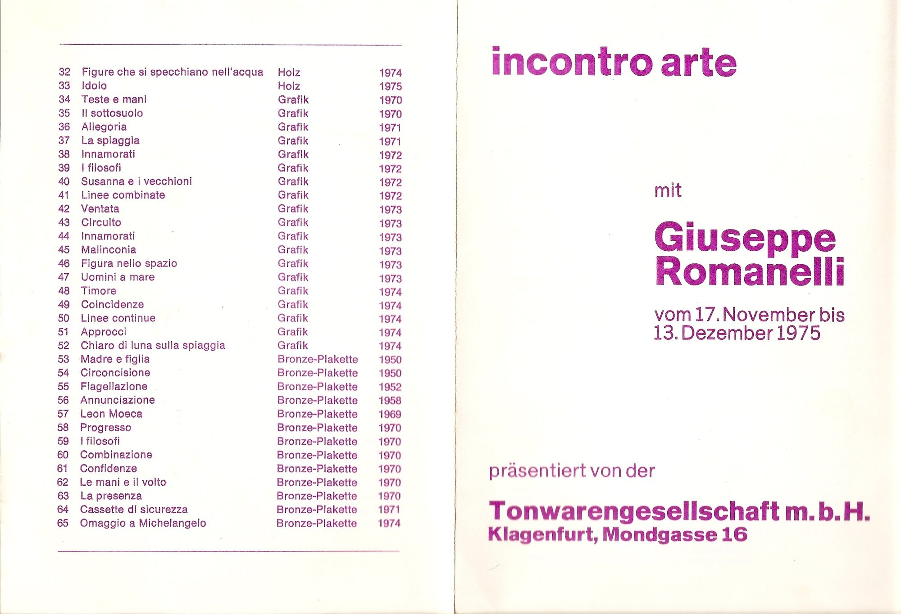

### Tonwarengesellschaft m.b.H, Klagenfurt am Wörthersee (Austria)

### dal 17 novembre al 13 dicembre 1975

##### L’artista espone alla Galleria d’Arte Tonwarengesellschaft m.b.H a Klagenfurt (in Austria) 65 opere.  Nella brochure di presentazione della mostra è presente un’introduzione di [Guido Perocco](https://edizionicafoscari.it/media/pdf/books/978-88-6969-198-0/978-88-6969-198-0-ch-11_hrOYKIj.pdf) (in tedesco).

