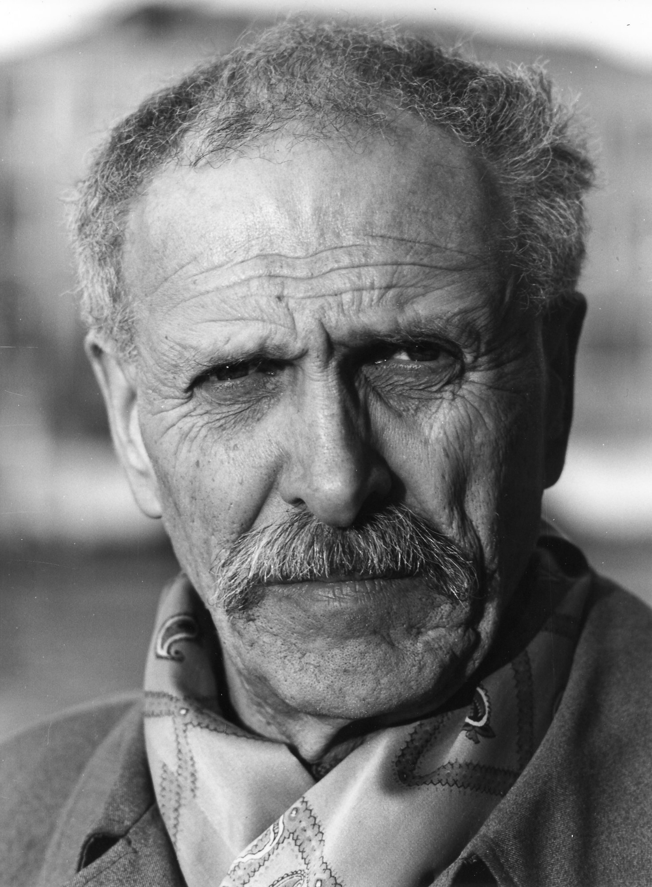

Giuseppe Romanelli nasce a Venezia il 2 marzo 1916 ed a Venezia muore il 2 luglio 1982. Fin da bambino dimostra attitudine e una grande passione per il disegno e le tecniche artistiche tanto che  a undici anni trascorre ogni suo tempo libero in una bottega di tagliapietra. Si diploma all'Accademia di Belle Arti di Venezia. Per tutta la sua vita studia qualsiasi forma d'arte antica e moderna. Era profondo conoscitore della lavorazione di ogni materiale dai legno,  al vetro, al marmo, alla fusione e sbalzo su vari metalli, alla ceramica, ecc. La sua carriera di scultore lo porta a partecipare a più Biennali d'Arte a Venezia e Quadriennali d'Arte di Roma. Ha insegnato all'Accademia di Belle arti di Venezia, alla Facoltà di Architettura di Venezia ed in altri istituti. Sue sculture, medaglie, incisioni e disegni si trovano in musei, gallerie, collezioni private ed opere pubbliche in Italia ed all'estero.

### le mostre

Dal 1937 al  1982 Giuseppe Romanelli  ha partecipato a mostre collettive, personali, nazionali ed internazionali in Italia e all’estero esponendo nelle seguenti città: Venezia,  Mestre, Jesolo, Padova, Oderzo, Pordenone, Cortina D’Ampezzo, Asiago, Trento, Rovereto, Udine, Trieste, Brescia, Milano, Novara, S.Martino di Castrozza, Norcia, Caprese Michelangelo, Arezzo, Piazzola sul Brenta, Torino, Folgaria, Bordighera, Genova, Bologna, San Remo, Rieti, Firenze, Roma, Ancona, Palermo, Napoli, Bari, Vienna, Sion, Salisburgo, Berna, Parigi, L’Aja, Amsterdam, Anversa, Amburgo, Stoccolma, Madrid, San Paolo del Brasile, Rio de Janeiro, Taipei, Colonia, New York, Helsinki, Klagenfurt, Cracovia, ecc.

Gli sono stati conferiti numerosi premi tra cui due della Pubblica Istruzione

Dall’Archivio storico d’Arte contemporanea della Biennale di Venezia si vede che a Giuseppe Romanelli, in vita, sono stati assegnati i seguenti riconoscimenti, acquisti ufficiali e premi:

- IX Mostra Sindacato Belle Arti – Venezia 1938 - Acquisto Comune di Venezia
- X Mostra Sindacato degli Artisti Veneti – Padova – Acquisto Comune di  Venezia
- Mostra Sindacato Belle Arti – Venezia 1939 – Acquisto Sindacato Belle Arti Venezia
- XI Mostra Sindacato Belle Arti – Venezia 1940 – Acquisto Comune di Venezia
- Assegnazione a Palazzo Ca’Pesaro di uno studio al piano terra sul Canal Grande-premio per il miglior scultore veneziano - 1940
- Esecuzione di un trofeo in bronzo per commissione del Ministero della cultura popolare quale premio da assegnare alla Mostra Internazionale d’Arte Cinematografica di Venezia - 1941
- Mostra Nazionale del Sindacato di Belle Arti – Milano 1941 – Acquisto Galleria Gian Ferrari
- Esecuzione di un trofeo in bronzo per commissione del Ministero della Cultura Popolare quale premio da assegnarsi alla X Mostra Internazionale d’Arte Cinematografica di Venezia – agosto 1942
- Mostra Sindacale Triveneta – Venezia,segnalato – Acquisto del Comune di Venezia
- Mostra Triveneta del Ritratto – Udine 1946 – Segnalato
- Premio per la scultura, ex-aequo con un altro scultore – Concorso Premio d’incoraggiamento ad artisti e studiosi d’Arte indetto dal Ministero della Pubblica  Istruzione – 16 Aprile 1947
- XXXV Mostra dell’Opera Bevilacqua La Masa – Venezia 1947- Segnalato – Acquisto del Ministero della Pubblica Istruzione – Acquisto per la Galleria d’ Arte Moderna di Venezia
- Premio per la scultura. Mostra Collettiva delle associazioni giovani artisti”Galleria dell’Opera Bevilacqua La Masa – Venezia 1948
- Seconda Mostra Nazionale d’Arte Sacra –Bergamo 1948 – Segnalato
- Premio per la scultura – Concorso premi di incoraggiamento ad artisti e studiosi d’arte indetto dal Ministero della Pubblica Istruzione – 16 Aprile 1948 Biennale d’Arte  triveneta – II Mostra.
- XXVI Mostra Collettiva Opera Bevilacqua La Masa –Venezia 1949 – Segnalato – Acquisto del Comune di Venezia per la galleria Internazionale di Arte Moderna di Venezia.
- XXVII Mostra Collettiva Opera Bevilacqua La Masa – Venezia 1950 – Segnalato – Acquisto del Comune di Venezia.
- Mostra Premio S.Remo di scultura,S.Remo 1952.
- Premio per la scultura nel premio d’arte sacra “Litte”di Pordenone 1953.
- Esecuzione di 12 Medaglie Premio in argento per la Mostra Internazionale Cinematografica della Biennale di Venezia 1954-1956.
- Premio Marche 1959 Palazzo degli Anziani Ancona.
- 100 bronzetti -  Commissionati per l’Istituto Federale delle Casse di Risparmio delle Venezie.
- Primo premio D’Arte Sacra S.Antonio 1961 Trieste.
- Mostra personale “Bevilacqua La Masa”- Segnalato – Acquisto Comune di Venezia 1963.
- Concorso Internazionale del bronzetto 1965 -
- Premio VIII Centenario di S.Francesco 1982
- Mostra personale,” Galleria San Vidal “ Premio San Vidal”.

Opere eseguite per edifici pubblici e religiosi:

- Due bassorilievi in pietra d’Istria  2 x 3.40 -  sistemazione del cimitero di Venezia
- “Tempesta sedata “ – bassorilievo in rame sbalzato - in memoria del primo sindaco ,dopo la liberazione  , della città di Venezia  - Cimitero di Venezia
- “Via Crucis “ -  ceramica policroma  -  chiesa di S . Giuseppe di Castello  - Venezia
- “Crocefisso “ – legno , noce di mansonia  - chiesa di S . Trovaso -  Venezia
- “Santa Rita “ – marmo bianco di Carrara – chiesa di San Luca – Venezia
- “San Giovanni Battista “ – bronzo - 1956 – chiesa di San Simeon  Profeta  (Venezia )
- “ Sant’Antonio “ – legno , noce di mansonia - (  primo premio  d’ Arte Sacra – 1961 – Triestre )  -

Chiesa di San Simeon Profeta  (Venezia )

- “Statua di Maria “ – legno – 1953 – chiesa di San Pietro Martire – Murano ( Venezia )
- Madonna di Fatima - pietra d’ Istria  - m. 3 x 3 x8  -  1956 – piazzale chiesa del  Cristo Lavoratore –Ca’ Emiliani (Venezia )
- “Tabernacolo “ – argento e rame sbalzati – 1968 – chiesa San Michele - Marghera  (Venezia )
- “Grande Crocefisso “ – legno esotico – 1968 – chiesa di San Michele – Marghera (Venezia )
- “Deposizione “ – bassorilievo in bronzo – m. 1 x 1,50 – 1948 – Stabilimento L.V.A.  – Marghera  (  Venezia )
- “ Statua di Maria “ – bronzo - m. 0,40 x 0,40 x 1,20 – Chiesa di San Camillo – Lido di  Venezia –
- “ Deposizione “ – lapide in marmo – chiesa di Sant’ Antonio – Lido di Venezia –
- “ In memoria dei caduti di Superga “ - bassorilievo in pietra d’Istria – Stadio spoertivp di Sant’Elena -  Venezia
- “ Statua di Maria “- legno , mansonia – m. o.60 x o.40 x1.00 chiesa Sant’ Ignazio – Ca’ Bianca - Lido – Venezia
- “San Giovanni Battista “ – bronzo  “Fonte battesimale “ – rame – Villaggio Sartori – Mestre

Due bassorilievi   -  pietra d’ Istria – m. 3,50 x 1.50

- “Crocefisso “ – bronzo – m. 1.80 x 1.80
- Quattro bassorilievi – pietra d’Istria – m. 0.90 x m.2.60
- “La creazione del mondo “ – 7 pannelli in bronzo
- Cinque cancelli – ferro – lavori ordinati dal Comune di Venezia per la sistemazione del  Cimitero di Mestre
- “ Redentore “ – bronzetto di Verona
- “Deposizione “ – bronzetto di Verona  - m. 1.50 x 0.70 x 2.00 – lavori ordinati dal comune  di Venezia per la sistemazione del Cimitero – Jesolo ( Venezia )
- Tarcisio , S. Francesco , S. Chiara , S. Tommaso  D’ Aquino , Santa Caterina , S. Pio X  - statue in bronzo argentato
- Crocefisso d’altare -  bronzo argentato  - Diocesi di Trento  1959 –Chiesa  Parrocchiale – Grigno   Val  Sugana
- Michele – statua in acciaio inox sbalzato –m. 0,80 x m.0,80 x m. 4.00 -campanile della chiesa di S. Michele  -  Quarto d’ Altino ( Venezia )
- “Deposizione“, “Ultima cena“, “Fede“, ”Speranza“, “Carità“ – bassorilievo in rame ed argento sbalzati
- “S. Giovanni Battista“ – statua in bronzo – Chiesa dell’Ospedale Civile – San Donà di Piave (Venezia)
- “La scuola“ – bassorilievo in rame sbalzato – m.8.50 x m.2.00 – Scuola Media Fuori Porta Piave
- “Madonna con Bambino“ – legno , mansonia – Chiesa Parrocchiale Stretti di Eraclea ( Venezia )
- “Studentesse“ – statua in bronzo – m.0.70 x m. 0.70 x m. 2.00 – Scuola Media ”Stefanini“ – Bassano del  Grappa  ( Vicenza )
- Bassorilievo - argento sbalzato  con incastonature di pietre dure e oro  - Chiesa Parrocchiale – Mussolente  ( Treviso )
- “La Vergine e Santa Bernardette“ - marmo -

Altare

- Tabernacolo con cinque santi e crocefisso  - rame argentato – Grotta di Lourdes – Villa Piccola – Auronzo
- “Crocefisso“ – legno , tiglio – m. 1,80 x m. 2.00
- “I simboli dei quattro  evangelisti  e SS. Sacramento“  – bassorilievo  - argento sbalzato con incastonature di pietre dure  - Convento dei Frati Cappuccini - Vico del Gargano –

Sue opere si trovano :

- Galleria Internazionale d’Arte Moderna – Ca’ Pesaro – Venezia
- Collezione Rosi Frontini - S.Paolo del Brasile
- Museo Reale Numismatico – L’ Aya – Olanda
- Museo della medaglia - Cracovia -  Polonia

In numerose collezioni private  nel mondo

I figli custodiscono più di duecento sculture in diversi materiali e centinaia di disegni e incisioni.
