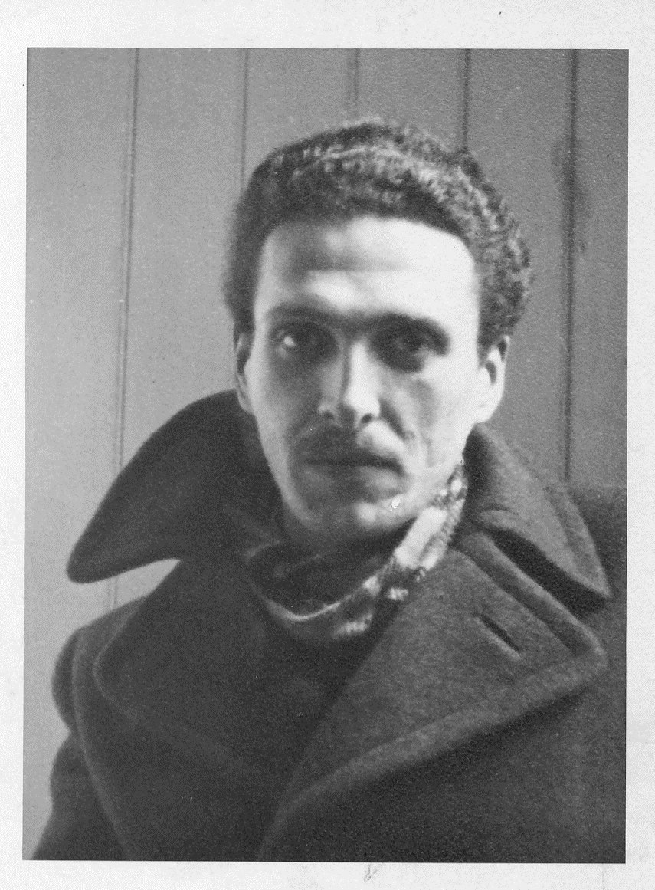

Giuseppe Romanelli scolpisce e disegna da quando, ancora bambino, imparava i primi segreti tecnici nella bottega di un severo scalpellino e contemporaneamente studiava all’istituto d’Arte dei Carmini (Venezia) dove si è diplomato, poi  il Magistero e all’Accademia delle Belle Arti di Venezia, sotto la guida dei Maestri Belletto, Baglioni e Martini.

Molto importante è per lui l’incontro con Arturo Martini, incide molto sulla sua formazione.

Nel frattempo Marino Marini vede occasionalmente le sue opere e ne elogia la misura e la capacità di sintesi.

Si diploma all’Istituto d’Arte dei Carmini (Venezia), all’Accademia delle Belle Arti (Venezia).

Docente: Istituto d’Arte dei Carmini, all’Accademia delle Belle Arti di Venezia, all’Istituto Universitario di Architettura (Venezia), all’Istituto Magistrale di Mestre (Venezia) e in altre scuole e istituti.

Sue Mostre: Fin dal 1937 ha partecipato a mostre collettive, personali, nazionali e internazionali in Italia e all’estero, alle Biennali di Venezia, alle Quadriennali di Roma e alle seguenti mostre: Venezia, Mestre, Jesolo, Padova, Oderzo, Pordenone, Cortina d’Ampezzo, Asiago, Trento, Rovereto, Udine, Trieste, Brescia, Milano, Novara, S. Martino di Castrozza, Norcia, Caprese Michelangelo, Arezzo, Piazzola sul Brenta, Torino, Folgaria, Bordighera, Genova, Bologna, San Remo, Rieti, Firenze, Roma, Ancona, Palermo, Napoli, Vienna, Sion, Salisburgo, Berna, Parigi, L’Aya, Amsterdam , Anversa, Amburgo, Stoccolma, Madrid, San Paolo del Brasile, Rio de Janeiro, Taipei, Colonia, New York, Helsinki, Klagenfurt, Cracovia, ecc.

Gli sono stati concessi numerosi premi tra i quali due della Pubblica Istruzione.

Dall’Archivio Storico d’Arte Contemporanea della Biennale di Venezia risulta che lo scultore Giuseppe Romanelli di Venezia ha avuto nella sua attività di artista i seguenti riconoscimenti, acquisti ufficiali e premi.

1. IX Mostra Sindacato Belle Arti – Venezia 1938 – Acquisto Comune di Venezia.
2. X Mostra Sindacato degli Artisti Veneti – Padova – Acquisto Comune di Venezia.
3. Mostra Sindacato belle Arti – Venezia 1939 – Acquisto Sindacato Belle Arti Venezia.
4. XI Mostra Sindacato Belle Arti – Venezia 1940 – Acquisto Comune di Venezia.

Nel 1940 gli viene assegnato in premio (al Palazzo Cà Pesaro il grande studio sul Canal Grande) per il miglior scultore veneziano.

5. Esecuzione di un trofeo in bronzo per commissione del Ministero della cultura popolare quale premio da assegnare alla Mostra Internazionale d’Arte Cinematografica di Venezia, settembre 1940.
6. Mostra Nazionale del Sindacato di belle Arti – Milano 1941 – Acquisto Galleria Gian Ferrari.
7. 7° Esecuzione di un trofeo in bronzo per commissione del Ministero della cultura popolare quale premio da assegnarsi alla X 0 Mostra Internazionale d’Arte Cinematografica di Venezia – Agosto 1942.
8. Mostra Sindacale Triveneta – Venezia, segnalato – Acquisto del Comune di Venezia.
9. XXXV Mostra dell’Opera Bevilacqua “La Masa” – Venezia 1947- Segnalato – Acquisto del Ministero della Pubblica istruzione – Acquisto per la Galleria Internazionale d’Arte Moderna di Venezia.
10. Mostra Triveneta del Ritratto – Udine 1946 – Segnalato.
11. Seconda Mostra Nazionale d’Arte Sacra – Bergamo 1948 – Segnalato.
12. Premio per la scultura, Mostra Collettiva delle associazioni giovani artisti “Galleria dell’Opera Bevilacqua La Masa ” – Venezia 1948.
13. Premio per la scultura ex equo con un altro scultore – Concorso Premio d’incoraggiamento ad artisti e studiosi d’Arte indetto dal Ministero della Pubblica Istruzione – 16 Aprile 1947.
14. Premio per la scultura – Concorso premi d’incoraggiamento ad artisti e studiosi d’arte indetto dal Ministero della Pubblica Istruzione – 16 Aprile 1948 Biennale d’Arte Triveneta – II Mostra.
15. XXVI Mostra Collettiva Opera “Bevilacqua La Masa” – Venezia. Segnalato Acquisto del Comune di Venezia per la galleria Internazionale di Arte Moderna di Venezia.
16. XXXVII Mostra Collettivo. Opera “Bevilacqua La Masa” – Venezia 1950 – Segnalato – Acquisto dal Comune di Venezia.
17. Mostra Premio S. Remo di scultura, S. Remo 1952.
18. Premio per la scultura nel premio d’arte sacra “Litte” di Pordenone 1953.
19. Esecuzione di 12 Medaglie Premio in argento per la Mostra Internazionale Cinematografica della biennale di Venezia.

1954 – 1956.

20. Premio Marche 1959 Palazzo degli Anziani Ancona.
21. Esecuzione 100 bronzetti Commissionati per l’Istituto Federale delle Casse di risparmio delle Venezie.
22. Primo premio d’Arte Sacra A. Antonio 1961 Trieste, Maggio e Luglio
23. Mostra Personale “Bevilacqua La Masa” – Segnalato – Acquisto Comune di Venezia 5 Ottobre 1963.
24. Concorso Internazionale del Bronzetto 1965 – Padova
25. Premio VIII Centenario di San Francesco 1982.
26. Mostra personale, Galleria San Vidal “Premio San Vidal”, U.C.A.I. II0 Edizione d’Arte Sacra per la casa, ricevimento premio e acquisto, assegnato al segretario della gioventù 1966
27. Associazione Diplomati Accademia Belle Arti di Venezia 1970.
28. Allegato al questionario biografico per il Dictionary Of International Biography

Sue opere figurano nelle seguenti Gallerie e Collezioni:

- Collezione Ettore Gianferrari – Milano una scultura
- Collezione Manlio Cappellin Venezia – una scultura
- Collezione Ferruccio Asta – Venezia – una scultura
- Collezione Comm. Giorgio Cecato (Pastorelli di Fatima)
- Collezione Dott. Frattina – Venezia – n. 1 disegno
- Italico Bras – Venezia – n. 1 scultura
- Carrain – Venezia – n. 1 disegno
- Giulio Meneghetti – Padova – n.l scultura e n. 3 disegni
- Aldo Zannini – Nizza Monferrato – n.2 disegni e n. 2 acqueforti.
- Comune di Venezia – ritratto Fulvia – bronzo del 1939
- Galleria Ettore Gianferrari – Venezia – bronzo
- Galleria Sandri – Venezia – Deposizione – terracotta
- Conte Volpi di Misurata – Venezia – una terracotta 1940
- Eugenio Zannini – Padova – n.4 terracotta e n. 3 bronzi.
- Rosi Barba Fratini – San Paolo del Brasile – n.l scultura
- Comune di Venezia – bronzo – Trofeo premio alla Mostra Biennale di Venezia 1941
- Romano – Venezia – n. Terracotta (la sonambola)
- Walter Marini Giorgio – terracotta del 1942 Risveglio, la sfinge, chiaro di luna
- Galleria d’Arte Internazionale Moderna n. 2 sculture Venezia
- Galleria d’Arte Moderna – Cà Pesaro – Venezia – omaggio alla partigiana undici disegni a matita e alcuni ritratti
- Cassa di Risparmio – Agenzia n. 1,14 – pannelli in argento sbalzato
- Sovraintendenza alle Belle Arti – Venezia – terracotta – contemplazione
- Galleria Internazionale d’Arte – bronzo, nudino 1944 Duca D’Aosta – Campo san Felice – Venezia – una scultura in pietra d’Istria – Amanti a Venezia, un grande bassorilievo in rame sbalzato (storia della caccia) – Venezia
- Alfredo Zannini – Padova – Crocifissione – Terracotta
- Lorenzo e Alda Ruzzante – Duna Fiorita (Caorle) – terracotta vetrinata – innamorati a Venezia
- Stabilimento I.L.V.A. Marghera – Venezia – bronzo bassorilievo – deposizione
- Monsignor Prof. Don Ilario Quntarelli – Venezia – una scultura in legno (Annunciazione del 1955)
- Cassa di Risparmio sede centrale – S. Luca – due bassorilievi, in rame e ottone sbalzati con elementi in oro e argento
- San Paolo del Brasile – Collezione Rosi Frontini – bassorilievo n terracotta (resurrezione della carne)

**Importanti opere eseguite per edifici pubblici e religiosi si trovano a Venezia oltre quelli soprannominati:**

- Cimitero di Venezia – lavori ordinati dal Comune per la sistemazione del cimitero.
- Due basso rilievi in pietra d’Istria mt. 2 X 3.40 l’uno. Un bassorilievo in rame sbalzato “tempesta sedata” mt.1.10 X 2.50 in memoria del primo Sindaco della città di Venezia dopo la liberazione.
- Chiesa di S. Giuseppe    di Castello “Via  Crucis”  in ceramica policroma, un crocefisso in legno.
- Chiesa di San Trovaso” Crocefisso” in legno di Mansonia.
- Chiesa di San Luca statua di “Santa Rita” in marmo bianco di Carrara.
- Chiesa di San Simeone Profeta, statua di San Giovanni Battista” in bronzo, statua di “S. Antonio” in legno di Mansonia.
- Murano (Venezia) Chiesa di San Pietro Martire, statua di “Maria” in legno del 1953.
- Burano (Venezia) Nuova Scuola Media, statua   in bronzo “le scolare” mt. O.BO X 0.40 X 2.00
- Marghera (Venezia) Piazzale Cà Emiliani, grande gruppo scultoreo in pietra di Verona mt. 3 X 3 X 8
- Chiesa San Michele, Tabernacolo in argento e rame sbalzati Grande “Crocifisso” in legno Arquà 1948.
- Stabilimento ILVA Marghera (VE)- bassorilievo in bronzo mt. 1.00 X 1.50 – 1948
- Lido di Venezia – Chiesa di San Camillo “Statua di Maria” in bronzo mt. 0.40 X 0- 40 X 1.20
- Chiesa di San Antonio al Lido di Venezia – scultura in marmo – deposizione.
- Stadio sportivo di S. Elena – Venezia – un bassorilievo in pietra d’Istria. In memoria dei caduti di Superga.
- Chiesa Cà Bianca, statua di “Maria” in legno di Mansonia mt. 0.60 X 0.40 X 1.00
- Mestre (Venezia) Villaggio Sartori – “San Giovanni Battista” in bronzo con fonte battesimale in rame,                (Cimitero            di            Mestre Venezia – lavori ordinati dal Comune di Mestre – Venezia – per la sistemazione del cimitero stesso) – due grandi bassorilievi in pietra d’Istria mt. 3.50 X   50, un “Crocefisso” in bronzo mt. 1.80 X 1.80, quattro bassorilievi in pietra d’Istria mt. 0.90 X 2.60 a decorazione della cella mortuaria.
- Jesolo (Venezia) – Cimitero – lavori ordinati dal Comune per la sistemazione del cimitero; Due statue in bronzetto di Verona “Redentore”, “Deposizione” m. 1.50 X m. 0.70 X m. 2.00 /
- Diocesi di Trento – 6 statue in bronzo argentato, raffiguranti S.Tarcisio, S. Francesco, S. Chiara, San Tommaso D’Aquino, Santa Caterina., San Pio X e un crocefisso d’altare Opere commissionate    dal rev.mo          Don Giovanni     Battista Mezzi della diocesi di Trento 1959.
- Quarto D’Altino (Venezia), chiesa di San Michele (campanile) Statua in acciaio inox sbalzato m. 0.80 X m. 0.80 X m. 4.00.
- San Donà di Piave (Venezia): Chiesa dell’Ospedale Civile bassorilievo            in rame e argento sbalzati “Deposizione”,             “Ultima Cena”, “Fede”, “Speranza”, “Carità'” e statua di San Giovanni Battista” in bronzo.
- Treviso: Scuola Media Fuori Porta Piave, bassorilievo in rame sbalzato m. 8.50 X m. 1.50.
- Stretti D’Eraclea. – Chiesa parrocchiale Madonna con bambino – legno Mansonia
- Bassano del Grappa (Vicenza) Scuola Media “Stefanini”: statua in bronzo m 0.70 X m. 0.70 X m. 2.00.
- Mussolente (Treviso):             Chiesa   Parrocchiale,      bassorilievo        in argento sbalzato con castonature in pietre dure e oro.
- Grigno in Valsugana Chiesa Parrocchiale: sei statue di Santi (in bronzo argentato), “Crocefisso” in bronzo argentato,
- Auronzo Villa Piccola: Grotta di Lourdes, La Vergine e Santa Bernadette in marmo, Altare, Tabernacolo con cinque Santi e crocefisso (rame argentato),
- Vaticano (Roma) Cappella privata di Papa Giovanni XXIII: Paliotto d’Altare in argento sbalzato e rame con incastonatura pietre dure su fondo di rame, reca   in argento, attorno all’immagine del Salvatore, le figure dei veneziani Beato Gregorio Barbarigo, San Pietro Orseolo, San Pio X, San Lorenzo Giustiniani;
- Benevento: Chiesa Santa Sofia, statua di “San Giovanni Battista” (bronzo) Cinque bassorilievi: Ultima Cena, le Virtù Teologali (rame sbalzato).
- Trieste: Sede Provinciale dell’I.N.P.S.: Bassorilievo in bronzo m 1.30 X 2.40
- Vico del         Gargano (Foggia) Convento         dei         frati       cappuccini: “Crocefisso in legno di tiglio m 1.80 X m. 2.00, bassorilievo con i simboli degli Evangelisti e SS. Sacramento in argento sbalzato con castonature in pietra dura.
- Aya (Olanda), Museo Reale Numismatico, medaglia in bronzo “La Flagellazione” del   1940;
- Rio De Janeiro, bassorilievo in terracotta.
