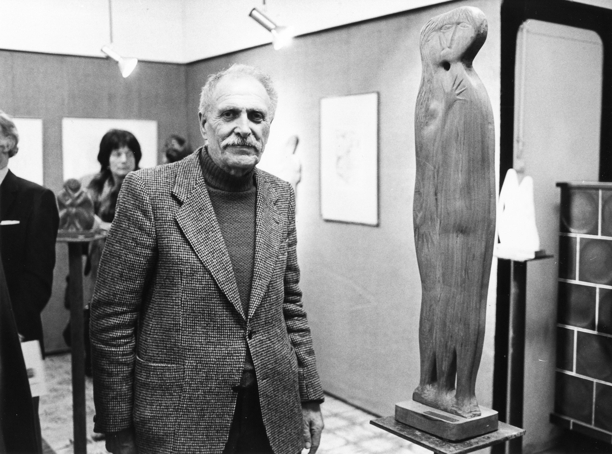

Dal 1937 fino alla morte ha esposto a mostre personali e collettive, tra cui la [Biennale di Venezia](https://web.archive.org/web/20220626083013/http://asac.labiennale.org/it/passpres/artivisive/sem-ricerca.php?Spersona=377554) e la [Quadriennale di Roma](https://web.archive.org/web/20241005181435/http://www.quadriennalediroma.org/arbiq_web/index.php?sezione=artisti&id=9683&ricerca=romanelli) e ad altre mostre nelle seguenti città: Venezia, Mestre, Padova, Treviso, Verona, Pordenone, Cortina d’Ampezzo, Trento, Udine, Trieste, Brescia, Milano, Novara, Torino, Genova, Bologna, Firenze, Roma, Palermo, Vienna, Sion, Berna, Parigi, L’Aia, Amsterdam, Anversa, Amburgo, Stoccolma, Madrid, S. Paolo del Brasile, Rio de Janeiro, Taipei.

Di seguito sono elencate, in ordine cronologico, le mostre dell’artista di cui si è conservata traccia o materiale grafico con il dettaglio delle opere esposte e la presentazione delle mostre.

- [XXII Biennale di Venezia](https://web.archive.org/web/20220626073926/http://asac.labiennale.org/it/passpres/artivisive/annali.php?m=14&c=l&a=377554)
- [XXIII Biennale di Venezia](https://web.archive.org/web/20220625162959/http://asac.labiennale.org/it/passpres/artivisive/annali.php?m=17&c=l&a=377554)
- [XXV Biennale di Venezia](https://web.archive.org/web/20220625180017/http://asac.labiennale.org/it/passpres/artivisive/annali.php?m=228&c=l&a=377554)
- [XXVI Biennale di Venezia](https://web.archive.org/web/20220625165249/http://asac.labiennale.org/it/passpres/artivisive/annali.php?m=229&c=l&a=377554)
- [XXVII Biennale di Venezia](https://web.archive.org/web/20220625172458/http://asac.labiennale.org/it/passpres/artivisive/annali.php?m=27&c=l&a=377554)
- [XXVIII Biennale di Venezia](https://web.archive.org/web/20220625175730/http://asac.labiennale.org/it/passpres/artivisive/annali.php?m=230&c=l&a=377554)
- [V Quadriennale di Roma](https://web.archive.org/web/20241005181435/http://www.quadriennalediroma.org/arbiq_web/index.php?sezione=artisti&id=9683&ricerca=romanelli)
- [VI Quadriennale di Roma](https://web.archive.org/web/20241005181435/http://www.quadriennalediroma.org/arbiq_web/index.php?sezione=artisti&id=9683&ricerca=romanelli)
- [VII Quadriennale di Roma](https://web.archive.org/web/20241005181435/http://www.quadriennalediroma.org/arbiq_web/index.php?sezione=artisti&id=9683&ricerca=romanelli)

*I collegamenti alle schede dell'Archivio storico della Biennale (ASAC) e dell'Archivio della Quadriennale di Roma puntano a copie salvate su archive.org: le pagine originali non sono più consultabili sui siti degli enti.*
