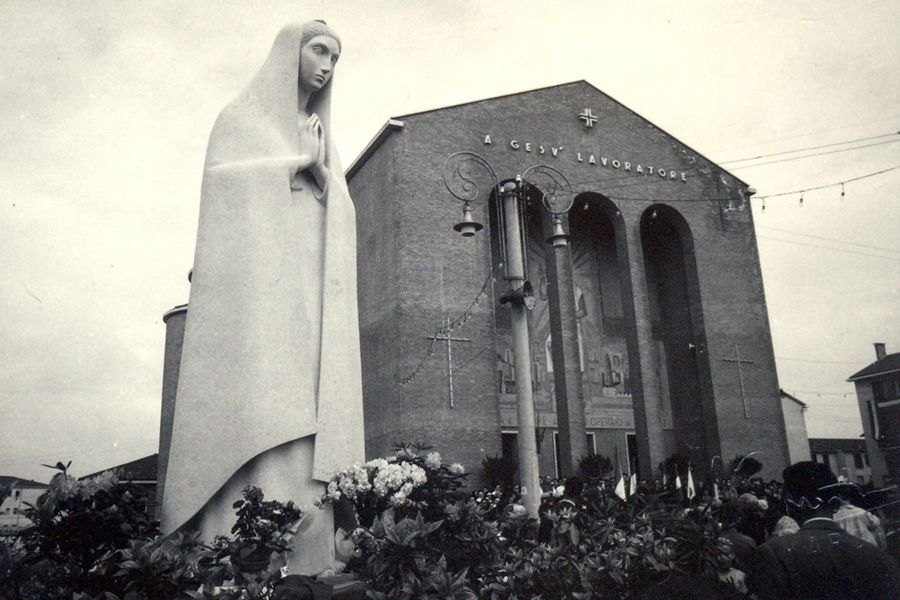
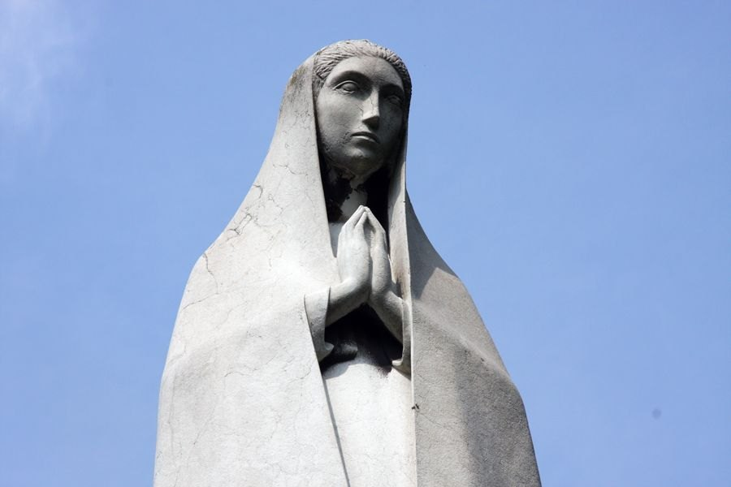
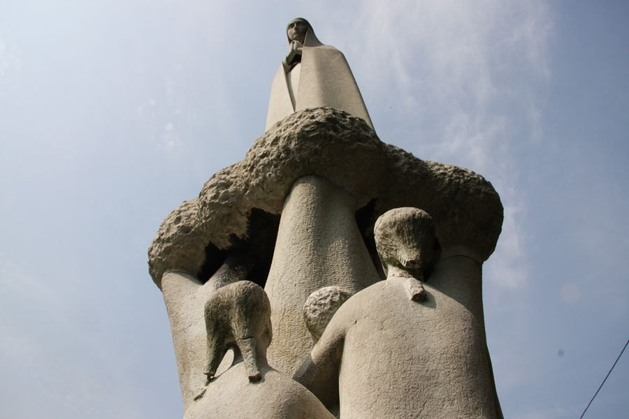
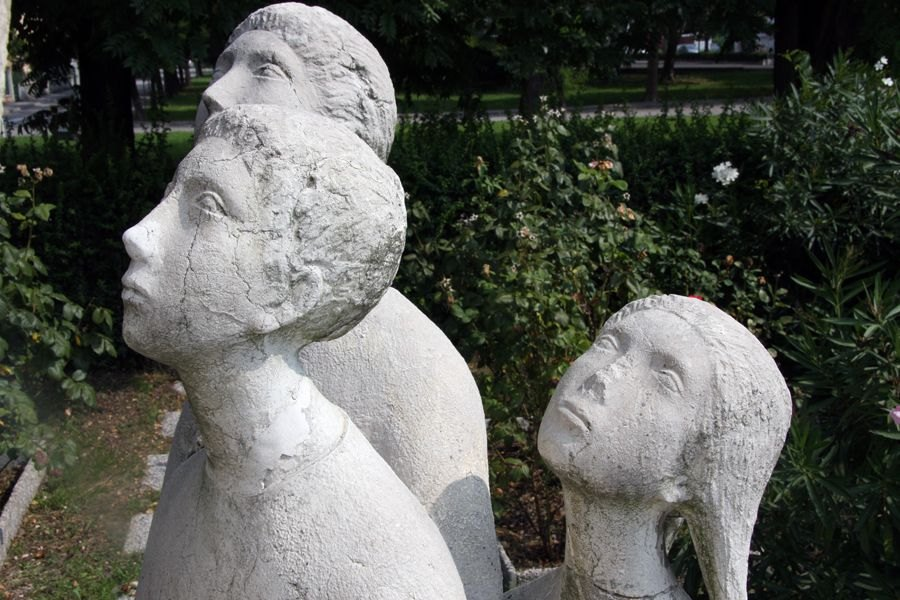

Oltre alle numerose opere presenti in collezioni private, Romanelli ha realizzato numerose opere pubbliche. Di seguito alcune foto pubblicate nel sito della Parrocchia di Gesù Lavoratore (Venezia-Marghera) relative alla statua “Madonna di Fatima”.

Per segnalazioni o foto invitiamo a inviare una mail all’indirizzo che si trova nella sezione contatti.

Archivio Parrocchia Cristo Lavoratore - Comune di Venezia/Municipalità di Marghera.

Statua della Madonna di Fatima

Posizione dal basso

Particolare Pastorelli

La lista delle seguenti opere pubbliche è tratta da uno dei suoi ultimi Curriculum che ci ha lasciato.

- Cimitero di Venezia – lavori ordinati dal Comune per la sistemazione del cimitero.
- Due basso rilievi in pietra d’Istria mt. 2 X 3.40 l’uno. Un bassorilievo in rame sbalzato “tempesta sedata” mt.1.10 X 2.50 in memoria del primo Sindaco della città di Venezia dopo la liberazione.
- Chiesa di S. Giuseppe    di Castello “Via  Crucis”  in ceramica policroma, un crocefisso in legno.
- Chiesa di San Trovaso” Crocefisso” in legno di Mansonia.
- Chiesa di San Luca statua di “Santa Rita” in marmo bianco di Carrara.
- Chiesa di San Simeone Profeta, statua di San Giovanni Battista” in bronzo, statua di “S. Antonio” in legno di Mansonia.
- Murano (Venezia) Chiesa di San Pietro Martire, statua di “Maria” in legno del 1953.
- Burano (Venezia) Nuova Scuola Media, statua   in bronzo “le scolare” mt. O.BO X 0.40 X 2.00
- Marghera (Venezia) Piazzale Cà Emiliani, grande gruppo scultoreo in pietra di Verona mt. 3 X 3 X 8
- Chiesa San Michele, Tabernacolo in argento e rame sbalzati Grande “Crocifisso” in legno Arquà 1948.
- Stabilimento ILVA Marghera (VE)- bassorilievo in bronzo mt. 1.00 X 1.50 – 1948
- Lido di Venezia – Chiesa di San Camillo “Statua di Maria” in bronzo mt. 0.40 X 0- 40 X 1.20
- Chiesa di San Antonio al Lido di Venezia – scultura in marmo – deposizione.
- Stadio sportivo di S. Elena – Venezia – un bassorilievo in pietra d’Istria. In memoria dei caduti di Superga.
- Chiesa Cà Bianca, statua di “Maria” in legno di Mansonia mt. 0.60 X 0.40 X 1.00
- Mestre (Venezia) Villaggio Sartori – “San Giovanni Battista” in bronzo con fonte battesimale in rame,  (Cimitero di Mestre Venezia – lavori ordinati dal Comune di Mestre – Venezia – per la sistemazione del cimitero stesso) – due grandi bassorilievi in pietra d’Istria mt. 3.50 X   50, un “Crocefisso” in bronzo mt. 1.80 X 1.80, quattro bassorilievi in pietra d’Istria mt. 0.90 X 2.60 a decorazione della cella mortuaria.
- Jesolo (Venezia) – Cimitero – lavori ordinati dal Comune per la sistemazione del cimitero; Due statue in bronzetto di Verona “Redentore”, “Deposizione” m. 1.50 X m. 0.70 X m. 2.00 /
- Diocesi di Trento – 6 statue in bronzo argentato, raffiguranti S.Tarcisio, S. Francesco, S. Chiara, San Tommaso D’Aquino, Santa Caterina., San Pio X e un crocefisso d’altare Opere commissionate dal rev.mo Don Giovanni Battista Mezzi della diocesi di Trento 1959.
- Quarto D’Altino (Venezia), chiesa di San Michele (campanile) Statua in acciaio inox sbalzato m. 0.80 X m. 0.80 X m. 4.00.
- San Donà di Piave (Venezia): Chiesa dell’Ospedale Civile bassorilievo in rame e argento sbalzati “Deposizione”, “Ultima Cena”, “Fede”, “Speranza”, “Carità'” e statua di San Giovanni Battista” in bronzo.
- Treviso: Scuola Media Fuori Porta Piave, bassorilievo in rame sbalzato m. 8.50 X m. 1.50.
- Stretti D’Eraclea. – Chiesa parrocchiale Madonna con bambino – legno Mansonia
- Bassano del Grappa (Vicenza) Scuola Media “Stefanini”: statua in bronzo m 0.70 X m. 0.70 X m. 2.00.
- Mussolente (Treviso): Chiesa   Parrocchiale,      bassorilievo in argento sbalzato con castonature in pietre dure e oro.
- Grigno in Valsugana Chiesa Parrocchiale: sei statue di Santi (in bronzo argentato), “Crocefisso” in bronzo argentato,
- Auronzo Villa Piccola: Grotta di Lourdes, La Vergine e Santa Bernadette in marmo, Altare, Tabernacolo con cinque Santi e crocefisso (rame argentato),
- Vaticano (Roma) Cappella privata di Papa Giovanni XXIII: Paliotto d’Altare in argento sbalzato e rame con incastonatura pietre dure su fondo di rame, reca   in argento, attorno all’immagine del Salvatore, le figure dei veneziani Beato Gregorio Barbarigo, San Pietro Orseolo, San Pio X, San Lorenzo Giustiniani;
- Benevento: Chiesa Santa Sofia, statua di “San Giovanni Battista” (bronzo) Cinque bassorilievi: Ultima Cena, le Virtù Teologali (rame sbalzato).
- Trieste: Sede Provinciale dell’I.N.P.S.: Bassorilievo in bronzo m 1.30 X 2.40
- Vico del Gargano (Foggia) Convento dei frati cappuccini: “Crocefisso in legno di tiglio m 1.80 X m. 2.00, bassorilievo con i simboli degli Evangelisti e SS. Sacramento in argento sbalzato con castonature in pietra dura.
- Aya (Olanda), Museo Reale Numismatico, medaglia in bronzo “La Flagellazione” del   1940;
- Rio De Janeiro, bassorilievo in terracotta.
